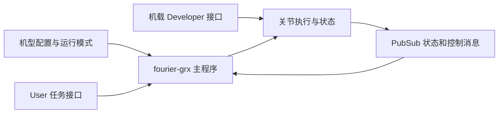
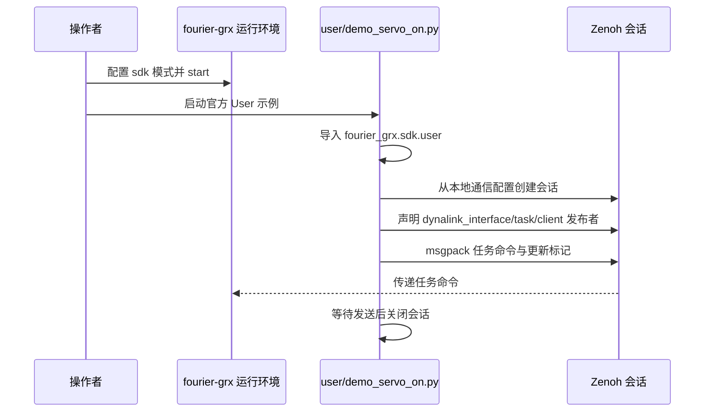

# 傅利叶 GRX N1（开源人形）

## 一句话定义

**Fourier GRX N1** 是傅利叶智能在 GitHub 组织 **[FFTAI](https://github.com/FFTAI/)** 下维护的开源人形软硬件栈之一；公开资料以 **[N1 文档站](https://fftai.github.io/fourier-grx-N1/)** 的安装、配置与控制 API 说明为主轴。

## 英文缩写速查

| 缩写 | 英文全称 | 简要说明 |
|------|----------|----------|
| BOM | Bill of Materials | 物料清单，硬件零部件列表 |
| API | Application Programming Interface | 应用程序编程接口 |
| SDK | Software Development Kit | 软件开发工具包 |
| ROS 2 | Robot Operating System 2 | 机器人系统集成与通信的常用中间件 |
| SOP | Standard Operating Procedure | 标准操作流程，如渐进式真机验证 |

## 为什么重要

- **国产开源人形入口**：与商业整机 **GR-1** 等产品线对照时，N1 常作为「可 fork 的软硬件参考」讨论。
- **SDK 边界**：文档强调对整机应用与底层控制的封装，部署前应核对与你的控制栈（ROS2 / 自研中间件）的接口假设。

## 开源入口（策展摘录）

| 类型 | 链接 |
|------|------|
| 文档 / SDK | [fourier-grx-N1 文档站](https://fftai.github.io/fourier-grx-N1/) |
| 组织 GitHub | [FFTAI](https://github.com/FFTAI/) |

> 网盘物料（BOM、STEP、加工图、装机 SOP）在转载清单中常见；提取码与路径以 [微信原文](https://mp.weixin.qq.com/s/3mF9a5Iuk7-WMg4-jCfBtA) 为准，并以 **官方发布** 校验。

## 文档与 SDK 源码的边界

[2026-11-15 官方 README 复核](../../sources/repos/open-robot-hardware-entry-review-2026-11-15.md)确认，`FFTAI/fourier-grx-N1` 主要维护 GitHub Pages/Jekyll 的 **SDK 文档**，并非 SDK 源码发行仓。README 将示例指向外部 `Wiki-GRx-Deploy` 的 `FourierN1` 分支；文档、示例、固件与硬件 BOM 应分别核对，不能由文档站可访问推断整套软硬件已完整发布。

## 核心原理

N1 文档按三条控制路径区分调用层级：User API 发任务命令、Developer API 在机载直接访问底层、PubSub API 在 server 模式收发状态与关节命令。接口选择先于消息字段选择，且 4.0.0 前后的角度单位不能混用。

## 源码运行时序图

此图止于公开示例的消息边界；没有把未阅读的 SDK 内部任务分派画成已核实调用链。

## 工程实践

以[官方技术文档通读](../../sources/repos/fourier-n1-core-docs-reading-2026-11-15.md)中的模式表选择 User 或 PubSub；记录固件/SDK 版本、配置文件、关节顺序及单位。User 手柄例程还需 `pygame` 与虚拟手柄配置。文档中的 `task/client` 与 `robot/control` 属于不同接口，移植时逐字段核对，不按名称相似性替换。

## 局限与风险

- 文档可读、示例公开，不等于 SDK 内部、全部权重、BOM 与加工资料均已取得。
- 旧 Developer 的度与新版 rad 接口混用会改变命令含义；运行模式错误也可能使指令无效。
- 快速开始明确失能时机器人会失去支撑；本次仅做资料核对，没有执行使能、行走或零位命令。

## 关联页面

- [人形机器人](./humanoid-robot.md)
- [开源人形硬件方案对比](./open-source-humanoid-hardware.md)
- [机器人开源宝库（微信策展第01期）索引](../overview/robot-open-source-wechat-issue01-curator.md)
- [Query：人形机器人硬件怎么选](../queries/humanoid-hardware-selection.md)

## 推荐继续阅读

- [傅利叶 GR-1 平台速览](./humanoid-robot.md#主流平台速览)（商业侧对照）

## 参考来源

- [官方技术文档与运行入口通读](../../sources/repos/fourier-n1-core-docs-reading-2026-11-15.md)。

- [官方硬件文档与入口复核](../../sources/repos/open-robot-hardware-entry-review-2026-11-15.md)

- [wechat_jixie_robot_open_source_treasury_issue01_10_robots.md](../../sources/blogs/wechat_jixie_robot_open_source_treasury_issue01_10_robots.md)
