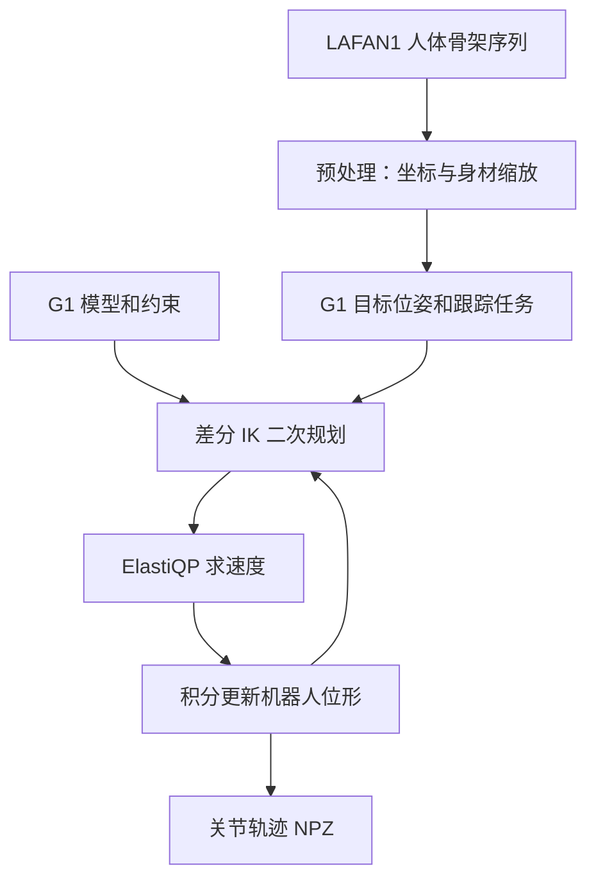
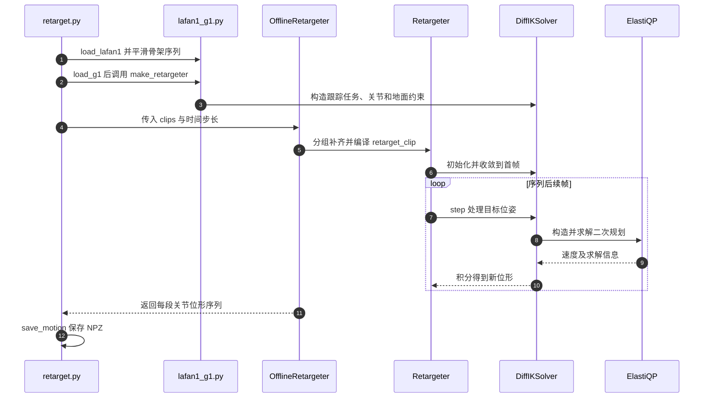

# frax：JAX 机器人运动学、动力学与动作重定向

## 一句话定义

斯坦福大学的开源 JAX 机器人运动学与动力学库；后续 `frax.ik` 通过差分 IK 和 ElastiQP 支持人形动作重定向。

## 英文缩写速查

| 缩写 | 英文全称 | 简要说明 |
|------|----------|----------|
| IK | Inverse Kinematics | 逆运动学 |
| QP | Quadratic Programming | 二次规划 |
| JIT | Just-in-Time compilation | 即时编译 |
| RNEA | Recursive Newton-Euler Algorithm | 逆动力学算法 |
| CRBA | Composite Rigid Body Algorithm | 关节空间惯量矩阵算法 |

## 流程总览

论文的动力学部分预先用祖先掩码编码运动树，将 RNEA、CRBA 中的树传播改为向量化操作，配合 JAX JIT 与自动微分；代价是相应运算的渐近复杂度增加。上述重定向流程依据后续官方 IK 文档及示例，不是论文原有实验。

## 源码运行时序图

依据源码 `f5e87ab`：`examples/ik/lafan1/retarget.py`、`lafan1_g1.py`、`frax/ik/retargeter.py`、`solver.py`；未运行。帧内顺序求解，离线封装将不同片段分配至多个 CPU 设备并异步执行。

## 性能与边界

| 测量 | 结果和范围 |
|------|------------|
| 论文 v2 控制器基准 | i9-14900KF：G1 差分 IK 6.71 µs、操作空间控制 24.6 µs；论文称相应 Python 控制器较 Pinocchio/MuJoCo Python 接口约快 2–5 倍。 |
| 官方后续离线重定向 | 同型号 CPU，LAFAN1 全集约 4 秒、超过 100,000 FPS；启用自碰撞避免约 7 秒。这是跨片段多设备吞吐，不能直接解读为单帧实时延迟，也不是对 GMR 的同条件基准。 |
| 接触与约束 | 示例默认地面约束，关节限位；自碰撞默认关闭。ElastiQP 对不等式引入隐式 L1 松弛，始终可行不等于原约束始终满足，也不能保证零脚滑、零穿透或动力学可行。 |
| 使用条件 | MIT 源码公开；数据单独下载。示例固定 CPU、双精度和特定 XLA 配置；JIT 编译、数据加载与具体计时范围应分别核对。 |

## 工程实践

安装 `pip install -e ".[examples]"`，运行 `python examples/ik/lafan1/download.py` 获取数据，再执行 `python examples/ik/lafan1/retarget.py`；用 `--self-collision-avoidance` 启用自碰撞处理。目标机器人更换需提供 URDF、碰撞模型及对应骨骼映射，并重新检查约束、脚滑与动力学可行性。实机控制应预编译并在目标硬件测量端到端延迟。

## 关联页面

- [动作重定向](../concepts/motion-retargeting.md)
- [逆运动学](../formalizations/inverse-kinematics.md)
- [GMR](../methods/motion-retargeting-gmr.md)

## 参考来源

- [论文归档：arXiv v2](../../sources/papers/frax.md)
- [官方源码与核查范围](../../sources/repos/frax.md)
- [官方文档](../../sources/sites/frax.md)

## 推荐继续阅读

- [frax.ik 指南](https://github.com/StanfordASL/frax/blob/f5e87ab59a0b82ba43095e882c1b88c9b0dacf07/docs/ik.md)
- [ElastiQP 论文](https://arxiv.org/abs/2609.19080)
