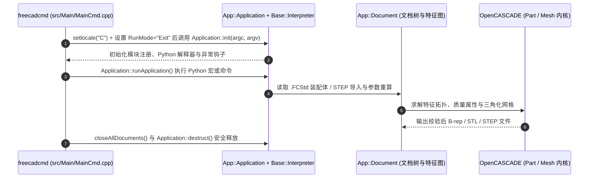

# FreeCAD（开源参数化机械 CAD）

## 一句话定义

**FreeCAD** 是基于 **OpenCASCADE** B-rep 内核、Coin3D 场景与 Qt/Python 脚本层的 **LGPL-2.1 开源参数化三维 CAD 软件**，在机器人建模链路中承担零许可成本的机械结构设计、装配与 STEP/网格及 URDF 上游生成。

## 英文缩写速查

| 缩写 | 英文全称 | 简要说明 |
|------|----------|----------|
| CAD | Computer-Aided Design | 计算机辅助设计，硬件结构建模 |
| B-rep | Boundary Representation | 边界表示实体模型，STEP 等交换格式的基础 |
| FEM | Finite Element Method | 有限元法，结构应力/变形分析 |
| CAM | Computer-Aided Manufacturing | 计算机辅助制造，刀路生成 |
| URDF | Unified Robot Description Format | ROS 生态统一的机器人连杆/关节描述格式 |
| STEP | Standard for the Exchange of Product model data | 工业 B-rep 零件/装配交换格式 |
| LGPL | GNU Lesser General Public License | FreeCAD 采用的弱 copyleft 开源许可 |
| ROS | Robot Operating System | 机器人中间件；社区插件可导出 URDF/xacro 包 |

## 为什么重要

1. **硬件与夹具 authoring**：开源整机、实验室夹具、传感器支架往往从 **参数化 CAD** 起步；FreeCAD 提供 **零许可成本** 的 B-rep 编辑，可导出 **STEP/STL/OBJ** 进入 [URDF（统一机器人描述格式）](../concepts/urdf-robot-description.md) 与 [仿真物理保真度](../queries/simulation-physics-fidelity.md) 所强调的 **几何/惯量第 ① 层**。
2. **CAD→仿真桥接**：官方 **Robot 工作台** 支持连杆-关节建模与运动学预览；社区 **CROSS**、**RobotCAD**、**RobotCreator** 等插件可从装配体生成 **URDF/xacro**、碰撞网格与 ROS2 启动文件——[ROS 2 文档](https://docs.ros.org/en/rolling/Tutorials/Intermediate/URDF/Exporting-an-URDF-File.html) 将 FreeCAD 生态列为常见 URDF 导出来源之一。
3. **与 STEP 工具链同族**：FreeCAD 与 [step2urdf](./step2urdf.md) 均基于 **OpenCASCADE** 语义处理 STEP；典型流程为 **FreeCAD 精修装配 → 导出 STEP → step2urdf / URDF-Studio 微调关节与惯量**。
4. **Python 脚本与无头自动化层**：宏与 **FreeCAD Python API** 可批量改尺寸、计算实体质量属性并导出网格；配合 `freecadcmd`（`MainCmd.cpp`）可无头运行参数化复现脚本，并与 [Text-to-CAD](../concepts/text-to-cad.md) 中的 **CadQuery/OpenSCAD 脚本 CAD** 串联审图。
5. **MCP 代理桥接**：[FreeCAD MCP](./freecad-mcp.md) 通过 Addon RPC + PyPI MCP server 把上述 API 暴露给宿主 Agent，支持对话式建模、`get_view` 审图与 CalculiX FEM 迭代。

## 核心原理：工作台与机器人管线映射

| 工作台 / 模块 | 机器人相关用法 |
|---------------|----------------|
| **Part Design / Sketcher** | 约束草图 + 拉伸/旋转；支架、法兰、连杆零件 |
| **Assembly** | 多零件装配、配合关系；导出 STEP 供 URDF 划分 link |
| **Robot** | 内置连杆-关节树、运动学预览；ROS 插件的上游几何 |
| **FEM** | 结构刚度/应力初评（不替代 SysID 或接触动力学） |
| **TechDraw** | 2D 工程图，加工与装配沟通 |
| **Python / Macro** | 批处理导出、尺寸驱动、质量/体积查询与 CI 检验 |

## 源码运行时序图

以 `FreeCAD/FreeCAD` 仓库无头 CLI 主入口 `src/Main/MainCmd.cpp` 与 Python/OpenCASCADE 文档处理周期为核对入口：

图依据：`FreeCAD/FreeCAD` `main` 分支 `README.md` 与 `src/Main/MainCmd.cpp`（172 行，2026-11-28 通读）。

## 工程实践

- **冻结零位与单位约定：** 导出 STEP 前在装配工作台显式设定机械零位坐标系并保持 SI 米制或统一毫米标注，避免转换 URDF 时出现 $\times 1000$ 尺度错位与 rpy 旋转漂移。
- **区分显示网格与碰撞体：** 用 Mesh 工作台对外部螺栓孔、Logo 倒角做简化或包络凸包，避免把高面数视觉 STL 直接当作 MuJoCo / PhysX 碰撞网格。
- **宏脚本可复现化：** 把批量尺寸变更与质心/惯量核对写进 Python 宏并用 `freecadcmd my_export.py` 自动化运行，便于与 [参数化 CAD 建模流程](../methods/parametric-cad-workflow.md) 和版本库对齐。

## 局限与常见误区

- **不是高保真物理仿真器**：FreeCAD 内置 Robot 工作台与插件侧重 **运动学/描述包生成**，不能替代 [MuJoCo](./mujoco.md) / Isaac 的 **接触丰富、千赫兹级动力学**。
- **URDF 插件成熟度参差**：CROSS/RobotCAD 等由社区维护，版本与 ROS 发行版绑定需自行验证；复杂闭链、柔性体与执行器动力学仍需 **人工核对** 或转 [MoveIt 2](./moveit2.md) / 专用编辑器。
- **拓扑命名敏感度**：复杂布尔与长特征历史改参时仍可能触发面/边编号跳变，关键配合基准建议优先挂在草图平面或装配基准轴上。
- **许可边界**：FreeCAD 本体 LGPL；**第三方工作台** 与 **导出资产** 许可各自独立——集成进商业硬件或数据集时需逐件核对。

## 关联页面

- [Blender（开源 3D 创作套件）](./blender.md)
- [Tinkercad](./tinkercad.md) — Autodesk 浏览器端草模与 Arduino 入门（上游启蒙）
- [step2urdf（STEP→URDF 浏览器转换）](./step2urdf.md)
- [URDF-Studio（URDF/MJCF 设计工作站）](./urdf-studio.md)
- [CAD Skills（LLM 驱动 CAD 技能）](./cad-skills.md)
- [OpenSCAD（脚本化参数 CAD）](./openscad.md)
- [SolidCraft（Rust 参数化 CAD）](./solidcraft.md)
- [FreeCAD MCP（MCP 驱动桌面 CAD）](./freecad-mcp.md)
- [MoveIt 2（ROS 2 运动规划）](./moveit2.md)
- [URDF（统一机器人描述格式）](../concepts/urdf-robot-description.md)
- [文字生成 CAD（Text-to-CAD）](../concepts/text-to-cad.md)
- [WBC 实现指南](../queries/wbc-implementation-guide.md)
- [仿真物理保真度链路](../queries/simulation-physics-fidelity.md)

## 参考来源

- [FreeCAD 官方源码仓库归档](../../sources/repos/freecad.md)
- [freecad-mcp 仓库源归档](../../sources/repos/freecad-mcp.md)
- [FreeCAD 用户 Wiki](https://wiki.freecad.org)
- [FreeCAD 开发者手册](https://freecad.github.io/DevelopersHandbook/)
- [ROS 2 — Generating an URDF File（CAD 导出工具列表）](https://docs.ros.org/en/rolling/Tutorials/Intermediate/URDF/Exporting-an-URDF-File.html)

## 推荐继续阅读

- [FreeCAD 官网与下载](https://www.freecad.org)
- [FreeCAD Workbenches 列表](https://wiki.freecad.org/Workbenches)
- [galou/freecad.cross](https://github.com/galou/freecad.cross) — ROS URDF/xacro 图形化工作台
- [drfenixion/freecad.robotcad](https://github.com/drfenixion/freecad.robotcad) — ROS2 描述包与 Gazebo/RViz 启动生成
