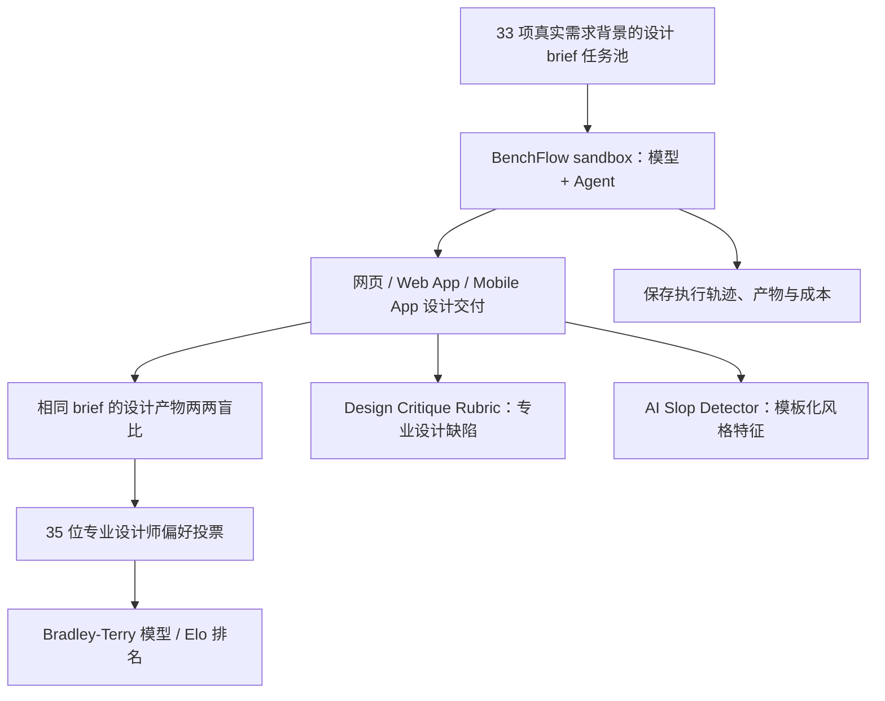

# Frontier Design Benchmark｜真实委托驱动的 AI 网页设计评测

## 一句话定义

**Frontier Design Benchmark（FDB）** 是 Contra Labs × BenchFlow 于 2026-11-18 发布的网站及应用设计评测：以真实委托背景的客户 brief、沙盒 agent 生成产物和专业设计师两两盲评作为主要比较方式。

## 英文缩写速查

| 缩写 | 英文全称 | 简要说明 |
|---|---|---|
| FDB | Frontier Design Benchmark | 本页介绍的基准 |
| Elo | Elo Rating | Bradley–Terry 两两偏好估计的相对排位数 |
| SDK | Software Development Kit | BenchFlow 提供的通用 agent 评测工具 |
| CI | Confidence Interval | 专家偏好胜率的不确定性区间 |
| UI | User Interface | 网页与应用的视觉及交互设计对象 |

## 为什么重要

- 设计生成质量要满足受众、品牌、页面结构和真实客户 brief，而不止页面能编译或元素能显示。
- **专家偏好 + 具体设计缺陷 + AI 模板化特征** 分开度量，避免单个通用美学分数遮蔽不同错误。
- 对具身评测可借鉴真实任务与专家评价组织方法，但绝不能把设计偏好 Elo 直接换算成机器人控制成功率。

## 核心信息

| 维度 | 官方报告 |
|---|---|
| 组织 | Contra Labs × BenchFlow |
| 发布 | 2026-11-18 |
| 任务池 | 33 项：27 个 Contra 工作委托改写，6 个创业公司实际项目 |
| 评委 | 35 名专业设计师；5 轮共 4,311 票（报告快照） |
| 执行 | BenchFlow 沙盒 agent 与 OpenRouter 提供的模型，尽可能使用模型厂商 harness |
| 评分 | 专家两两偏好（主榜）、Design Critique Rubric、AI Slop Detector |
| 数据 | [官方 Dataset](https://contralabs.com/frontierdesign/dataset)：by request，未公开完整下载 |

## 核心原理与流程总览

- **专家偏好是主排名：** 报告称 4,311 次盲评票；200 次随机平分评委进行重复排名，平均 Spearman 0.95。
- **Rubric 与 Slop 是辅助指标：** Slop 更低表示典型 AI 模板化模式较少，而非质量必然更高。
- **两个官方页不一致：** 研究报告写 Rubric 34 个维度，方法页写 35 条规则；本页保留各自来源，不合并作统一精确数字。
- **任务集与榜口径：** 报告初始池为 33 项，在线榜注释 27 Contra jobs；不能假定每个统计截面使用全部 33 题。

## 源码运行时序图

**不适用（完整评测数据与专属运行入口不可复现）：** [BenchFlow SDK](https://github.com/benchflow-ai/benchflow) 为通用开源基础设施，但官方 Dataset 页面不提供全量任务、golden、rollouts、原始专家票，因此不能编造此基准的复现时序。

## 实验与评测

| 官方来源 | Gestalt (stealth) | 注意 |
|---|---|---|
| 2026-11-18 静态研究报告 | 1,928 Elo、89%，378/423 | 发布快照 |
| 2026-11-20 实时榜 | 第 1、1,931 Elo、90%，420 票 | 后续可变化 |
| 报告人类设计直接比较 | 20/28 次偏好 Gestalt | 样本有限，不代表所有人类作品 |

榜首是匿名设计模型 [Gestalt (stealth)](gestalt-stealth-design-model.md)，**不是** [GeWu-Lab 同名视觉语言论文](paper-gestalt-2610-00576.md)。

## 与其他工作对比

相对仅验证代码功能的 benchmark，本榜更重视专业设计师的视觉质量与委托需求符合度。相对 [RLE-Bench](rle-bench.md) 的机器人学习工程 agent 评测，其任务、工具、交付产物、评价指标皆不同，分数不能跨榜对比。

## 工程实践

- 基于相同客户 brief、素材、模型版本、harness 和预算进行多次采样、盲评，额外保存 rubric 明细、成本及原始选择记录。
- 对照官方榜单引用**日期快照**；不可将报告数据与更新后的动态票数合并。
- 严格复现需访问官方完整数据，当前 [Dataset](https://contralabs.com/frontierdesign/dataset) 为申请制。

## 局限与风险

- 初版设计任务和专业评委样本有限，部分数据不可公开下载，严格复验受限。
- 评测对象包含模型与 harness；不同 agent 实现对设计结果的贡献难以单独识别。
- 评测范围不涉及机器人动作、动力学、实物交互、安全或 sim-to-real。

## 关联页面

- [榜首匿名模型 Gestalt (stealth)](gestalt-stealth-design-model.md)
- [GeWu-Lab 同名 Gestalt 论文](paper-gestalt-2610-00576.md)
- [AI Agent 评测](../concepts/ai-agent-evaluation.md)
- [RLE-Bench](rle-bench.md)

## 参考来源

- [Contra Labs 官方报告、方法与数据核读](../../sources/sites/contra-frontier-design-benchmark.md)
- [Gestalt (stealth) 官方预览](../../sources/sites/contra-gestalt-stealth.md)

## 推荐继续阅读

- [官方研究报告](https://contralabs.com/research/frontier-design-benchmark)
- [方法与评分规则](https://contralabs.com/frontierdesign/methodology)
- [数据访问说明](https://contralabs.com/frontierdesign/dataset)
