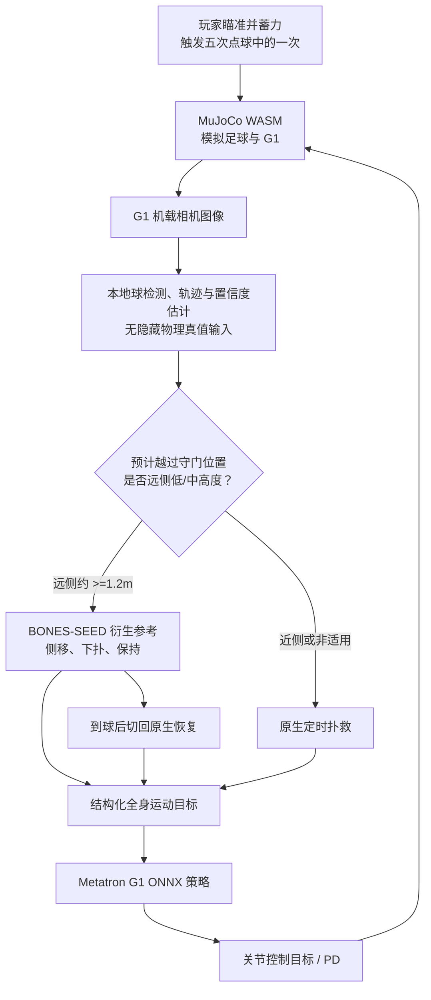
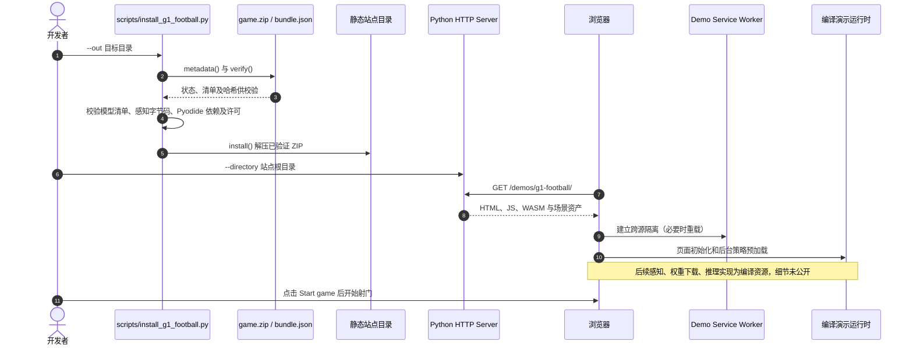

# G1 Football：Metatron 驱动的 Unitree G1 视觉守门员

## 一句话定义

**G1 Football**（*ProtoMotions G1 Football*）是 NVIDIA 的**浏览器五次点球仿真游戏**：守门员使用自身仿真摄像头检测足球、估计来球轨迹，将任务目标与扑救动作参考交给 Metatron 全身运动策略，使 MuJoCo 中的 Unitree G1 做侧移、扑救与恢复。**它不是实机视觉控制演示，也不保证所有设备实时运行。**

## 英文缩写速查

| 缩写 | 英文全称 | 简要说明 |
|---|---|---|
| G1 | Unitree G1 Humanoid | 本演示的 29 关节仿真人形机器人 |
| ONNX | Open Neural Network Exchange | Metatron 浏览器推理图格式 |
| WASM | WebAssembly | 浏览器执行 MuJoCo / CPU 模型推理的运行方式 |
| WebGPU | Web Graphics Processing Unit API | 有兼容 GPU 时优先使用的浏览器推理后端 |
| FP32 | 32-bit Floating Point | 官方发布的模型权重精度 |
| PD | Proportional–Derivative | 策略输出关节位置目标所用的底层控制参数 |

## 为什么重要

- 展示**不直接使用仿真真值球坐标**的传感器闭环：机载相机像素 → 球检测/轨迹预测 → 目标切换 → 全身执行，区别于把已知仿真球位置直接喂给策略。
- 用现有 **Metatron** 全身基础策略处理守门动作，把专门的视觉估计与任务状态机放在策略外部；不应误认为端到端图像输入的守门 VLA。
- 可复核浏览器打包/部署、ONNX Runtime Web、MuJoCo WASM 与 WebGPU/CPU 退化路径；但内部游戏和感知实现只给出了编译资产。

## 核心原理

### 系统边界与输入输出

| 模块 | 输入 | 输出或行为 | 已核对边界 |
|---|---|---|---|
| 射门界面 | 玩家方向、蓄力 | 初始球飞行轨迹 | W/S 高低、A/D 左右、Space 释放；每轮 5 球 |
| MuJoCo 物理 | 足球、球门、G1 当前物理状态 | 碰撞、运动及守门员机载相机图像 | 浏览器本地仿真，不是实机 |
| 球感知 | 守门员相机像素 | 球候选及来球横越位置/时机估计 | 使用图像的形状检查、置信门限；不读取隐藏球真值 |
| 扑救任务逻辑 | 相机估计的来球轨迹 | 近侧原生定时扑救 / 远侧参考下扑 | 远侧低/中射门约 ≥1.2 m 时触发；高角球无跳扑参考 |
| Metatron | 机器人状态与结构化运动目标 | 全身关节动作/PD 控制目标 | 已训练策略负责执行，任务规划在其外 |
| 恢复 | 扑救完成后的机器人状态 | 使用原生恢复能力起身 | 下扑后起身可能比原生扑救更慢 |

### 流程总览

图基于官方 G1 Football 用户指南及 README 的可公开机制。**视觉检测内部代码、投影公式、状态机具体函数不可从公开源码逐行复原**，上图只表达文档明确的控制流，不是声称已逆向编译程序。

### 扑救决策与限制

- **近门柱**：保持原生 timed save，官方配对试验显示这类球原生行为更强。
- **远侧低/中高度**：相机估计的横越位置距身体侧面至少约 **1.2 m**，按一段 BONES-SEED 衍生参考先侧移再下扑，低姿保持到球抵达，然后切换原生恢复。
- **高角球**：守门员处球高度超过约 **0.9 m** 时不执行下潜，官方说明缺少跳跃参考。
- **检测重试**：检测不到可信球目标时，以更小的图像闭运算核重新处理**同一相机像素**，避免小球与白色球场线连成非圆形；不绕过置信门限。
- **传感器与时间**：官方 README 提及模型化的 60 ms 传感延迟；在 CPU/WASM 优化任务调度并不等于去掉该延迟。

## 实验与评测

| 范围 | 结果 | 正确解读 |
|---|---|---|
| 官方 24 次配对射门（8 种球 × 3 个相机噪声种子） | 加入远侧下扑后 **21 次救球**，原生扑救 **16 次救球** | 同条件受限审计，**不是总体扑救成功率** |
| 中速、横向距 1.5 m 的六次球 | 加入参考后六次均救下 | 只说明给定构型，不能外推各种射门 |
| 远端慢球 | 有两球从成功变为失球 | 非单调改进 |
| 近侧射门 | 两版本结果相同 | 当前适配仍优先原生 timed save |
| 移动设备 / WebGPU | Chromium 触控模拟经过验证 | 未对实体 iPhone/Safari 或硬件 WebGPU 实时吞吐作认证 |

## 源码运行时序图

**可见范围：部署与浏览器启动链路。** 官方公开 Python 安装器与浏览器预览检查脚本，但 **G1 Football 游戏/感知代码只提供编译包及 Python 字节码**。所以下图前半段依据可读的 `scripts/install_g1_football.py`，后半段按官方 README 描述的部署流程；不能把它解释为已审计的编译 JS 内部函数调用图。

官方的 `scripts/check_g1_football_browser.py` 只用 Playwright 确认场景与预加载消息，**拦截**后台 Worker `start` 消息，不加载模型权重，不能当作实际扑救回归测试。完整的应用源码运行时序图 **不适用**，理由是游戏与感知开发源码没有发布。

## 工程实践

| 操作 | 官方支持范围 |
|---|---|
| 在线试玩 | [G1 Football](https://nvlabs.github.io/ProtoMotions/demos/g1-football/)；首访自动下载约 403 MB 权重 |
| 浏览器环境 | HTTPS 或 localhost；支持时 WebGPU 自动启用，`?provider=wasm` 强制 CPU |
| 本地部署 | 官方 README：Git LFS 获取 `game.zip` → `python scripts/install_g1_football.py --out …` → 在站点目录起 HTTP Server |
| 部署门禁 | 安装器校验资源包大小/哈希、manifest、感知 Pyodide ABI、第三方许可；`--status` 返回发布门禁状态 |
| 真正复现 | 可运行公开编译版本，但无法从公开源码重训或修改完整视觉守门游戏 |
| 调试重点 | 相机检出时机与置信度、横越位置、切换下扑条件、模型推理吞吐、G1 失衡和起身延迟 |

## 局限与风险

- **仿真不是真机**：只证明浏览器中的相机-运动控制方案；不能直接用于控制真实 G1、宣称真机成功率或安全性。
- **实时性未保证**：模型大约 403 MB，浏览器缓存、移动端内存、WebGPU 驱动、WASM 后端都会影响加载和运行速度。
- **源码有限**：框架代码 Apache-2.0，模型使用 NVIDIA Open Model License；感知字节码、编译游戏资源、动作数据及资产的许可各自独立。不能用框架的开源事实替代游戏代码开放。
- **扑救覆盖不全**：高角球、极远球与部分慢球可能失手或失去平衡；下扑参考会让起身变慢。
- **统计外推受限**：21/24 vs 16/24 为 24 组配对场景，不能视为公开分布上准确的成功率估计。

## 关联页面

- [Metatron：可提示的人形全身执行层](./paper-metatron-promptable-whole-body-execution.md) — 本演示复用的冻结基础策略
- [ProtoMotions：人形仿真与运动学习框架](./protomotions.md) — 底层框架与通用工具链
- [Unitree G1](./unitree-g1.md) — 本演示的机器人平台
- [人形运动](../tasks/humanoid-locomotion.md) — 学习任务背景

## 参考来源

- [G1 Football 官方文档与在线演示归档](../../sources/sites/g1-football-protomotions.md) — 已通读官方用户指南
- [G1 Football 官方源码/编译包边界归档](../../sources/repos/g1-football-protomotions.md) — 已核对 README、安装器与浏览器预览脚本
- [NVIDIA 在线互动演示](https://nvlabs.github.io/ProtoMotions/demos/g1-football/)
- [NVIDIA G1 Football User Guide](https://nvlabs.github.io/ProtoMotions/user_guide/g1_football.html)
- [NVIDIA Metatron 官方项目页](https://research.nvidia.com/labs/par/projects/metatron/)
- [Metatron v1 模型卡](https://huggingface.co/nvidia/Metatron-v1)

## 推荐继续阅读

- [官方 README 与本地安装指引](https://github.com/NVlabs/ProtoMotions/blob/main/demos/g1-football/README.md)
- [Metatron 原始项目主页](https://research.nvidia.com/labs/par/projects/metatron/)
