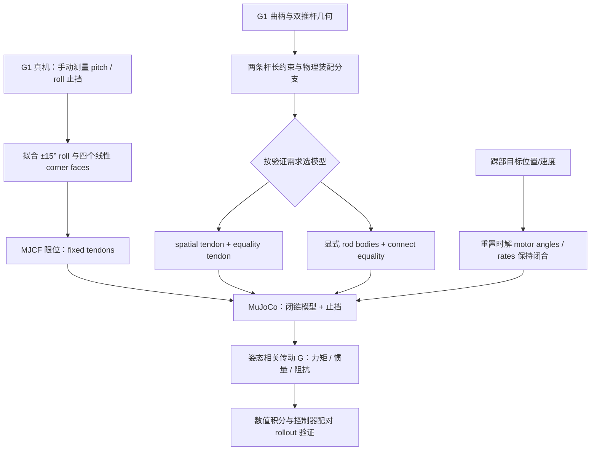
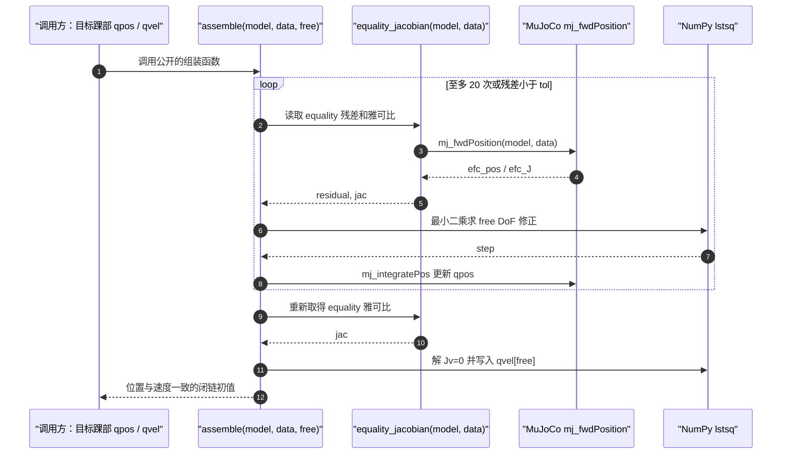

# Closing the Loop｜闭合运动学回路：Unitree G1 推杆踝关节的 MuJoCo 建模

> **资料身份：** Kevin Zakka、Qiayuan Liao，2026-11-16 技术博客（不是 arXiv 论文）。[作者原文](https://kzakka.com/closing-the-loop/)；本文对文章正文已逐节核对，模型 ZIP 内容尚待独立解包验证。

## 一句话定义

**Closing the Loop** 是一份 G1 推杆踝建模工程案例：从真机限位测量出发，以 MuJoCo fixed/spatial tendon 和 equality constraints 在保留踝部 pitch–roll 控制接口的同时，重建闭链机构的可达范围、位姿相关力矩传递与电机侧反射惯量。

## 英文缩写速查

| 缩写 | 英文全称 | 简要说明 |
|---|---|---|
| G1 | Unitree G1 | 本文研究的人形机器人及双推杆踝机构 |
| MJCF | MuJoCo XML Format | 以 XML 描述关节、腱、约束与执行器 |
| DoF | Degrees of Freedom | 闭链约束后踝部保留的独立自由度 |
| PD | Proportional–Derivative | 受传动雅可比影响的低层刚度/阻尼控制 |
| RL | Reinforcement Learning | 可先使用较简串联踝模型进行训练的场景 |
| Sim2Real | Simulation to Real | 通过闭链验证减少真机机构差异 |

## 为什么重要

- 常用的 **pitch / roll 两独立铰链**训练模型将角度限位当成矩形，并假定电机与踝端一一对应；真实 G1 是小腿内两电机经曲柄/推杆驱动足部的**双闭链**，两个假定都不普适。
- 若重定向或 RL 输出矩形角度空间的边角姿态，真实连杆/机械止挡可能根本到不了；若把踝端 PD 增益直接平分给两个电机，传动雅可比造成的耦合会改变闭环刚度。
- 本文将**可达域与限位**、**运动学/力传递**、**重置一致性**、**积分数值稳定性**分开评估，适合作为从简化训练模型过渡到高保真部署验证的工程参考。

## 核心原理

### 1. 从矩形 joint limits 到真实止挡

作者将 G1 置于仰卧姿态，手动移动踝部并记录 pitch、roll；接近中性 pitch 时可达到约 **±16–18° roll**，在 pitch 两端 roll 空间明显缩小。原文使用 **±15° roll** 与四条拟合边界的线性不等式 `c_r θ_roll + c_p θ_pitch ≤ b`，在 MJCF 中转成 **fixed tendon 的上限**，切掉不可达矩形角。

四条拟合边界**不等于真机精确碰撞模型**：原文轨迹个别点与拟合边界的差异仍达约 2°。训练框架若只从 joint `range` 推导 soft limits、重置裁剪和惩罚，应单独纳入 tendon limits。

### 2. 闭链运动学与动力学

令 `x=[pitch,roll]`、`u=[motor A,motor B]`。对每条推杆，曲柄端点 `p(u)` 与足部锚点 `a(x)` 满足 `||p(u)-a(x)||=L`，两条约束消去多余运动，保留踝部 **2 DoF**。

选定真机机构的装配分支后，`u=h(x)`，定义 `G=∂h/∂x`，则

- 速度：`u̇ = G ẋ`
- 力矩（虚功）：`τ_x = Gᵀ τ_u`
- 电机侧惯量反射：`I_x = Gᵀ I_u G`

以上是**局部、远离奇异位形**的映射。若需向电机发送给定踝端力矩，可用 `τ_u = G⁻ᵀ τ_x`；若用独立电机 PD，则不能自动等价于踝空间对角 PD，因为 `G` 随姿态变化且引入耦合。

### 3. MuJoCo 模型层次对比

| 模型 | 实现 | 获得的性质 | 边界与成本 |
|---|---|---|---|
| 串联踝 + fitted stops | pitch/roll hinge + 四条 fixed tendon | 近似真机机械限位 | 不表达电机侧耦合传动 |
| 空间腱闭链 | crank/motor hinge + spatial tendon + `equality tendon` | 可达域、变传动比/力矩/惯量，理想无质量杆 | 两踝额外 4 DoF / 4 条闭环约束行；不包含杆本身惯量/碰撞 |
| 实体推杆闭链 | rod body + 两摆动 hinge + `equality connect` | 额外表达推杆质量、惯量、几何与端部关节 | 两踝额外 12 DoF / 12 条约束行；轻杆数值缩放可能需要 `diagexact` |

**注意：** 所有模型均需叠加拟合的机械止挡；仅闭合传动回路并不会自动表达真实的硬限位。两类闭链 equality 的 `solref` 与 `solimp` 在原文中都给出示例。

## 流程总览

## 实验与评测（作者报告，不等于真机控制性能）

- **动作不可达：** 在 LAFAN1 的旧矩形限位重定向里，约 **1.5%** 的支撑脚姿态超出某条拟合边界至少 1°；这说明不可只检查 pitch/roll 单独限位。
- **电机力矩：** 在符合拟合止挡、闭链逆解有效的承重脚样本中，**不足 0.1%** 的样本估计需任一电机超过 ±25 N·m。接触力来自拟合和逆动力学，**非 G1 真机电流/力矩测量**。
- **控制器实验：** 256 对 6 s 舞蹈 rollout，在单项追踪策略及 ±25 N·m 电机限幅下，独立电机 PD 的故障率为 **20%**，踝空间控制力矩经 `G⁻ᵀ` 映射时为 **16%**。
- **积分器试验：** 位置执行器放在踝 pitch/roll 时，`implicitfast` 在 4 ms 下闭链易失稳；作者测试过的步长里 `discrete` 保持稳定。将执行器放在电机侧时，其测试的积分器均保持稳定。这是**所测模型/参数组合**的结论，不可推广为所有系统恒稳定。

## 结论

**优先在训练侧使用足够简单的模型，但将真实限位与闭链传动作为部署前验证的硬条件。**

1. 做人形动捕重定向时，先从 **矩形范围改成联合限位**，避免不可实现的脚踝姿态。
2. 对真实 G1 的电机力矩饱和、变传动比与反射惯量，至少使用 **空间腱闭链模型**核对。
3. 如果需要模拟杆碰撞、质量或端部关节，再承担实体杆的额外仿真成本。
4. 控制参数应从**踝空间到电机空间做雅可比映射**，不能直接把踝部增益平均分给双电机。
5. 重置时联立调整电机角和角速度；对给定执行器布置显式验证积分器与步长，不套用固定的全局最优积分器。

## 源码运行时序图

作者**公开了可下载的 MJCF 模型 ZIP 与网页上的 Python `assemble` / `close_crank` 代码片段**，但页面没有独立训练/推理仓库或明确的 CLI 入口；以下严格依据原文的 `assemble(model, data, free)` 函数调用链，不冒充 ZIP 中的未审查脚本。

**另一段解析函数** `close_crank` 对 G1 曲柄使用几何双分支解，再借助 `mj_jacSite` 设置电机速度；它要求初始电机角靠近真机装配分支，并显式检查奇异杠杆臂。**复现状态：** 已读网页函数与 MJCF 片段，但没有解包校验下载模型和在 MuJoCo 4.0.1 上运行，因此不写“复现通过”。

## 工程实践

1. **先测量机械边界。** 用真实硬限位约束 retarget 和 reset 数据，不要把 `joint range` 当全机构的约束集合。
2. **逐级校验 MJCF。** 串联踝加 fixed tendon → spatial tendon/equality 闭链 → 若需要则显式 rod/connect；闭链的 `qpos0` 必须满足杆长约束。
3. **重置必须一致。** 给定参考踝部 pitch/roll 后，按解析或 Gauss–Newton 方法求 motor angles，利用微分约束同步 `qvel`；避免 equality solver 产生巨大瞬态修正力。
4. **区分执行器位置。** 对 ankle-space position control，优先核验原文建议的 `discrete`；对 motor-space actuation，逐步核对电机力矩/阻抗映射与数值表现。
5. **资料入口。** [作者原文](https://kzakka.com/closing-the-loop/) 和 [五种模型及网格 ZIP](https://kzakka.com/closing-the-loop/assets/g1_ankle_models.zip)；模型需 MuJoCo ≥ 3.16，作者实验用 4.0.1。ZIP 尚未本地解包核对，不能宣称运行成功。

## 局限与风险

- 机械止挡由手动实验拟合，**近似边界**不应解读为每台 G1 都一致的精确 CAD 碰撞极限。
- 数值结果包括逆动力学和策略仿真，**并非真机最终部署性能证明**；文中也仅评估一项 dance tracking policy。
- 等效无质量杆模型不覆盖推杆自身的质量、关节摩擦和碰撞；实体杆模型增加约束数和数值调试量。
- `G` 的逆与增益映射受奇异性限制；不同姿态的 motor-side PD 不等于常数 ankle-side PD。
- **公开资产边界：** 作者提供 ZIP 的 XML/mesh 与网页 Python 片段，未列项目独立 GitHub 代码仓库；本次无法直接检查 ZIP 中的五个模型和 NOTICE，也未完成可运行复现。**本页 `complete` 仅表示原文技术知识的阅读、结构化整理和来源追溯已经完成，不代表模型包已复现或验证。**

## 关联页面

- [人形机器人并联关节解算](../concepts/humanoid-parallel-joint-kinematics.md) — 闭链 IK / FK / 力矩雅可比的总理论框架
- [Armature 建模](../concepts/armature-modeling.md) — `Gᵀ I_u G` 与对角 armature 建模差异
- [Unitree G1](./unitree-g1.md) — 真机平台、关节接口与控制栈
- [MuJoCo](./mujoco.md) — MJCF tendon/equality/积分器所依赖的引擎
- [mjlab](./mjlab.md) — RL reset/soft limit 与 tendon constraint 的集成问题
- [Sim2Real](../concepts/sim2real.md) — 从简化仿真到控制器上机验证
- [Sim2Real 纵深 Stage 1](../../roadmap/depth-sim2real.md) — 资产与执行器对齐

## 参考来源

- [作者原文通读归档](../../sources/blogs/kzakka-closing-the-loop-g1-ankle-20261116.md) — 测量方法、公式、实验、稳定性、运行代码片段及许可
- [Closing the loop（2026-11-16）](https://kzakka.com/closing-the-loop/) — Kevin Zakka / Qiayuan Liao 的一手材料

## 推荐继续阅读

- [作者公开的 G1 踝 MJCF/网格包](https://kzakka.com/closing-the-loop/assets/g1_ankle_models.zip) — 对比 serial / tendon / rod-body 三类建模，复核许可证 NOTICE
- [MuJoCo 官方 XML tendon 文档](https://mujoco.readthedocs.io/en/stable/XMLreference.html#tendon) — fixed/spatial tendon 与 equality 配置
