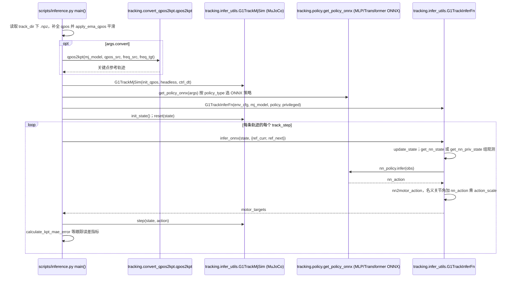

# 银河通用 AstraBrain：世界–动作与全身控制路线

## 一句话定义

**AstraBrain** 把银河通用的世界–动作学习与身体执行组织成一套模型系列；研究时应分别追踪 **WAM 的数据与动作接口**、**WBC 的参考运动跟踪**。

## 英文缩写速查

| 缩写 | 英文全称 | 简要说明 |
| --- | --- | --- |
| WAM | World-Action Model | 世界与动作联合或级联建模方向 |
| WBC | Whole-Body Control | 全身运动、平衡与接触协调 |
| VLA | Vision-Language-Action | 视觉和语言条件下生成动作 |
| DAgger | Dataset Aggregation | 在策略诱导状态下收集专家监督并蒸馏 |

## 为什么重要

- 同一公司的“脑”和“小脑”提供不同研究接口：动作生成模型的跨任务泛化与运动跟踪器的稳定性，须分别评测。
- WBC 已有代码与 checkpoint，适合研究 G1 上的跟踪复现；WAM 现有官方材料主要用于理解技术定位。
- 早期 [GraspVLA](cn-os-graspvla.md) 的合成抓取预训练是另一条有公开资产的操作路线，不能用其开放状态替代 WAM 的核查。

## 核心原理

| 模块 | 输入与机制 | 输出 / 证据 |
| --- | --- | --- |
| AstraBrain WAM | 官网称通过 LDA 利用异构人类/机器人、真实/仿真、带/不带动作标签的数据 | 定位为跨本体隐式世界–动作基座；具体动作空间和推理图尚不能由官网介绍确定 |
| AstraBrain-WBC 0.5 | 对应 [Humanoid-GPT](paper-humanoid-gpt.md)：重定向运动语料、HME 分簇专家、DAgger 蒸馏、因果 Transformer | 以本体状态与参考运动生成低层执行动作；公开实现主要面向 Unitree G1 |
| WAM-TTT | 官网另列的无动作标签人视频后训练部署技术 | 不应直接解释为 WAM 全量训练配方或资产开放 |

官网 WBC 报告约 **8040 万参数 / 2 万小时人动作**，与论文大模型跟踪结果一致；成功率 **92.58%** 应按论文的跟踪基准解读，不能当成家务任务成功率。WAM 的“隐式世界”措辞也不足以证明部署时必然运行未来视频生成。

## 工程实践

1. 做身体层复现，从 [Humanoid-GPT 源码归档](../../sources/repos/humanoid_gpt_galaxy_general_robotics.md) 的 `scripts.inference`、`scripts.eval_parallel` 与 `deploy.play_track` 开始。
2. 做抓取策略研究，从 [GraspVLA](cn-os-graspvla.md) 的模型服务、SynGrasp-1B 与仿真评测入口开始。
3. 做 WAM 选型，先记录观测、动作表示、预测目标、数据组成和延迟；当前官网未披露的字段保持“未公开/未确认”，等一手论文或代码补证。

| 模块 | 代码 | 权重 | 完整训练数据 |
| --- | --- | --- | --- |
| WAM | 本次入口未确认 | 本次入口未确认 | 本次入口未确认 |
| WBC 0.5 | 推理/评测/部署已发布；完整训练待发布 | checkpoint 已发布 | 待发布 |

## 局限与风险

- 核查日期为 **2026-10-05**；没有发现链接只说明此次官方入口的可见范围，不能证明公司永远不会开放。
- 公司 About 页中的“首个”等表述是发布方主张，本页不据此建立行业排名。
- 目前缺少可核查的 WAM→WBC 联合部署接口，不能自行画出二者实际运行闭环。

## 源码运行时序图

本页的 WBC 0.5 对应开源仓库 Humanoid-GPT；仓库只公开推理与部署代码，训练代码与数据 README 标为 TODO，故下图画的是仿真推理链路，不含训练，也不含 AstraBrain 的 WAM 部分。

入口：`python -m scripts.inference --onnx_track storage/ckpts/pns_wo_priv264.onnx --track_dir storage/test`（README 命令；真机入口为 `python -m deploy.play_track --real --net <nic>`）。

图依据：GalaxyGeneralRobotics/Humanoid-GPT@9f9e7b7，读过 README.md、scripts/inference.py、projects/transformer/inference.py（仅头部与主循环）、tracking/infer_utils.py（infer_onnx、nn2motor_action）、tracking/policy.py（get_policy_onnx）、deploy/play_track.py（仅文件头与入口说明）。

## 关联页面

- [Humanoid-GPT / AstraBrain-WBC 0.5](paper-humanoid-gpt.md)
- [GraspVLA](cn-os-graspvla.md)
- [WAM 概念与分类](../concepts/world-action-models.md)
- [公司技术路线对照](../comparisons/robot-foundation-model-company-paths-2026.md)

## 参考来源

- [银河通用官网与开源核查](../../sources/sites/galbot-astrabrain.md)
- [Humanoid-GPT 官方仓库归档](../../sources/repos/humanoid_gpt_galaxy_general_robotics.md)
- 源码核对（2026-11-02）：GalaxyGeneralRobotics/Humanoid-GPT@9f9e7b7，读过 README.md、scripts/inference.py、projects/transformer/inference.py、tracking/infer_utils.py、tracking/policy.py、deploy/play_track.py（仅文件头）；时序图依据以上文件，未运行代码；AstraBrain 的 WAM 部分无公开源码核对。

## 推荐继续阅读

- [机器人论文阅读笔记：Humanoid-GPT](https://imchong.github.io/Robot_Learning_Paper_Notebooks/papers/07_Teleoperation/Humanoid-GPT__Scaling_Data_and_Structure_for_Zero-Shot_Motion_Tracking/Humanoid-GPT__Scaling_Data_and_Structure_for_Zero-Shot_Motion_Tracking.html)
- [银河通用官方技术介绍](https://galbot.com/about/)
- [Humanoid-GPT 项目页](https://qizekun.github.io/Humanoid-GPT/)
