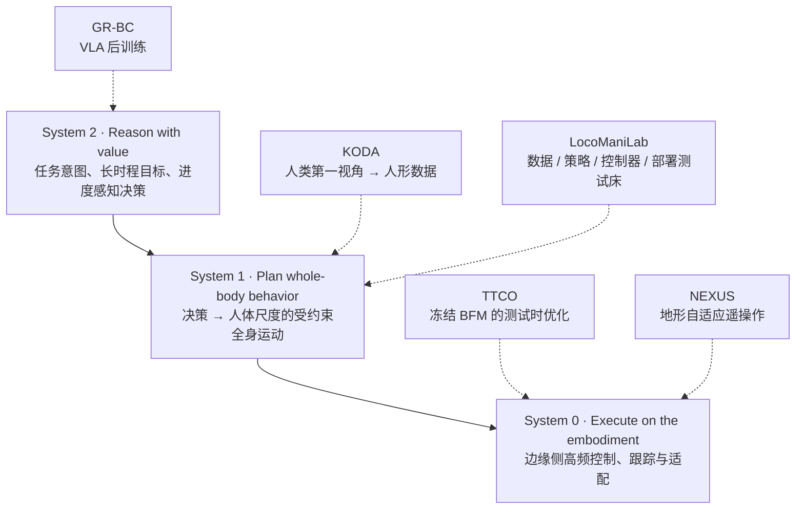

# 伽马智能（Gamma Robotics）

## 一句话定义

**伽马智能（Gamma Robotics，官网 gammarobotics.com.cn）** 是中国电信人工智能研究院（TeleAI）孵化的第一家市场化具身公司。TeleAI 于 2026-10-20 官宣，公司「近日」在上海徐汇注册成立并入驻模速空间。公司做人形机器人的 **「自进化」** 与 **「全身模型」**：机器人在真实交互里持续积累经验、更新能力；把全身运动与灵巧操作放进一个模型统一建模。

## 英文缩写速查

| 缩写 | 英文全称 | 简要说明 |
|------|----------|----------|
| TeleAI | Institute of Artificial Intelligence, China Telecom | 中国电信人工智能研究院；公司的孵化方，5 篇论文的联合署名单位 |
| BFM | Behavior Foundation Model | 行为基础模型；TTCO 在冻结的 BFM 上做测试时优化 |
| TTCO | Test-Time Command Optimization | 测试时指令优化；bfm_ttc 仓库的方法名 |
| GR-BC | Graph-Reweighted Behavior Cloning | 图重加权行为克隆；给 VLA 后训练的每段动作按进展加权 |
| KODA | Kinematics–Observation Data Alignment | 运动学–观测数据对齐；把人类第一视角演示转成人形训练数据 |
| VLA | Vision-Language-Action | 视觉-语言-动作模型 |
| PRTS | Primitive Reasoning and Tasking System | 官网 GBot 页称的「操作基础模型」 |
| DoF | Degree of Freedom | 自由度；GBot-W 官网写 22 个（不含末端和底盘） |
| AIDC | AI Data Center | 智算中心；报道称将在中国电信 AIDC 服务中做示范应用 |

## 为什么重要

- **运营商孵化的人形公司样本：** 中国电信集团投资、TeleAI 孵化、中电信产业基金战投，并与 TeleAI 共建人形机器人实验室（[成立报道](../../sources/sites/gamma-robotics.md)）。读者可以观察研究院团队转成公司后，研究与产品怎样分工。
- **开源比例高：** 公司 GitHub 组织 5 个公开仓库都对应 2026-09～10 的署名论文，覆盖遥操作全身控制、BFM 测试时计算、人类视频转人形数据、VLA 后训练和移动操作测试床。对照：同年成立的[源策未来](./archon-robotics.md)公司组织尚无公开仓库。
- **研究线覆盖全身栈各层：** NEXUS、TTCO 偏全身控制（System 0 / 1）；KODA、LocoManiLab 偏数据与评测；GR-BC 偏 VLA 后训练（System 2 侧的操作策略）。这几层正是[公司路线对照](../comparisons/robot-foundation-model-company-paths-2026.md)里「③ 全身技能」与「① 世界与动作」的交界。

## 公司概况

| 项 | 内容 | 来源 |
|----|------|------|
| 名称 | 伽马智能；英文 Gamma Robotics；官网页脚主体 Gamma Evolution Intelligence Technology (Shanghai) Co., Ltd；中文工商全称未找到 | 官网页脚、GitHub 组织页 |
| 成立 | TeleAI **2026-10-20** 官宣「近日」注册成立；具体注册日未公开 | IT之家、上观新闻（**媒体口径**） |
| 地点 | 上海市徐汇区模速空间（官网写 Model-Speed Space Innovation Community） | 官网、报道 |
| 创始人 | **白辰甲**，创始人兼 CEO；曾任 TeleAI 通用具身智能研究所所长 | 报道 |
| 科学顾问 | **李学龙**，中国电信集团 CTO、首席科学家、TeleAI 院长 | 报道 |
| 投资 | 中电信（上海）人工智能产业私募基金战略投资；金额未披露 | 报道 |
| 口号 | 「EVOLVE WHAT MATTERS」 | 官网 |

论文署名中的 **Chenjia Bai** 与 TeleAI、Gamma Robotics 双署名，且担任 KODA 通讯作者。本页推测其与报道中的白辰甲为同一人；报道未给英文名，这一对应未经一手来源确认。

## 时间线

| 日期 | 事件 | 依据 |
|------|------|------|
| 2026-09-30 | NEXUS（arXiv:2609.39000 v1）署名「γ-Robotics」 | arXiv |
| 2026-10-10 | TTCO（arXiv:2610.14896 v1） | arXiv |
| 2026-10-14 | GR-BC（arXiv:2610.20504 v1，CoRL 2026） | arXiv |
| 2026-10-15 | KODA（arXiv:2610.21152 v1） | arXiv |
| 2026-10-16 | GR-BC 代码发布 | Gamma-Robot/GR-BC README |
| 2026-10-20 | TeleAI 官宣伽马智能成立 | IT之家 |
| 2026-10-22 | LocoManiLab（arXiv:2610.30876 v1） | arXiv |

GBot-W、GData 的发布日期官网未写。

## 核心原理：官网三层栈与产品

官网开发者页把系统分为三层，只给一句话描述，没有模型名或控制频率：

虚线是本页按论文内容做的归类（推测），官网没有把论文对应到层。

- **GBot-W（官网规格）：** 140 kg 轮式双臂人形，高度 1340–1800 mm 可调；22 DoF（颈 2、单臂 7、腰 3、腿 3）；四舵轮底盘最高 1.5 m/s；Jetson AGX Orin 64 GB；单臂额定负载 6 kg；混合工况续航 4–8 h。价格未写。
- **PRTS 操作模型（自报）：** 官网写「pretrained on 167B operation and embodied-reasoning data」，双臂任务平均成功率 95.9%。任务清单和评测条件未公开；官网 Research 页把 PRTS 列为 TeleHuman 组织下的论文。
- **GData 数采套件：** GData-Finger 手持柔顺夹爪，GData-Ego 头戴四相机（260° 有效视场）；自报多设备同步 <1 ms、末端定位 1 mm。

## 署名 Gamma Robotics 的开源工作

| 工作 | 做什么 | 开放状态（2026-11-06） |
|------|--------|------------------------|
| [NEXUS](./paper-nexus-terrain-adaptive-teleoperation.md) | 离线把平地动作适配到地形，只在训练时监督特权教师；部署的学生只看平地命令、本体历史和单帧深度，Unitree G1 | [训练管线](https://github.com/Gamma-Robot/NEXUS)与 G1 ONNX 权重；CC BY-NC 4.0；sim-to-sim / sim-to-real 部署代码与近 1,000 小时配对语料未发布 |
| [TTCO](./paper-ttco-test-time-compute-humanoid-bfm.md) | 不改 BFM 权重，在仿真里采样优化输入指令，缩小参考动作与执行的差距 | [代码](https://github.com/Gamma-Robot/bfm_ttc)；Apache-2.0（SPIDER 采样器 CC BY-NC） |
| [GR-BC](./paper-gr-bc.md) | 用目标可达图估计剩余步数，给 VLA 行为克隆按进展加权，复用失败与人工接管片段 | 部分开源：[代码](https://github.com/Gamma-Robot/GR-BC)（2026-10-16，Apache-2.0）；四个任务数据集、训练好的策略权重与真机部署未发布 |
| [KODA](./paper-koda-egocentric-vla.md) | 把人类第一视角演示转成人形运动学和机载视角视频 | [部分代码](https://github.com/Gamma-Robot/KODA)；动作标签与训练待发布 |
| [LocoManiLab](./paper-locomanilab.md) | 234 任务的人形移动操作测试床，统一数据、策略、全身控制器与部署 | [代码](https://github.com/Gamma-Robot/LocoManiLab)，MIT；README 称部分模型集成未端到端复验 |

官网 Research 页还列出 TextOp、HUSKY、PRTS、Align-Then-stEer、AssemLM、SMART、WNM-3D、GN0 共 8 项工作，代码多在 TeleHuman 组织下，部分早于公司成立。本库把它们算作创始团队在 TeleAI 的成果，不计入公司路线；已收录的有 [TextOp](./paper-loco-manip-161-022-textop.md)、[HUSKY](./paper-amp-survey-14-husky.md)、[WNM-3D](./paper-wnm-3d-vln.md)。官网 NEXUS 卡片标题与 [NEXUS 研究预告页](./nexus-humanoid.md)一致，和 Gamma-Robot/NEXUS 仓库的论文标题不同，两者共用项目页。

## 工程实践

- **先跑哪个仓库：** 想复现全身控制，从 NEXUS（`play.py` 回放 `.pt` checkpoint，可导出 ONNX；仓库另附 G1 ONNX 权重）或 bfm_ttc（MuJoCo Warp，需要 CUDA GPU）开始；想做 VLA 后训练，GR-BC 基于 LeRobot，支持 SmolVLA / X-VLA / π₀.₅。
- **许可要分开看：** NEXUS 原创部分和 bfm_ttc 的 SPIDER 采样器是 CC BY-NC 4.0（非商用），GR-BC、bfm_ttc 主代码是 Apache-2.0，LocoManiLab 是 MIT，KODA 没有统一许可。
- **开发者接口：** 官网 SDK 与接口标「STAGED ACCESS」，没有文档或下载链接；GBot-W 目前只能看规格表，无公开 SDK。

## 局限与风险

- 成立日期、投资方与人员来自同一轮通稿转载，TeleAI 原文未找到；融资金额、团队规模未披露。
- GBot-W 规格和 PRTS「167B 数据、95.9% 成功率」均为官网自报，没有评测细节，也不知道是否已交付客户。
- 5 篇论文都与 TeleAI 联合署名，公司与研究院的成果边界难分；本库只按「署名含 Gamma Robotics + 仓库在 Gamma-Robot 组织」计入公司路线。
- 本库 GR-BC、LocoManiLab 详情页的开放状态写于代码发布前，以本页 2026-11-06 核查为准。

## 关联页面

- [机器人基础模型公司路线对照](../comparisons/robot-foundation-model-company-paths-2026.md) — 伽马智能在三视角矩阵中的位置
- [NEXUS](./paper-nexus-terrain-adaptive-teleoperation.md) · [TTCO](./paper-ttco-test-time-compute-humanoid-bfm.md) · [GR-BC](./paper-gr-bc.md) · [KODA](./paper-koda-egocentric-vla.md) · [LocoManiLab](./paper-locomanilab.md) — 署名公司的五篇开源工作
- [TextOp](./paper-loco-manip-161-022-textop.md) · [HUSKY](./paper-amp-survey-14-husky.md) · [WNM-3D](./paper-wnm-3d-vln.md) · [NEXUS 研究预告](./nexus-humanoid.md) — 官网 Research 页列出的 TeleAI 团队工作
- [行为基础模型](../concepts/behavior-foundation-model.md) · [全身控制](../concepts/whole-body-control.md) · [Loco-Manipulation](../tasks/loco-manipulation.md) · [遥操作](../tasks/teleoperation.md)
- [源策未来](./archon-robotics.md) — 同年成立、同在上海徐汇的人形基础模型公司

## 参考来源

- [伽马智能官网、GitHub 组织与成立报道核查（2026-11-06）](../../sources/sites/gamma-robotics.md)
- [KODA 论文归档](../../sources/papers/koda_arxiv_2610_21152.md) · [GR-BC 论文归档](../../sources/papers/gr_bc_arxiv_2610_20504.md) · [LocoManiLab 论文归档](../../sources/papers/locomanilab_arxiv_2610_30876.md) · [bfm_ttc 仓库归档](../../sources/repos/bfm_ttc.md)
- IT之家（凤凰网转载，2026-10-21）<https://tech.ifeng.com/c/8xOzOB5LWWf>
- 上观新闻（中国青年网转载，2026-10-21）<http://news.cyol.com/gb/keji/articles/2026-10/21/content_aj4N57ILEp.html>
- arXiv：[2609.39000](https://arxiv.org/abs/2609.39000)、[2610.14896](https://arxiv.org/abs/2610.14896)、[2610.20504](https://arxiv.org/abs/2610.20504)、[2610.21152](https://arxiv.org/abs/2610.21152)、[2610.30876](https://arxiv.org/abs/2610.30876)

## 推荐继续阅读

- [伽马智能官网](https://gammarobotics.com.cn/) — 产品规格、三层栈与 Research 列表
- [Gamma-Robot GitHub 组织](https://github.com/Gamma-Robot) — 5 个开源仓库
- [网易智能成立报道](https://tech.china.com/article/20261021/202610211967496.html) — 自进化与全身模型的定位说明
