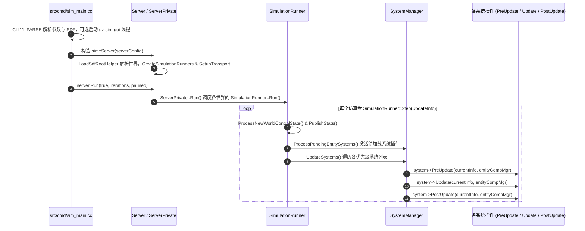

# Gazebo Sim

[Gazebo Sim](https://github.com/gazebosim/gz-sim) 收录于具身智能研究室 [开源项目主表](https://github.com/RealXiaoze/humanoid-motion-intelligence/blob/main/%E8%AE%BA%E6%96%87%E4%B8%8E%E9%A1%B9%E7%9B%AE/%E5%BC%80%E6%BA%90%E9%A1%B9%E7%9B%AE%E4%B8%BB%E8%A1%A8.md) 的「工程与实机部署」分组，是本库为该入口建立的独立详情节点。

## 一句话定义

在ROS生态中承担场景、物理、传感器和插件运行层，传输与组件接口便于把导航、感知、控制节点接入同一仿真系统；适合验证消息时序和系统集成，不以GPU强化学习吞吐为首要目标。

## 英文缩写速查

| 缩写 | 英文全称 | 简要说明 |
|------|----------|----------|
| Sim2Real | Simulation to Real | 仿真到真机部署主线 |
| RL | Reinforcement Learning | 训练与评测常用框架 |
| API | Application Programming Interface | 仿真/中间件编程接口 |
| SDK | Software Development Kit | 真机与工具链开发套件 |

## 为什么重要

- **主表工程定位清晰**：该条目被放在「工程与实机部署」下，说明它服务的是这条人形运动智能问题链上的具体环节，而不是泛泛的链接收藏。
- **可对照开源边界**：主表已概括其可复现范围（训练/推理/部署或仅方法页）；选型时应先读本页「开源状态」，再回官方 README / 项目页核对许可证与平台支持。
- **便于知识库交叉引用**：独立节点让路线图、对比页与 ingest 日志可以稳定链接，避免只在策展列表里「点名」却无法下钻。

## 核心原理

### 在技术路线中的位置

| 字段 | 内容 |
|------|------|
| 主表分组 | 工程与实机部署 |
| 官方入口 | https://github.com/gazebosim/gz-sim |
| 开源状态（据主表） | 已开源（以官方仓库 README 为准） |

主表给出的技术定位可压缩为：

> 在ROS生态中承担场景、物理、传感器和插件运行层，传输与组件接口便于把导航、感知、控制节点接入同一仿真系统；适合验证消息时序和系统集成，不以GPU强化学习吞吐为首要目标。

阅读时建议抓住三点：**(1) 输入是什么数据或观测；(2) 输出是参考轨迹、策略、数据还是中间件能力；(3) 公开材料能否支撑训练/部署复现。**

### 流程直觉（对照主表叙事）

具体模块边界以官方文档为准；本页不替代 README。

## 源码运行时序图

核对源码：`gazebosim/gz-sim`（`main` 分支）`src/cmd/sim_main.cc`、`src/Server.cc`、`src/ServerPrivate.cc`、`src/SimulationRunner.cc` 与 `src/SystemManager.cc`。

## 工程实践

1. **CLI 与库接入**：安装 Gazebo 后直接以 `gz sim <world.sdf>` 或 `gz sim -h` 启动；做 C++ 独立集成时链接 `libgz-sim`。源码与 Debian 包混装时需配置 `GZ_CONFIG_PATH` 指向各 YAML 插件目录；Windows 下需用 `gz sim -s` 与 `gz sim -g` 分终端启停服务端和 GUI。
2. **描述格式与物理引擎分工**：原生世界、模型与传感器配置使用 [SDFormat](../concepts/urdf-robot-description.md)（参见 [描述格式对比](../comparisons/urdf-vs-mjcf-vs-sdf-vs-openusd.md)），导入 URDF 时底层自动转换为 SDF；通过 `gz-physics` 插件切换 DART（默认）或 Bullet / Bullet Featherstone 后端。
3. **ROS 2 联调与边界对齐**：经 `ros_gz_bridge` 把 `gz-transport` 话题桥接到 ROS 2，重点核对仿真时钟（`/clock`）、关节命名、传感器频率/噪声模型及控制器周期，勿将其与 GPU 百万步并行训练引擎混淆。
4. **验证许可与版本**：Apache-2.0 开源；按语义化版本与 Gazebo 年度发行版（如 Harmonic / Ionic 等）对齐配套 `gz-*` 库版本。

| 检查项 | 建议 |
|--------|------|
| 许可与星标时效 | 以官方仓库页面为准 |
| 支持机器人 / 仿真 | 读 assets 与 task 配置 |
| 真机入口 | 查找 SDK、ROS、ONNX/JIT 导出说明 |

## 局限与风险

- **主表是策展摘要**：细节、指标与许可以一手来源为准；本页只做知识库节点与导航。
- **开源状态可能变化**：标为待发布的项目后续可能放码；已开源仓库也可能拆分或迁移路径。
- **不要与同名论文页混淆**：若本库另有 `paper-*` 深读页，以论文页承载方法细节，本实体页侧重工程入口与选型。

## 关联页面

- [sim2real](../concepts/sim2real.md)
- [isaac-lab](../entities/isaac-lab.md)
- [Humanoid Motion Intelligence](./humanoid-motion-intelligence.md)
- [开源主表覆盖索引](../queries/hmi-opensource-projects-coverage.md)
- [PID Control（比例-积分-微分控制）](../methods/pid-control.md) — 系统联调时可用简单关节反馈控制核对插件、传感器与控制周期。
- [Manipulation](../tasks/manipulation.md) — 将机械臂、物体与传感器组合成操作场景时，以任务约束检验系统集成。

## 参考来源

- [Gazebo Sim 官方仓库 README 与 C++ 源码通读](../../sources/repos/gazebo-sim.md) — `gazebosim/gz-sim` 架构与 `sim_main.cc` / `Server.cc` / `SimulationRunner.cc` 核对（2026-11-28）
- [SDFormat 官方 XML 规范通读](../../sources/sites/sdformat_official_spec.md)
- [Humanoid Motion Intelligence 仓库归档](../../sources/repos/humanoid-motion-intelligence.md)
- [开源项目主表（上游）](https://github.com/RealXiaoze/humanoid-motion-intelligence/blob/main/%E8%AE%BA%E6%96%87%E4%B8%8E%E9%A1%B9%E7%9B%AE/%E5%BC%80%E6%BA%90%E9%A1%B9%E7%9B%AE%E4%B8%BB%E8%A1%A8.md)

## 推荐继续阅读

- [官方入口](https://github.com/gazebosim/gz-sim)
- [Humanoid Motion Intelligence 知识库实体页](./humanoid-motion-intelligence.md)
