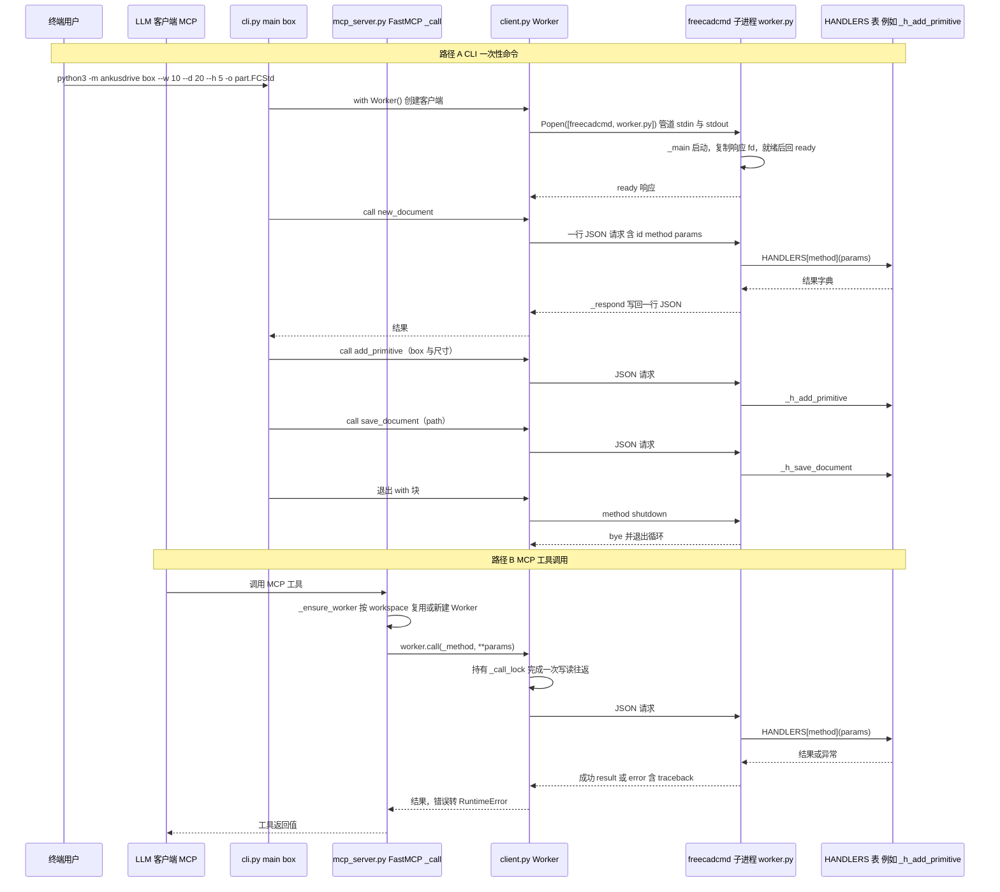

# AnkusDrive（gchen19/AnkusDrive）

## 一句话定义

AnkusDrive（gchen19/AnkusDrive）是把 FreeCAD 变成机械设计工作台，提供 CLI 和 MCP，覆盖参数化 CAD、工程图、FEM/CFD 仿真与制造检查。

## 英文缩写速查

| 缩写 | 英文全称 | 简要说明 |
|------|----------|----------|
| CAD | Computer-Aided Design | 计算机辅助设计与几何建模 |
| MCP | Model Context Protocol | 代理调用 CAD/可视化工具的协议 |
| FEM | Finite Element Method | 结构有限元分析方法 |

## 为什么重要

对 CAE 自动化而言，代理能否稳定完成任务，取决于工程步骤是否清楚、工具边界是否明确、结果是否保留可审查证据。把 FreeCAD 变成机械设计工作台，提供 CLI 和 MCP，覆盖参数化 CAD、工程图、FEM/CFD 仿真与制造检查。

## 核心原理

**项目自身范围：** CLI and MCP workbench for LLM-driven mechanical design in FreeCAD.

**工作流：** 代理由 CLI/MCP 创建参数化几何，按需执行分析或制造检查，并输出可审阅的 CAD 与工程产物。

**仓库映射说明：** 文章未给出该项目完整的 owner/repository URL；此处按文章中的项目名/描述与公开 GitHub 仓库匹配。引用时请以本页链接的仓库 README 为准。

## 工程实践

1. 从目标问题识别所需的 Skill、MCP、CLI 或软件接口，不把指导文件当成求解器。
2. 依照仓库 README 检查安装前提、软件/许可证、输入文件和输出证据。
3. 小规模运行并逐项核对几何、网格、边界、求解状态和物理量，再决定是否扩大任务。

文章所述的项目特征：把 FreeCAD 变成机械设计工作台，提供 CLI 和 MCP，覆盖参数化 CAD、工程图、FEM/CFD 仿真与制造检查。

## 局限与风险

CAD/FEM/CFD 能力需由 FreeCAD 模块及外部求解器支撑；输出仍须工程师验证。

源码状态核验：该 GitHub 仓库于 2026-10-07 可公开访问。仓库 API 报告许可证为 Apache-2.0。 涉及商业软件时，安装包和有效许可证需由使用者自行提供。

## 源码运行时序图

入口有两个：CLI `python3 -m ankusdrive box --w 10 --d 20 --h 5 -o part.FCStd`（`ankusdrive/__main__.py` → `cli.main`），以及 MCP 服务 `ankusdrive mcp`（stdio，`cli.cmd_mcp` → `mcp_server.run`）。两条路径都经 `client.Worker` 拉起 `freecadcmd` 子进程运行 `worker.py`，由其中的 `HANDLERS` 表执行 FreeCAD 操作。

图依据：gchen19/AnkusDrive@bcbfab3，实际读过 `README.md`（grep 安装与 CLI 用法）、`ankusdrive/__main__.py`、`ankusdrive/cli.py`（模块说明、`cmd_box`、`cmd_mcp`、`main`，局部阅读）、`ankusdrive/client.py`（`Worker.__init__` 的 Popen 与 `call`，局部与 grep）、`ankusdrive/worker.py`（`handler` 装饰器、`_respond`、`add_primitive` / `save_document` 注册处、`_main` 的分派与 shutdown 分支，局部阅读）、`ankusdrive/mcp_server.py`（`_ensure_worker`、`_call`、`run`，grep 与局部阅读）。handler 内的几何实现，以及 `mainthread` 与 `_cases` 的并发细节未展开。

## 关联页面

- [CAE / CFD 代理工具项目总览](../overview/cae-cfd-agent-skills-landscape.md)
- [CAD CAE Copilot](./armpro24-blip-cad-cae-copilot.md)

## 参考来源

- [公众号文章原始资料归档](../../sources/blogs/wechat_cae_cfd_agent_skills_2026-10-07.md)
- [GitHub 仓库资料归档](../../sources/repos/gchen19-ankusdrive.md)
- [gchen19/AnkusDrive 官方仓库](<https://github.com/gchen19/AnkusDrive>)
- 源码核对（2026-11-02）：gchen19/AnkusDrive@bcbfab3，读过 README.md（grep）、ankusdrive/__main__.py、ankusdrive/cli.py、ankusdrive/client.py（局部）、ankusdrive/worker.py（局部）、ankusdrive/mcp_server.py（局部）；时序图依据以上文件，未运行代码。

## 推荐继续阅读

- [项目 README](<https://github.com/gchen19/AnkusDrive/blob/main/README.md>)