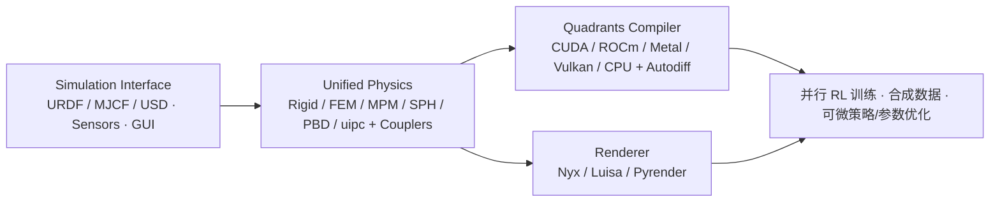
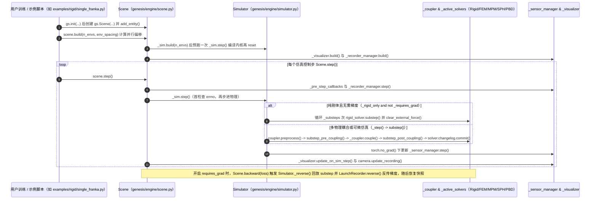

# Genesis (仿真器)

## 一句话定义

**Genesis / Genesis World**（[Genesis-Embodied-AI/genesis-world](https://github.com/Genesis-Embodied-AI/genesis-world)，原 `Genesis`）是面向物理 AI 的四层开源仿真平台，将 **Python 仿真接口、统一多物理场求解器（刚体/FEM/MPM/SPH/PBD/libuipc）、Nyx 渲染与 Quadrants（Taichi 分支）跨硬件编译器** 集成于单场景闭环中，兼顾 GPU 并行采样、可微仿真与多物质耦合。

## 英文缩写速查

| 缩写 | 英文全称 | 简要说明 |
|------|----------|----------|
| GPU | Graphics Processing Unit | 图形处理器，大规模并行仿真训练的算力基础 |
| FEM | Finite Element Method | 有限元方法，用于软体弹塑性形变求解 |
| MPM | Material Point Method | 物质点法，用于沙土/雪/切割等大变形连续介质 |
| SAP | Semi-Analytic Primal | 借鉴自 Drake 的凸优化刚柔接触耦合求解器 |
| IPC | Incremental Potential Contact | 经 `libuipc` 接入的无穿透接触求解后端 |

## 为什么重要

随着具身智能向软体、流体与长程操作渗透，单一刚体引擎已显不足。Genesis 的核心价值在于：
- **万物可仿**：不仅支持刚体（Rigid Body），还把 FEM、MPM、SPH、PBD 与 `libuipc` 放入同一 `Scene` 状态与多类 Coupler 框架。
- **可微仿真**：借助 Quadrants 编译器追踪并逆向重放物理内核，允许通过 `scene.backward(loss)` 对轨迹/参数做端到端梯度优化。
- **跨平台 GPU 并行**：除 NVIDIA CUDA 外，Quadrants 还下沉至 AMD ROCm、Apple Metal、Vulkan、x86 与 ARM64。

## 核心原理与四层架构

- **Simulation Interface（Python API 层）**：提供 URDF / MJCF / OBJ / GLB / USD 资产解析、并行与异构环境布局、控制器与多模态传感器（相机、LiDAR、IMU、触觉与接触力等）。
- **Physics（统一多物理与耦合器）**：按材质分配对应求解器（Rigid / FEM / MPM / SPH / PBD / uipc），并在多物理步中经 Explicit Coupler 或 SAP Coupler 交换冲量/约束力。
- **Render（三路相机渲染）**：支持自研面向机器人的 **Nyx** 光追渲染器（`gs-nyx`）、Luisa 光追与 Pyrender 光栅。
- **Compiler（Quadrants 编译器）**：2025 年 6 月自 Taichi 分支独立，提供自动微分、GPU graphs 与 DLPack PyTorch 零拷贝。

## 机制与架构图

## 源码运行时序图

以官方仓库 [Genesis-Embodied-AI/genesis-world](https://github.com/Genesis-Embodied-AI/genesis-world)（`main` 分支）中 `Scene` / `Simulator` 内核步进链路（核对 `genesis/engine/scene.py`、`genesis/engine/simulator.py`）为入口：

图依据：`Genesis-Embodied-AI/genesis-world` `main` 分支（2026-11-28 核对 `README.md`、`genesis/engine/scene.py`、`genesis/engine/simulator.py`；未本机运行仿真）。

## 工程实践

1. **环境安装与依赖边界**：官方 README 要求 **Python >= 3.12 且 < 3.15**，需先安装 PyTorch 再执行 `pip install genesis-world`（或克隆后 `pip install -e ".[dev]"` / `uv sync`）；跑 `uv run examples/rigid/single_franka.py` 做最小冒烟验证。**Quadrants** 已随包捆绑，而 **IPC（`pyuipc`）** 与 **Nyx 渲染（`gs-nyx`）** 为可选扩展依赖。
2. **多引擎移植核对（重要）**：第三方四引擎对照（[机器人仿真三层分工](../concepts/robot-simulation-three-layers.md)）实测发现，部分 MJCF 导入时可能带入默认 `armature`（如 0.1 kg·m²）或触发 Genesis SAP 耦合器单独的 `coup_friction` 默认值（0.1，而非碰撞 `friction`）；更换物理后端前须回读关节惯量与耦合参数。
3. **开发与评测定位**：纯刚体大规模 RL 时优先利用 `_rigid_only and not _requires_grad` 快速路径；多物理软体/可微控制时结合 `substeps` 与 `Scene.backward()` 控制显存开销。

## 局限与风险

- **耦合默认与数值敏感性：** SAP 耦合器迭代上限（默认 `n_sap_iterations = 5`）及默认耦合摩擦 `coup_friction` 若未显式对齐，易在软体抓取上引起动量残差或提前脱手；精炼网格或缩小步长也未必自动消除四面体翻转（详见 [Manda Robotics 对比](../concepts/robot-simulation-three-layers.md)）。
- **单环境 vs 并行扩展边界：** 单个小场景在 GPU 上难以打满流处理器，单环境调试效率常低于 CPU MuJoCo；数千级以上并行 env 才体现出千万级 aggregate steps/s 吞吐优势。
- **许可与品牌区分：** 开源仓库本身为 **Apache-2.0**；商业闭源/托管能力与研究开源代码边界请看下方辨析表，以各自官方条款为准。

## 与其他系统的关系

- **推荐背景**：[xbotics-embodied-guide](../../sources/repos/xbotics-embodied-guide.md) 将 Genesis 推荐为实战路线图中的核心工具之一。
- **对比**：相比 [mujoco](mujoco.md)，Genesis 的并行化程度更高；相比传统的 [sapien](sapien.md)，它在非刚体仿真方面具有显著优势。
- **轮腿双足示例：** [wheel_legged_genesis](./wheel-legged-genesis.md) 用 Genesis + RSL-RL 训 CJ-003，再迁 MuJoCo。
- **视觉 on-policy RL：** [SDPG（Stochastic Decoupled Policy Gradient）](./paper-sdpg-visual-rl-stochastic-decoupled.md) 官方实现基于 Genesis + Hydra，单卡 RTX 4080 数小时端到端训 visual MuJoCo 与 egocentric 套件（[HaoxiangYou/SDPG](https://github.com/HaoxiangYou/SDPG)）。

## 名称辨析（易混品牌）

英文 **Genesis** 在机器人领域至少对应三条易混线索：

| 线索 | 映射 |
|------|------|
| **Genesis-Embodied-AI / Genesis World（开源）** | 本页 — GitHub 官方开源仓 [Genesis-Embodied-AI/genesis-world](https://github.com/Genesis-Embodied-AI/genesis-world) |
| **Genesis World 1.0（公司栈）** | [Genesis World 1.0](genesis-world-10.md) — Genesis AI 全栈仿真基础设施（评测引擎叙事） |
| **GENE-26.5（公司模型）** | [GENE-26.5](gene-26-5-genesis-ai.md) — 操作基础模型品牌 |

公司博客称创立前发布的初版仿真即 **Genesis World** 前身（曾用名 Genesis），与开源项目在叙事上同源但**发布边界与许可证未必一致**；选型时以仓库与官方文档为准。总档见 [genesis_gene_ecosystem](../../sources/papers/genesis_gene_ecosystem.md)。

## 关联页面

- [Genesis World 1.0](genesis-world-10.md) — 同公司演进中的全栈仿真与 real-to-sim 评测基础设施
- [仿真评测基础设施](../concepts/simulation-evaluation-infrastructure.md) — 「仿真优先服务评测」的概念归纳
- [GS-Playground](./gs-playground.md) — 同为新一代高吞吐仿真，以批量 3DGS 渲染换取光真实感视觉观测（RSS 2026）
- [GENE-26.5（Genesis AI）](gene-26-5-genesis-ai.md) — 与公司品牌相近的机器人基础模型产品线（非本仿真仓库）
- [wheel_legged_genesis](./wheel-legged-genesis.md) — Genesis 上的双轮足 PPO 训练与 MuJoCo sim2sim
- [Reinforcement Learning (RL, 强化学习)](../methods/reinforcement-learning.md) — 并行环境服务策略采样与训练，吞吐需与实际 RL 更新开销一起评估。
- [Manipulation](../tasks/manipulation.md) — 切菜、倒水等多物理交互应回到操作任务的接触与成功判定。

## 参考来源

- [Genesis World 官方仓库与内核源码通读](../../sources/repos/genesis_world_reading.md) — 官方 README、`scene.py`、`simulator.py` 一手核对与链接勘误（2026-11-28）
- [genesis_ai_simulation_world_10_blog（Genesis AI：World 1.0 与仿真评测）](../../sources/blogs/genesis_ai_simulation_world_10_blog.md)
- [Xbotics-Embodied-Guide](../../sources/repos/xbotics-embodied-guide.md)
- [机器人仿真工具核心论文](../../sources/papers/simulation_tools.md)
- [genesis_gene_ecosystem（Genesis / GENE 资料总档）](../../sources/papers/genesis_gene_ecosystem.md)
- [sources/blogs/wechat_shenlan_sim_platforms_top8_decade.md](../../sources/blogs/wechat_shenlan_sim_platforms_top8_decade.md)
- [Genesis World GitHub](https://github.com/Genesis-Embodied-AI/genesis-world) · [官方文档](https://genesis-world.readthedocs.io/en/latest/)

## 推荐继续阅读

- [Genesis World 官方文档](https://genesis-world.readthedocs.io/en/latest/)
- [Genesis AI 博客：The Role of Simulation in Scalable Robotics, Genesis World 1.0, and the Path Forward](https://www.genesis.ai/blog/the-role-of-simulation-in-scalable-robotics-genesis-world-10-and-the-path-forward)
- [机器人论文阅读笔记：Genesis](https://imchong.github.io/Robot_Learning_Paper_Notebooks/papers/11_Simulation_Benchmark/Genesis__A_Generative_and_Universal_Physics_Engine_for_Robotics_and_Beyond/Genesis__A_Generative_and_Universal_Physics_Engine_for_Robotics_and_Beyond.html)
