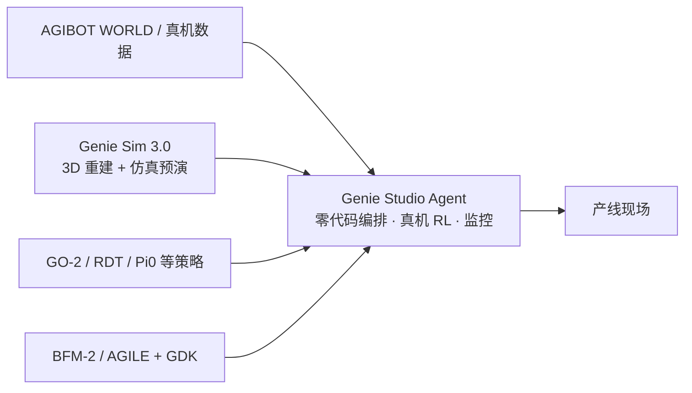

# Genie Studio Agent

**Genie Studio Agent**（2026-04-13 正式发布，[官方新闻稿](https://agibot.com/news/newsroom/agibot-launches-genie-studio-agent-to-en-59)）是智元在 [2026-06 发布地图](../overview/agibot-june-2026-release-technology-map.md) 中 **最偏产业化** 的段落：构建于一站式开发平台 [Genie Studio](https://genie.agibot.com/geniestudio) 与 **GDK** 之上，把机器人能力封装为 **可编排、可部署、可维护** 的企业流程（微信发布文：<https://mp.weixin.qq.com/s/Ha9_0TLyVtec-cL4WqFAbA>）。

## 一句话定义

**零/低代码机器人作业编排与交付平台**——回答「demo 能跑之后，如何复制到第二个工位、第二种料架、另一种节拍」。

## 英文缩写速查

| 缩写 | 英文全称 | 简要说明 |
|------|----------|----------|
| VLA | Vision-Language-Action | 视觉-语言-动作多模态策略 |
| RL | Reinforcement Learning | 通过与环境交互最大化长期回报来学习策略 |
| Sim2Real | Simulation to Real | 仿真策略迁移真机 |
| GDK | Genie Development Kit | 智元标准真机硬件抽象与控制开发组件 |

## 为什么重要

- **交付层闭合：** 数据、仿真、模型、运控底座若不能进入 **可复用流程**，现场仍高度依赖定制项目。
- **模块封装：** 视觉感知、运动控制、导航规划、VLA、强化学习工具链等以模块接入编排。
- **工程能力：** 文内强调任务编排、仿真验证、上线监控、异常恢复、集群监管。
- **案例：** 半导体封测（华天科技合作）晶圆 / Tray 盘上下料、汽车零部件安全带卷收器上料等。

## 核心原理

依据 [官方产品页与新闻稿](../../sources/sites/agibot-genie-studio-agent.md)，Genie Studio Agent 依托智元全栈 SDK 与 **GDK（Genie Development Kit）**，将「模型能力」包装为四项交付机制：

1. **零代码模块化工作流编排：** 将视觉感知、运动控制、导航、VLA 与 RL 工具链封装为可视化节点与预置行业模板，业务人员通过拖拽连接组装产线任务。
2. **仿真优先（Simulation-first）预演：** 集成 3D 场景重建与仿真环境，在真实停机部署前完成任务流、路径与交互异常的虚拟验证。
3. **真机强化学习持续优化：** 运行期结合力控与视觉反馈在线调整抓取/放置策略精度，而非一次性静态固化脚本。
4. **全链路监控与主动运维：** 统一看板聚合系统状态、版本管理、远程诊断与异常预警，支撑跨工位集群监管。

### 与底层模块关系

## 工程实践

| 项 | 核查与实践要点 |
|----|----------------|
| **开源状态** | **商业闭源平台** — Agent 编排器与 GDK 平台自身未开源源码；底座可接入开源的 AgiBot World 数据与 Genie Sim 评测生态 |
| **源码运行时序图** | **不适用**（商业云边平台及专有 SDK，无公开源码仓库） |
| **模型与算力兼容** | 官方页披露支持 RDT、$\pi_0$、OpenVLA、GR00T 及自研 GO-1，提供视频硬件解码随机帧加载（宣称降 80%+ 存储/带宽）与云边混合/加密部署 |
| **产线落地路径** | 模板建任务 → 3D 场景重建与仿真预演 → 编译/GDK 一键下发真机 → 现场监控与真机 RL 迭代 |

## 局限与风险

- **闭源与生态绑定：** 平台自身及 GDK 属于智元商业软件栈，未开放源码可供第三方自托管审阅；跨非智元异构硬件的适配成本以厂商支持为准。
- **厂商自报指标边界：** 典型场景约 48 卡天适配、单卡推理提速 2–3×、单机日采千条等数字均来自官方宣传材料，实际收益受现场工况、传感标定与节拍复杂度影响。
- **真机 RL 安全边界：** 产线在线 RL 自优化与力控放置需严格的碰撞/力限安全包络，不能免除现场调试与安全认证。

## 关联页面

- [策略优化](../methods/policy-optimization.md) — 延伸阅读，了解策略学习的优化目标。
- [强化学习](../methods/reinforcement-learning.md) — 延伸阅读，了解基于奖励的策略训练。
- [应用交付分类 hub](../overview/agibot-release-category-06-application-delivery.md)
- [Sim2Real](../concepts/sim2real.md)

## 参考来源

- [Genie Studio Agent 官方平台与新闻稿归档](../../sources/sites/agibot-genie-studio-agent.md)
- [wechat_embodied_ai_lab_agibot_june_2026_release.md](../../sources/blogs/wechat_embodied_ai_lab_agibot_june_2026_release.md)

## 推荐继续阅读

- [AGIBOT Launches Genie Studio Agent（官方英文新闻稿）](https://agibot.com/news/newsroom/agibot-launches-genie-studio-agent-to-en-59)
- [Genie Studio 官方产品页](https://genie.agibot.com/geniestudio)
- [Genie Studio Agent 发布文（微信）](https://mp.weixin.qq.com/s/Ha9_0TLyVtec-cL4WqFAbA)
