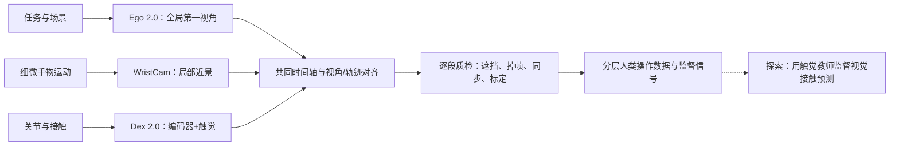

# GenRobot DAS 2.0：Ego / WristCam / Dex 人类多模态数据采集

## 一句话定义

**GenRobot DAS 2.0** 是简智机器人面向 Human Data（人类操作数据）的采集硬件组合：用 **Ego 2.0** 留住任务与全身上下文、**WristCam** 增加近场手–物视角、**Dex 2.0** 实测关节运动与触觉，尽可能把“看见动作”和“测到接触”对齐。

## 英文缩写速查

| 缩写 | 英文全称 | 简要说明 |
|---|---|---|
| DAS | Data Acquisition System | 简智机器人多模态数据采集系统 |
| Ego | Egocentric | 人类第一视角任务观察 |
| DoF | Degrees of Freedom | Dex 手部捕捉的运动自由度 |
| RGB | Red Green Blue | 头戴 / 腕部相机彩色视频 |
| IMU | Inertial Measurement Unit | 头部与腕手惯性运动数据 |
| MCAP | MCAP (robotics log container) | Ego 2.0 视频与 IMU 的官方输出容器 |
| VLA | Vision-Language-Action | 可使用人类示范信号训练的机器人策略族 |

## 为什么重要

人视频可以覆盖大量任务和环境，却常丢失指尖遮挡后的运动、接触发生的时刻、接触强弱，以及走近目标—站位—操作—搬运的连续身体过程。采集质量应同时关注**场景覆盖、动作监督密度、真实接触和跨模态时间对齐**，不能只比较摄像头数量或录制小时。

这是一组**数据采集硬件**，并非发布一个已完成训练与评测的 VLA/WAM 模型；涉及下游性能的说法必须单独给出训练和机器人任务证据。

## 核心原理

### 按任务选择采集模态

| 配置 | 能提供的主要信息 | 仍然缺失或受限 |
|---|---|---|
| Ego 2.0 | 第一视角、环境与任务过程、头部视觉/惯性信号 | 遮挡下的细微手指动作、真实接触力 |
| Ego + WristCam | 增加手–物局部相对运动、可见形变与近场画面 | 视野外/隐藏接触及力仍不可直接观测 |
| Ego + Dex 2.0 | 头部任务上下文 + 21DoF 手部关节 + 实测触觉 | 设备接触本身可能改变示范；须做标定与信号一致性质检 |
| Ego + WristCam + Dex | 以视觉和实测触觉构建**配对监督样本** | 报道表述为正在探索的同步采集/蒸馏路线，**不是已经验证的模型产品** |

### 厂商标称参数（2026-11-14 核对）

| 子系统 | 核心规格 | 工程含义 |
|---|---|---|
| Ego 2.0 | 六路全局快门，30 fps；2×5 MP + 4×2 MP；整机水平 340°；手追踪标称 4 mm | 增强环境覆盖与手部监督信息，但不保证遮挡完全解决 |
| Ego 2.0 采集 | 200 Hz IMU；400 g（不含电池）；单包参考 2.5–3 h、磁吸热换；MCAP 含 H.264 图像及 IMU | 便于长时采集与逐段 QA；官方注明空间定位轨迹**目前尚不支持作为输出** |
| WristCam | RGB 1920×1280@30 fps，水平 166°，IMU 200 Hz | 近手跟拍，补全头戴视角的精细局部信息 |
| Dex 2.0 | 21 DoF / 21 磁编码器，0.2° 编码器精度、1 mm 指尖精度；侧置 60 g 外骨骼 | 通过关节直接测量减轻视觉遮挡歧义，尽量少妨碍自然操作 |
| Dex 2.0 触觉 | 980 点/手、100 Hz、0.1 N 最小检测力、1 mm 空间分辨率、0–20 N 量程、±10%FS 测量精度 | 为接触时刻、位置与强弱提供实测标签；不可将检测力和测量精度混淆 |
| 头手对齐 | 官网标称约 1 ms | 是设备/系统宣称值，不等于实测跨天漂移或机器人端到端误差 |

### 流程总览

**图中实线**是采集/对齐的概念性信息流，并非官方公布的具体 SDK 调用链；**虚线**代表报道提出、尚待模型和真机任务验证的视觉触觉配对监督方向。

### Whole-body 与下游

一条完整的人类示范可能跨越：**靠近与站位（策略层）→ 躯干–肩臂–手协调（协调层）→ 起身、转向、搬运（执行层）**。这些运动记录对 loco-manipulation 有价值，但人体骨架并不能不经动力学/运动学约束直接映射到不同机器人；重定向和下游验证仍是独立环节。

## 工程实践

1. **先选择任务与有效监督。** 只需要任务上下文时用 Ego；精细手物相对运动加入 WristCam；需要接触力/时刻标注时加入 Dex，避免把纯 RGB 直接解释成力真值。
2. **录制前质量门。** 佩戴稳定、镜头无遮挡、相机曝光一致、手套关节零位与触觉偏置有记录；记录操作者/场景/任务和设备版本。
3. **时间同步与标定。** 保存设备时间戳、时钟基准和外参；在“手接触物体”这类事件上检测视频与触觉标签错位。以运动速度 0.5 m/s 为例，1 ms 偏移对应 0.5 mm 几何运动位移，**不是 0.5 mm 全系统重建精度**。
4. **逐段 QA 与发布。** 检查掉帧、遮挡、触觉漂移/串扰、任务失败重试与数据授权；只把经过筛选的 episode 纳入可训练集，并区分原始小时与合格小时。
5. **模型使用。** 可将 Dex 实测接触作为监督训练视觉接触估计器，或对部分表示做蒸馏；遮挡与物体内在物性造成的信息不可观测问题仍需量化评估。

**源码运行时序图：不适用。** 本产品体系是硬件/采集方案，三个官方产品页没有可据以重建“DAS 2.0 全模态采集运行时序”的公开可执行源码入口。已有 [das-datakit](./cn-os-das-datakit.md) 是独立 MCAP 读取/转换工具；不能未经验证便声称覆盖本代 Dex 2.0 配对触觉链路。

## 局限与风险

- **宣传参数不等于独立实测。** 官网页面未给出 4 mm 指尖/手追踪误差与 1 ms 同步的分布、测试场景、标定和跨批次稳定性报告。
- **原生触觉≠完美力标签。** 压阻薄膜存在偏置、饱和、温漂与佩戴影响；标称 ±10%FS、0.1 N 检出下限都须结合实际任务验证。
- **高像素未必进入模型。** 如果训练统一缩至低分辨率，细节可能丢失；高分辨率也可用于离线运动标签重建，不必直接输入策略。
- **视觉替代触觉尚未证明。** 报道描述的 Ego+WristCam+Dex 配对监督/知识蒸馏目前属于探索；重量、隐藏接触等变量不一定能仅从图像恢复。
- **硬件代际不应混淆。** 已开放的 [Gen-HumanEgo](./gen-human-ego-dataset.md) 使用旧版 DAS-Ego 的 1600×1300、30 fps 六相机语料；不能将 Ego 2.0 的 5 MP / 340° 或 Dex 2.0 触觉参数套用到该数据集。
- **开放状态。** 官网可查看产品规格；截至核查日未在这三张产品页发现 DAS 2.0 原始配对多模态数据、触觉蒸馏训练代码或公开模型评测。

## 关联页面

- [Gen-HumanEgo：旧版 DAS-Ego 开放数据集](./gen-human-ego-dataset.md) — 数据字段与当前硬件产品区分
- [das-datakit](./cn-os-das-datakit.md) — 现有开源 MCAP 读取/转换工具，兼容性须核对
- [Ego 采集综述](../overview/ego-category-01-data-collection.md) — 按场景挑采集 rig
- [EgoScale](../methods/egoscale.md) — 人数据规模、跨本体学习与训练信号利用
- [Teleoperation](../tasks/teleoperation.md) — Dex 的遥操用途属于另一条数据获取路径

## 参考来源

- [官方 Ego 2.0 / Dex 2.0 / WristCam 产品资料归档](../../sources/sites/genrobot-das-2-0-official.md)
- [量子位 2026-11-12 报道摘要](../../sources/blogs/qbitai-genrobot-das-2-human-data-2026-11-12.md)

## 推荐继续阅读

- [DAS Ego 2.0 官方规格](https://www.genrobot.ai/products/ego2)
- [DAS Dex 2.0 官方规格](https://www.genrobot.ai/products/dex2)
- [DAS WristCam 官方规格](https://www.genrobot.ai/products/wristcam)
- [Gen-HumanEgo 官方数据门户](https://www.genrobot.ai/data/open-dataset)
