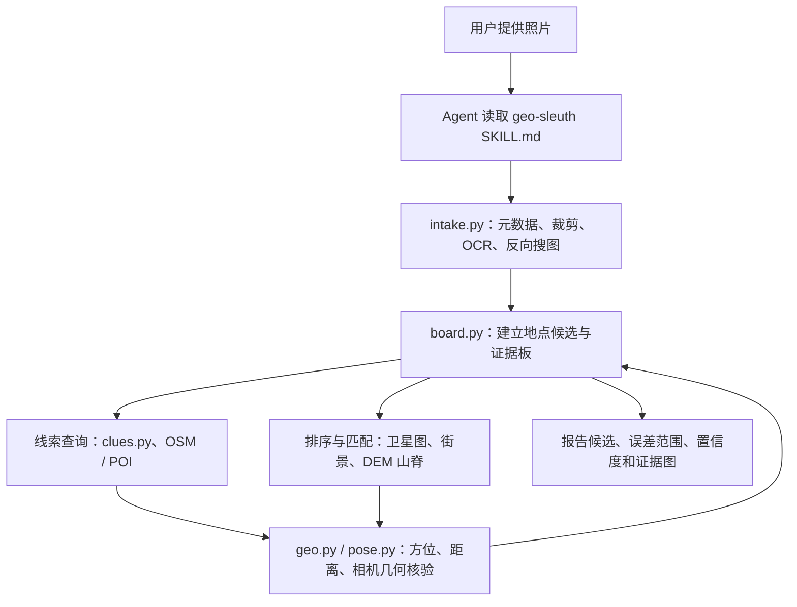
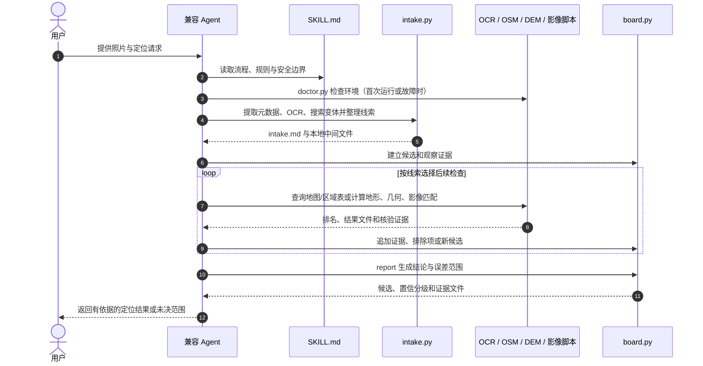

# geo-sleuth：可核验的照片地理定位 Agent Skill

**一句话定义：** geo-sleuth 把照片地理定位拆成“代理提出/判断假设，脚本采集线索、枚举候选、计算几何并排序”的工作流，要求结论能够回指实际运行的命令和产物，而不是凭模型印象猜地点。

## 英文缩写速查

| 缩写 | 英文全称 | 简要说明 |
|------|----------|----------|
| EXIF | Exchangeable Image File Format | 照片元数据格式；可能含 GPS、拍摄时间、焦距等信息 |
| OCR | Optical Character Recognition | 从照片中识别文字，为地名、标牌等提供候选线索 |
| OSM | OpenStreetMap | 开放地图数据；用于查询道路、铁路、桥梁、POI 等地物 |
| DEM | Digital Elevation Model | 数字高程模型；用于地形剖面、地平线和山脊线匹配 |
| OSINT | Open-Source Intelligence | 对公开来源信息的整理分析；公开数据不等于完整或准确 |

## 项目概况

| 项目 | 内容 |
|------|------|
| 作者/维护者 | GitHub 用户 Oldcircle |
| 形式 | 标准 Agent Skill：SKILL.md + Python 脚本和参考资料 |
| 支持代理 | README 列出 Claude Code、Codex、Cursor、Gemini CLI、OpenCode、GitHub Copilot 等 |
| 安装 | 仓库 README 提供 `npx skills add Oldcircle/geo-sleuth` |
| 环境 | Python 3.10+、uv、curl；部分浏览器/机器学习功能另有依赖 |
| 许可 | 仓库标注 MIT（以仓库 LICENSE 为准） |
| 输出 | 候选位置、相机朝向、误差半径/分档置信度及证据图；具体取决于运行的工具和数据覆盖 |
| 核验状态 | 2026-10-13 检查官方仓库 README、skill 与 data-sources 文档；截图中的 2 m 结果属于 README 展示案例 |

## 核心设计

Skill 将工作分为三层，避免把所有判断都交给一个多模态模型：

1. **候选决策（board.py）：** 维护候选地点、观察/计算证据、支持与反对证据、排除、排序和下一步建议。高精度结论需要满足 skill 的交叉验证规则；无法唯一定位时应返回范围或多个候选。
2. **感知与计算（Python scripts）：** 脚本提取/排序信息或做几何计算；模型查看照片、提出可检验假设，并在排名靠前的结果中判断。
3. **证据报告：** 结论需指向本次会话实际运行的命令和输出文件。没有运行或没有生成的核验，不能表述为已验证；最终生成位置、误差范围、置信分级与证据图。

工具并不等于“自动把照片变成 GPS”。例如 DEM 山脊匹配可快速缩小区域，但沿视线方向移动一段距离可能仍得到近似山形；要确定机位，通常还需要桥墩间距、道路/河岸等独立近景约束。

## 主要工具链

| 模块 | 主要脚本 | 作用 |
|------|----------|------|
| 输入与预处理 | exif.py、imgprep.py、intake.py | 读取可用 EXIF；生成边缘/缩放/图块与搜索变体；执行 OCR 和反向搜图并汇总 intake.md |
| 图像线索 | ocr.py、revimg.py、clues.py | 识别文字；查 Baidu/Yandex 近似图或关键词结果；按国家区域包查车牌、区号、行政区等表 |
| 地物候选 | osm.py、poi.py、gazetteer.py | 调用 OSM/Overpass 和区域数据列出地物、组合关系、道路/路线候选及行政区 |
| 几何定位 | geo.py、sun.py、pose.py | 计算方向/距离/交线、太阳与阴影、相机视场及多点投影核验 |
| 地形与图像匹配 | terrain.py、sat_scan.py、match.py、tiles.py | DEM 地平线/山脊拟合；CLIP 卫星图候选排序；DINOv2 与 SIFT 地面图像匹配；生成候选图板 |
| 汇总与证据 | board.py、evidence.py | 记录证据、管理候选排序并生成最终报告数据和证据图 |

## 流程总览

以上是方法层的数据流；具体运行会因照片线索、地区包、网络服务可用性而跳过某些阶段。

## 源码运行时序图

运行时序取自官方仓库对 skill、脚本与候选板的描述；其中反向搜图、地图/地形服务和机器学习模型是按需调用，并非每次执行都必走。

## 复现与适用边界

- **安装后先自检：** README 建议首次使用运行 scripts/doctor.py；可添加 `--network` 检查外部服务可达性。网络探测只确认连通，不保证服务允许上传、覆盖充分或没有验证码。
- **计算开销：** terrain 区域扫描、卫星图和街景候选搜索可能耗时；match.py / sat_scan.py 首次可能安装依赖并下载模型权重。README 案例报告数十分钟至更久，视范围和线索而异。
- **数据并非真值：** OSM 在不同地区完整度不同；高程、卫星图、街景覆盖/年份和地图坐标系均会影响结果。中国区域尤其要区分 WGS84、GCJ-02、BD-09 等坐标系。
- **不能泛化截图精度：** README 展示一个 27,335 个初始候选逐步收敛到作者声称 ±2 m 的案例。该数字是该次案例报告，不是通用误差保证或独立测评。
- **隐私：** 工具会访问外部地图/影像/搜索服务；开启 Baidu/Yandex 反向搜图时会调用相应外部服务。私密、敏感或不应外传的照片不要送入反向搜图，可用 intake.py 的 `--no-rev` 跳过该步骤。
- **安全与用途：** 官方 SKILL.md 要求若照片并非用户本人拍摄，或涉及私人住宅、未成年人，在继续前先问用途；不可把公开数据能力当作对个人进行跟踪或识别的授权。
- **开放边界：** 核心技能、脚本和文档公开，MIT 许可；OSM、地图、影像、搜索服务与 DEM 是上游依赖，覆盖/可用性、服务条款和速率限制分别受上游约束。

## 结论

**geo-sleuth 的亮点不是“模型猜得准”，而是把照片定位拆成可追溯的候选生成、工具计算、交叉验证与拒绝过度精确的流程。**

1. 需要可复核照片地理定位时，可将它作为 Agent Skill 安装，让代理按步骤运行工具，而不是只凭视觉语言模型猜城市。
2. 高精度依赖两条以上独立几何/视觉约束或足够的地面特征核验；只有相似山脊或弱地标时应报告更宽范围。
3. 把案例 ±2 m 当作演示结果，不当作产品级精度承诺；确认其实际误差必须检查该次运行的命令和产物。
4. 对中文地区，使用前确认地图源的坐标系；不同坐标系的偏差可达数百米，足以淹没米级结论。
5. 反向搜图会调用外部服务；敏感照片应跳过该步骤，并限制分享本地中间产物。
6. 对他人照片、私人住宅和未成年人照片，先确认用途并遵守当地法律、平台政策与个人隐私边界。
7. 将其与机器人定位工作区分：它是面向照片溯源/地理猜谜的工具链，不是实时 SLAM、GNSS 或机器人导航定位器。

## 关联页面

- [OSIRIS 全球 OSINT 情报地图](./osiris-global-osint.md) — 公开地理信息聚合与该技能的照片线索检索区别。
- [LAYS 跨视角航向估计](./paper-sa-2606-22094-lays.md) — 研究型地面/卫星跨视角定位方法，与该技能的启发式候选核验不同。
- [Meshroom](./meshroom.md) — 摄影测量与相机/场景重建工具，可作几何信息的互补方向。
- [Agent Skills（Addy Osmani）](./agent-skills-addyosmani.md) — 通用 Agent Skill 组织与分发实践。
- [导航与 SLAM 栈总览](../overview/navigation-slam-autonomy-stack.md) — 区分照片地理定位与机器人本体定位。

## 参考来源

- [geo-sleuth 官方仓库来源归档](../../sources/repos/geo-sleuth.md)
- [GitHub 仓库](https://github.com/Oldcircle/geo-sleuth)
- [英文 README](https://github.com/Oldcircle/geo-sleuth/blob/main/README.md)
- [简体中文 README](https://github.com/Oldcircle/geo-sleuth/blob/main/README.zh-CN.md)
- [Agent Skill 规范文件](https://github.com/Oldcircle/geo-sleuth/blob/main/skills/geo-sleuth/SKILL.md)
- [工具与数据源说明](https://github.com/Oldcircle/geo-sleuth/blob/main/skills/geo-sleuth/references/data-sources.md)

## 推荐继续阅读

- [Agent Skills 规范](https://agentskills.io/)
- [OpenStreetMap](https://www.openstreetmap.org/)
- [AWS Terrain Tiles / Terrarium 数据格式](https://registry.opendata.aws/terrain-tiles/)
