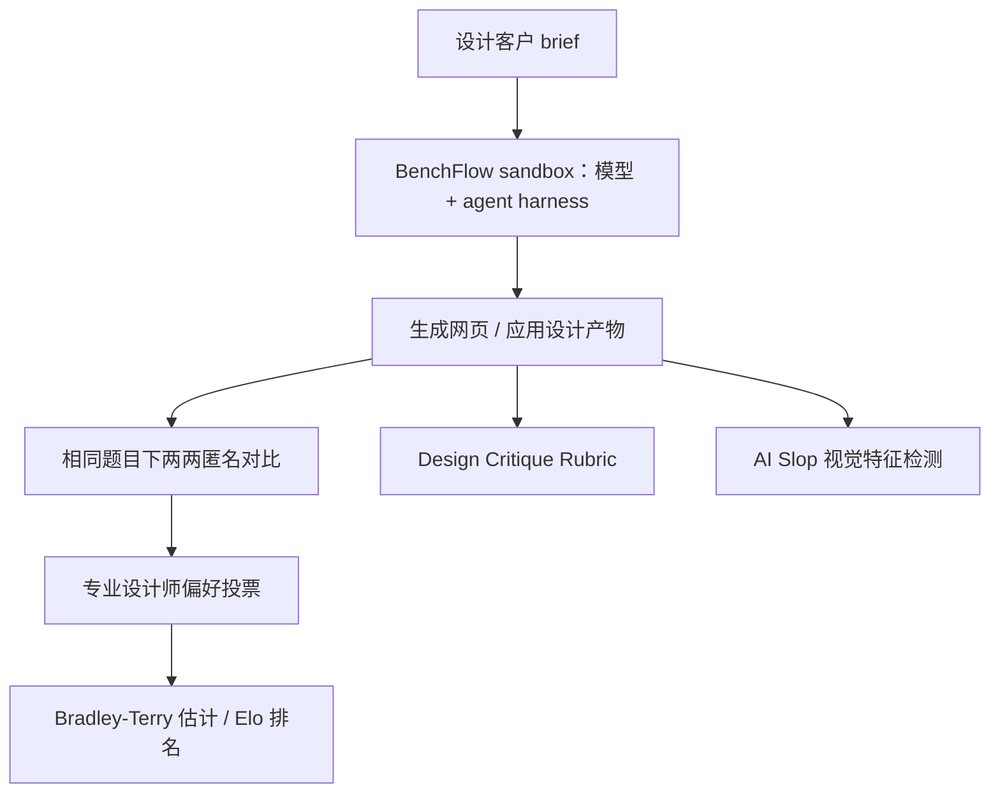

# Gestalt (stealth)：Frontier Design 匿名设计模型

## 一句话定义

**Gestalt (stealth)** 是 Contra Labs 在 [Frontier Design Benchmark](frontier-design-benchmark.md) 研究报告中预览的匿名网页设计模型，2026-11-20 查询时在专家盲测榜居首，**不是可证实对应** [GeWu-Lab Gestalt 论文](paper-gestalt-2610-00576.md)。

## 英文缩写速查

| 缩写 | 英文全称 | 简要说明 |
|---|---|---|
| FDB | Frontier Design Benchmark | 当前排名所属的设计评测 |
| Elo | Elo Rating | 依据专家两两偏好估计的相对模型分数 |
| CI | Confidence Interval | 榜单胜率的区间估计 |
| SDK | Software Development Kit | 评测运行方 BenchFlow 提供的通用工具 |

## 为什么重要

- 评委是**专业设计师**，且任务来自真实客户委托改写；与仅测静态截图美观的 benchmark 不同。
- 评价的是模型和 agent harness 在特定任务上的系统成绩，不能只由榜单推断未知模型架构、开发组织或底层算法。
- 与同名开源论文区分，可避免把错误的代码、模型权重和 Elo 关联在同一个知识节点。

## 核心信息

| 来源与查询时间 | Gestalt (stealth) | 注意 |
|---|---|---|
| 2026-11-18 [官方报告](https://contralabs.com/research/frontier-design-benchmark) | Elo 1,928；89%；378/423 | 研究发布快照 |
| 2026-11-20 [在线榜](https://contralabs.com/frontierdesign/leaderboard) | 第 1；Elo 1,931；90%；420 votes | 后续榜单可能变化 |
| 报告人类作品直接比较 | 20 / 28 偏好 Gestalt | 有限样本，不代表普遍胜过人类 |

## 核心原理与流程总览

**匿名模型内部机制未公开。** 下图只展示已证实的**外部评测流程**，不推测它用了哪种模型骨干、预训练或图像生成方式：

## 源码运行时序图

**不适用：** Contra Labs 官方未公布 Gestalt (stealth) 专属训练、推理源码或运行入口；通用 BenchFlow SDK 不是匿名模型代码，不能编造源码时序图。

## 实验与评测

官方报告在 2026-11-18 记录 1,928 Elo 与 89% 的专家偏好结果，线上榜单 2026-11-20 更新为 1,931 Elo、90%。两次记录的投票数不完全相同，**不可合并为同一个样本口径**。

## 与其他工作对比

与 [GeWu-Lab Gestalt](paper-gestalt-2610-00576.md) 相比，后者有公开论文、视觉语言离散扩散架构和源码；本模型只有评测成绩及匿名预览。名称相同**不构成技术继承或同一团队的证据**。

## 工程实践

- 引用排名时记下日期、榜单模型显示名、Elo 和投票量；不可缓存为永久第一。
- 若评估设计生成 agent，优先使用相同 brief、相同运行约束与盲评，再对照 Rubric。
- 需要独立复验必须得到 [官方数据集申请](https://contralabs.com/frontierdesign/dataset) 的任务、rollouts 和专家票。

## 局限与风险

- 未有公开的一手技术论文、训练代码、权重、专属 API 与完整开发者身份。
- 分数针对网站设计任务，不是机器人视觉语言动作模型性能。
- 上榜系统可能受 agent harness 影响，不能将所有收益归因于底座模型。

## 关联页面

- [Frontier Design Benchmark](frontier-design-benchmark.md)
- [GeWu-Lab 同名 Gestalt 论文](paper-gestalt-2610-00576.md)
- [AI Agent 评测](../concepts/ai-agent-evaluation.md)

## 参考来源

- [官方匿名模型预览核读](../../sources/sites/contra-gestalt-stealth.md)
- [官方设计基准研究报告及方法](../../sources/sites/contra-frontier-design-benchmark.md)

## 推荐继续阅读

- [Contra Labs 官方研究报告](https://contralabs.com/research/frontier-design-benchmark)
- [实时设计排行榜](https://contralabs.com/frontierdesign/leaderboard)
