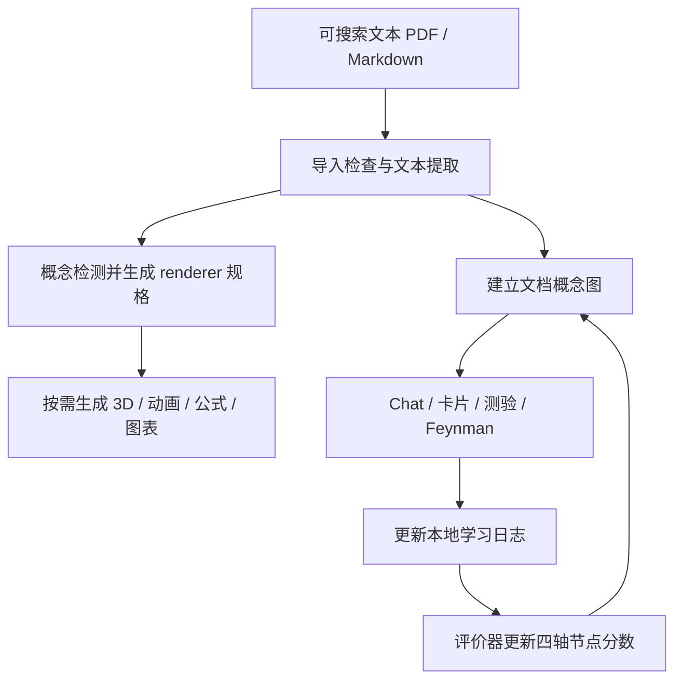

# Get It. Study Companion

## 一句话定义

**Get It.** 是一个围绕 PDF/Markdown 文档的开源桌面学习 companion：它把概念识别、可选的图文/3D 可视化、概念关系图与复习交互放在同一工作流中，目标是让学习者练习解释和迁移，而非只获得一份摘要。

## 英文缩写速查

| 缩写 | 英文全称 | 简要说明 |
|------|----------|----------|
| PDF | Portable Document Format | 可导入的主要学习材料格式；扫描图像型 PDF 不在当前文本解析输入范围内 |
| LLM | Large Language Model | 由用户选用的模型 CLI/API 执行概念检测、辅导与评价任务 |
| CLI | Command-Line Interface | Codex、Claude、Gemini 等模型工具通过命令行接入桌面应用 |
| KG | Knowledge Graph | 文档概念节点与类型化关系构成的学习图谱 |
| API | Application Programming Interface | 用户也可提供模型 API endpoint 或 API key 接入模型服务 |

## 为什么重要

- **把文档阅读变成跨模态学习：** 概念检测 agent 标记适合视觉化的概念，再由不同 renderer 生成 3D 场景、物理/化学动画、公式解释、曲线或引用。对机器人技术学习而言，这种形态可以帮助理解空间几何、运动学、动力学或算法曲线；它不会自动替代原文与工程验证。
- **把复习信号放回同一上下文：** Chat、flashcards、quizzes 和 Feynman 讲解都与同一文档及概念图关联，使学习者可以在概念层面回看已有练习记录，而不只是积累彼此孤立的聊天和卡片。
- **提供本地可控的模型接入：** 桌面端储存文档和学习记录，模型请求通过用户选择的 CLI/API 到供应方；它没有项目方的模型代理服务。此设计保留了用户选择供应商或本地模型的空间，但云端模型调用的内容处理仍取决于具体供应方条款。

## 核心结构

| 组件 | 输入 | 输出与作用 |
|------|------|------------|
| 文档导入与质量门 | 可搜索文本 PDF 或 Markdown | 文本缓存与页码信息；扫描型/图片型材料无法走当前文本路径 |
| 概念检测 | 分页文本与文档上下文 | 概念标签与锚文本，并选择 3D、动画、公式、图表或文字 renderer |
| 可视化管线 | 被选中的概念与 renderer 规格 | 按需生成旁栏内容；运行错误可触发修复再生成 |
| 知识图谱构建 | 整份文档文本 | 约 6–25 个概念节点、类型化边与总览说明 |
| 学习工具与日志 | 用户问答、卡片自评、测验及口头讲解 | 每份文档的本地 JSON 学习日志 |
| 评价器 | 基线图谱分数与新增互动日志 | 按记忆、理解、结构、应用四轴更新节点分数 |
| 模型路由与桌面壳 | Codex / Claude / Gemini CLI/API 或 OpenAI-compatible endpoint | Electron 桌面 UI 与本机存储；模型调用走选定供应商或本地 endpoint |

## 工作流

一次文档导入并行构建可视化标签与初始概念图；随后复习互动进入日志，评价器用新日志增量更新图谱。可视化默认按需生成，也可配置在阅读时自动渲染。

## 工程实践

- **运行形态：** Electron 桌面应用，前端基于 Next.js/React/TypeScript；`npm run dev` 用于本地开发，README 提供多平台 Electron 构建命令。
- **模型选择：** 支持 Codex、Claude、Gemini 与 OpenAI-compatible endpoint；在配置中选择自己的账号/API 或本地模型。账户与用量限制由对应模型供应方决定。
- **材料准备：** 优先使用可搜索文本 PDF 或 Markdown。项目 README 指出扫描件/仅图像文档会被入口质量门拒绝，文档页数上限为 150 页。
- **隐私读法：** 文档、缓存、知识图谱与学习日志保存在设备上；使用云端模型时，相关提示上下文会交给用户选择的模型供应方处理。项目方称模型流量不经其自有服务器，并单独发送匿名启动/更新统计 ping；README 提供 `GETIT_DISABLE_ANALYTICS=1` 关闭统计。
- **发布检查：** 官网与 README 对安装包签名状态的描述并不同步：官网目前仍标 v1.1.0 与未签名 hackathon builds，README 对 v1.2.1 后的 macOS 产物描述为已签名并 notarized。下载前应核对具体 GitHub Release 版本、平台与签名信息。

## 局限与风险

- **分数不等于经验证的掌握度测量：** 四项分数是产品定义的评价输出；项目材料未提供独立教育研究来证明它们与真实迁移或考试表现的对应关系。
- **单调不减会掩盖遗忘：** README 说明运行时 clamp 让节点分数不下降。这避免一次评价把进度回退，但也意味着图谱不能用来表示记忆衰退或知识熟练度下降。
- **可视化可能需要纠错：** 概念标签、renderer 规格和生成内容仍由模型参与产生；页面支持沙箱错误后的修复循环，但不能保证物理、数学或科学表述正确，重要内容须回到来源核验。
- **文档输入有界：** 项目当前说明仅支持可抽取文本的 PDF/Markdown；扫描件、纯图片文档与超页数材料不适用自动路径。
- **本地存储不等于模型零数据外传：** 选择云端 CLI/API 后，模型服务按其政策处理请求；第三方模型账户条款与隐私政策仍适用。
- **站点发布提示可能过时：** 项目官网与 README 对版本及 macOS 签名状态不一致，应按单个 release 核实，不把旧官网提示推广为所有版本的状态。

## 与 Robotics_Notebooks 的关系

Get It. 是通用学习应用，不是机器人研究平台。对本知识库读者的实际用途是把机器人学课程、控制推导或技术报告作为阅读材料，试用其概念可视化与主动回忆流程；模型评价器和生成内容仍需独立校验。

- [Three.js Game Skills](./threejs-game-skills.md) — 浏览器 3D 技能库；同用 Three.js，但 Get It. 的目标是文档学习可视化
- [Skills For Real Engineers（mattpocock）](./mattpocock-skills.md) — 可安装编码代理技能库，作为通用 Agent Skills 参照
- [WikiSkill（论文实体）](./paper-wikiskill.md) — 把研究文献与 agent skill/wiki 连接的研究方向
- [Agentic Coding 时代的软件工程基础](../concepts/agentic-coding-software-fundamentals.md) — 理解代理工作流的可验证边界与人工判断

## 参考来源

- [beltromatti/get-it 仓库资料归档（本站）](../../sources/repos/beltromatti-get-it.md)
- [getit.noesisai.it 项目页归档（本站）](../../sources/sites/getit-noesisai.md)
- [beltromatti/get-it（GitHub）](https://github.com/beltromatti/get-it)
- [Get It. 官网](https://getit.noesisai.it/)

## 推荐继续阅读

- [GitHub README](https://github.com/beltromatti/get-it#readme) — 架构、模型接入、存储位置与构建说明
- [Technical write-up（Markdown）](https://github.com/beltromatti/get-it/blob/main/technical-writeup.md) — 产品设计、评价维度、评估器队列与沙箱架构
- [Get It. Releases](https://github.com/beltromatti/get-it/releases) — 下载前核对版本、平台与签名信息
