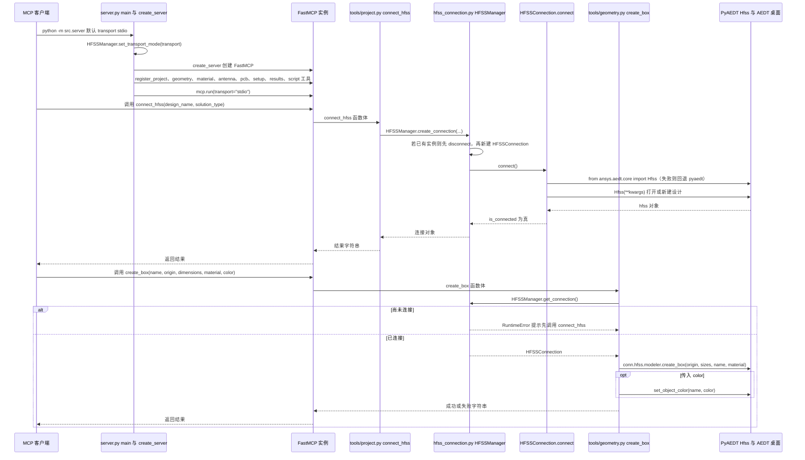

# HFSS MCP Server（gfgf2023/hfss-mcp-server）

## 一句话定义

HFSS MCP Server（gfgf2023/hfss-mcp-server）是面向 HFSS 天线和 PCB 仿真的 MCP 服务，涉及天线几何、边界与激励、远场方向图等任务。

## 英文缩写速查

| 缩写 | 英文全称 | 简要说明 |
|------|----------|----------|
| MCP | Model Context Protocol | 代理与工程软件工具的交互协议 |
| CAE | Computer-Aided Engineering | 计算机辅助工程软件与分析 |
| API | Application Programming Interface | 软件可供自动化调用的接口 |

## 为什么重要

对 CAE 自动化而言，代理能否稳定完成任务，取决于工程步骤是否清楚、工具边界是否明确、结果是否保留可审查证据。面向 HFSS 天线和 PCB 仿真的 MCP 服务，涉及天线几何、边界与激励、远场方向图等任务；文章只用“hfss-mcp”描述此类工具，仓库映射据名称与领域匹配。

## 核心原理

**项目自身范围：** MCP server for Ansys HFSS antenna design and PCB simulation.

**工作流：** 将代理指令转为 PyAEDT/HFSS 建模与求解操作，再导出场图、远场或 PCB 仿真结果。

**仓库映射说明：** 文章未给出该项目完整的 owner/repository URL；此处按文章中的项目名/描述与公开 GitHub 仓库匹配。引用时请以本页链接的仓库 README 为准。

## 工程实践

1. 从目标问题识别所需的 Skill、MCP、CLI 或软件接口，不把指导文件当成求解器。
2. 依照仓库 README 检查安装前提、软件/许可证、输入文件和输出证据。
3. 小规模运行并逐项核对几何、网格、边界、求解状态和物理量，再决定是否扩大任务。

文章所述的项目特征：面向 HFSS 天线和 PCB 仿真的 MCP 服务，涉及天线几何、边界与激励、远场方向图等任务；文章只用“hfss-mcp”描述此类工具，仓库映射据名称与领域匹配。

## 局限与风险

“hfss-mcp”是通用项目名；此页面归到 gfgf2023 仓库是基于当前公开仓库匹配，文章未给出明确 owner 链接；仍需软件许可证。

源码状态核验：该 GitHub 仓库于 2026-10-07 可公开访问。仓库 API 报告许可证为 MIT。 涉及商业软件时，安装包和有效许可证需由使用者自行提供。

## 源码运行时序图

入口：`python -m src.server`（README「运行」节，默认 stdio 传输；另可加 `--transport http --host 127.0.0.1 --port 8765` 或 `--transport sse`）。客户端先调用 `connect_hfss` 建立 AEDT/HFSS 连接，之后的建模工具都经 `HFSSManager` 单例取得连接。

图依据：gfgf2023/hfss-mcp-server@d694e46，实际读过 `README.md`（运行命令段，grep 与局部）、`src/__main__.py`、`src/server.py`（`create_server` 工具注册、`main` 的 transport 分支）、`src/tools/geometry.py`（`create_box` 全文）、`src/tools/project.py`（`connect_hfss` 注册，grep）、`src/hfss_connection.py`（`HFSSConnection.connect` 局部、`HFSSManager.get_connection` / `create_connection`）。`run_pyaedt_script` 的 `exec` 执行环境（`src/tools/script.py`）只做了局部阅读，图中未画出；建模与求解的 PyAEDT 内部行为未运行验证。

## 关联页面

- [CAE / CFD 代理工具项目总览](../overview/cae-cfd-agent-skills-landscape.md)
- [Ansys AEDT MCP](./laplaceyoung-ansys-aedt-mcp.md)

## 参考来源

- [公众号文章原始资料归档](../../sources/blogs/wechat_cae_cfd_agent_skills_2026-10-07.md)
- [GitHub 仓库资料归档](../../sources/repos/gfgf2023-hfss-mcp-server.md)
- [gfgf2023/hfss-mcp-server 官方仓库](<https://github.com/gfgf2023/hfss-mcp-server>)
- 源码核对（2026-11-02）：gfgf2023/hfss-mcp-server@d694e46，读过 README.md（运行段）、src/__main__.py、src/server.py、src/tools/geometry.py、src/tools/project.py（grep）、src/tools/script.py（局部）、src/hfss_connection.py（局部）；时序图依据以上文件，未运行代码。

## 推荐继续阅读

- [项目 README](<https://github.com/gfgf2023/hfss-mcp-server/blob/master/README.md>)