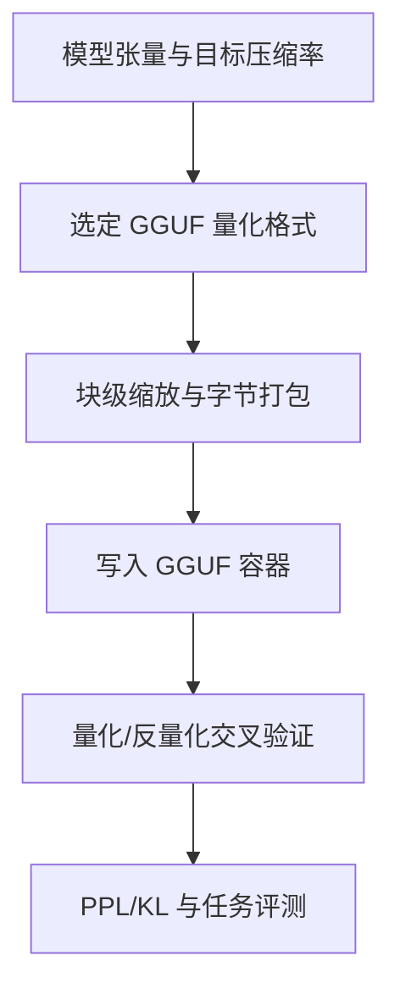
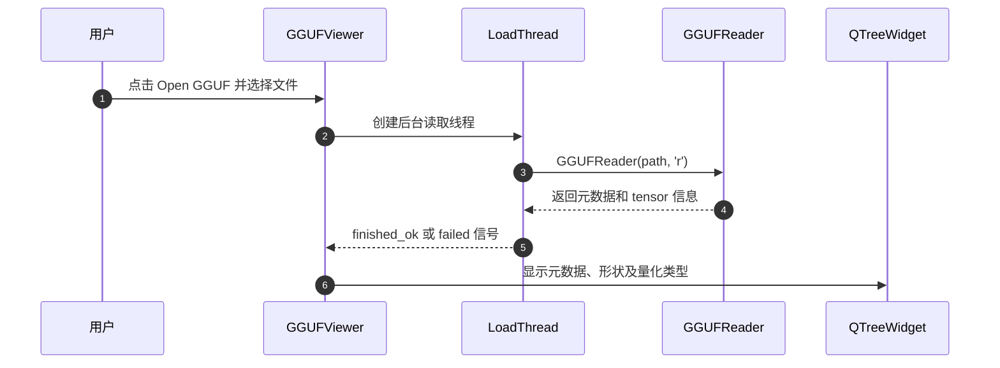

# GGUF 量化内幕：数据格式、误差与验证

## 一句话定义

课程解释 GGUF 容器与量化张量的字节布局、误差、反量化和验证方法；强调量化值能被正确解码，与模型量化后是否好用是两种不同测试。

## 英文缩写速查

| 缩写 | 英文全称 | 简要说明 |
|---|---|---|
| GGUF | GPT-Generated Unified Format | 模型张量/元数据容器 |
| PPL | Perplexity | 语言模型困惑度评测 |
| KL | Kullback–Leibler Divergence | 概率分布变化指标 |
| IQ | Importance-Weighted Quantization | 与重要性/码本相关的格式家族 |

## 为什么重要

端侧 LLM 量化不只是保存较小文件。读错位序、尺度或块形状，会在不明显报错的情况下破坏权重；即使格式实现正确，也需要 PPL、KL 和任务级评测来验证质量。

## 核心原理

README 以 20 章串起 GGUF 格式、Q4_0/Q8_0、K-quants、IQ 码本、三值量化、混合精度和工具链。第 18 章明确区分逐块交叉验证、全模型评测和特殊格式前提验证；src/gguf_viewer.py 通过 GGUFReader 打开文件，后台 QThread 把元数据与张量 shape/type/offset 转成树状行。

### 课程/项目主线流程总览

## 源码运行时序图

以下是**核对过的代表性源码入口**，不代表全部示例运行或获得同等输出。

## 工程实践

文件查看器源码为 src/gguf_viewer.py，PyQt6 用户点击 Open GGUF 后由 LoadThread(QThread) 使用 gguf.GGUFReader 解析文件并发射 finished_ok 或 failed；可用来核查 GGUF 头、字段及张量 dtype，不等于对模型质量做完评测。

## 局限与风险

不同 GGUF 格式的 packing 规则、量化参考实现可能随 llama.cpp 更新；跨引擎互操作需字节级验证。小模型的 PPL 变化不能直接推断下游任务可靠性。

**原文通读范围：** 本节点以完整阅读过的官方 README 原文为主（配套内容有重点核验），不声称整本书或全部实验章节均逐篇精读。健康度描述的是知识节点的结构与已声明原文范围。

## 关联页面

- [cpp-llm-engine](./cpp-llm-engine.md) — 关联的工程知识或开源项目。
- [tensorrt-llm](./tensorrt-llm.md) — 关联的工程知识或开源项目。
- [pytorch](./pytorch.md) — 关联的工程知识或开源项目。

## 参考来源

- [官方入口文档通读记录](../../sources/repos/gguf-quant-internals-course-overview-read-20261113.md)
- [项目来源索引](../../sources/repos/gguf-quant-internals.md)
- [作者/维护者仓库](https://github.com/datawhalechina/gguf-quant-internals)

## 推荐继续阅读

- [官方原文入口](https://github.com/datawhalechina/gguf-quant-internals)
