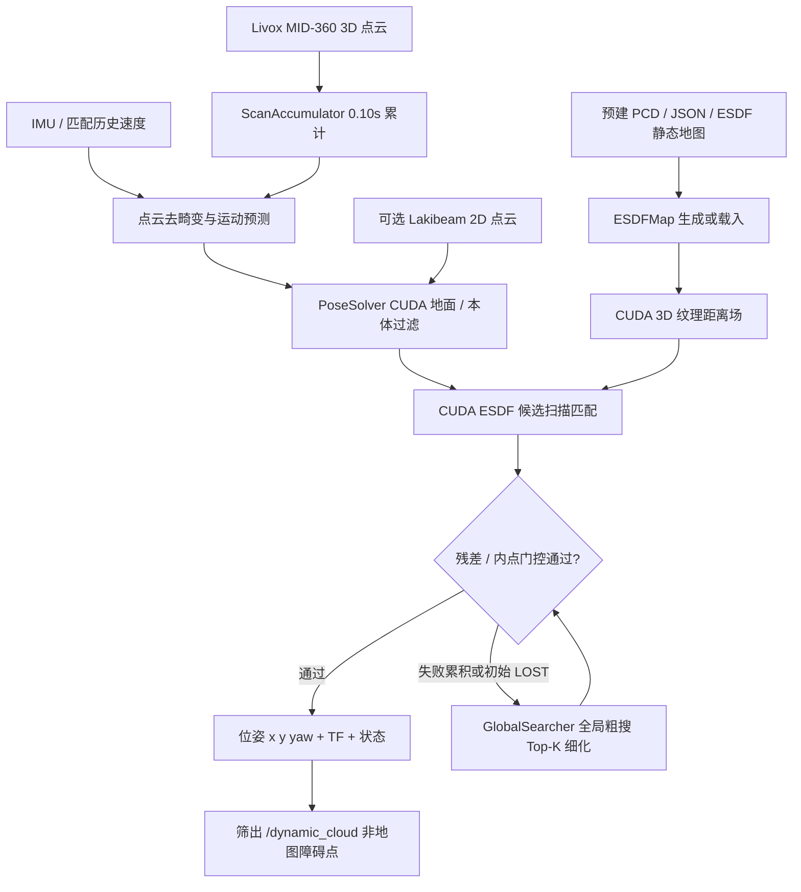
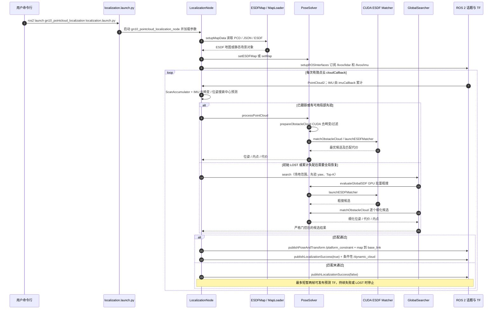

# GN10 PointCloud Localization｜基于 ESDF 与 CUDA 3D 纹理的实时点云定位

## 一句话定义

**GN10 PointCloud Localization** 是面向 ROS 2 的开源地图定位器：先把静态环境表示为三维 ESDF，再用 GPU 对实时 3D LiDAR 点云的候选 `x/y/yaw` 位姿做距离场匹配；定位丢失后可在已知地图内全局搜索，而非依赖轮式里程计或人工输入起始坐标。

## 英文缩写速查

| 缩写 | 英文全称 | 简要说明 |
|---|---|---|
| ESDF | Euclidean Signed Distance Field | 欧氏距离场，存储位置到预建地图几何的距离用于匹配 |
| CUDA | Compute Unified Device Architecture | NVIDIA GPU 并行计算及 3D 纹理查询接口 |
| LiDAR | Light Detection and Ranging | Livox MID-360 激光点云输入 |
| IMU | Inertial Measurement Unit | 去畸变、偏航角积分与短时搜索预测 |
| ROS 2 | Robot Operating System 2 | 传感器、位姿、状态与点云的通信框架 |
| TF | Transform | 发布 `map → base_link` 坐标变换 |

## 为什么重要

- **失锁可恢复**：局部匹配连续失败后，进入全地图 GPU 粗搜索、Top-K 候选细化与成本/内点门控的恢复路径。
- **地图查询快**：`src/cuda/esdf_matcher.cu` 使用 `cudaTextureObject_t`、`tex3D<float>` 和硬件三线性插值，使每点距离查询在算法上为 O(1)；整体帧耗时仍依赖点数与候选数。
- **适合机载部署的工程实例**：README 明确面向 Jetson Orin Nano 与 Livox MID-360，给出 ROS 2 Humble / CUDA 12+ / 地图预处理的具体入口。
- **动态点分离**：把与静态地图不吻合的障碍点发布至 `/dynamic_cloud`，利于规划层进一步处理；这不是物体分类。

## 核心信息

| 项目 | 已核实信息 |
|---|---|
| 官方维护 | TMCIT Ararobo 2026A 团队（东京都立产业技术高等专门学校机器人竞赛团队） |
| 原始仓库 | [tmcit-ararobo-2026a/gn10-pointcloud-localization](https://github.com/tmcit-ararobo-2026a/gn10-pointcloud-localization) |
| 阅读版本 | `3691e308`（2026-11-12 主分支提交） |
| 开源程度 | **已开源**：ROS 2 C++/CUDA 实现、launch、配置与 ESDF 转换入口；Apache-2.0 |
| 输入 | Livox 3D 点云 + IMU + **预建静态地图**；配置可选 2D Lakibeam 和外部融合位姿 prior |
| 输出 | `x, y, yaw` 平面定位，`/platform_constraint`、`map → base_link` TF、定位状态和筛出的点云 |
| 环境 | Ubuntu 22.04 / ROS 2 Humble / CUDA ≥12.0 / NVIDIA GPU |

## 核心原理

**地图先行。** 支持从 `.pcd`、`.json`、`.esdf` 等静态几何资源生成/载入 ESDF。`src/esdf_map.cpp` 将障碍物几何预计算进体素距离场；`PoseSolver::setESDFMap` 将其交给 CUDA 匹配器。**没有预建地图，就不具备这里所说的全局定位能力**。

**扫描匹配。** `ScanAccumulator` 对 Livox 扫描做短窗口累计；IMU / 速度历史用于补偿运动与预测局部搜索中心。`PoseSolver::prepareObstacleCloud` 触发 CUDA 去畸变/地面及本体过滤，随后 `matchObstacleCloud` 用 ESDF 评估多候选位姿并细化，最后依 3D/2D 残差、内点数量与比例做接受门控。

**全局恢复。** 初始没有有效定位，或失配次数达到设定阈值时，`GlobalSearcher::search` 在场地范围执行 GPU 粗网格搜索，取空间上分离的 Top-K 候选，再对完整点云细化并验证；默认阈值 25 帧，Top-K=4。它求的是平面 `SE(2)` 位姿，而不是 6-DoF 激光 SLAM。

## 流程总览

图为阅读官方 README 与核心源码后的模块抽象；实际上仅在符合条件的扫描上进行全局搜索，动态点发布也受订阅、定位状态等条件约束。

## 源码运行时序图

入口：`ros2 launch gn10_pointcloud_localization localization.launch.py`；`launch/localization.launch.py` 将 `common_params.yaml` 与 `localization_params.yaml` 注入可执行体 `gn10_pointcloud_localization_node`（`src/main.cpp` 的 4 线程 ROS executor）。以下节点/方法对应官方仓库 `3691e308` 的真实调用层次。

源码核对范围：`src/main.cpp`、`launch/localization.launch.py`、`src/localization_node.cpp`（构造、`cloudCallback`、`imuCallback`、`publishPoseAndTransform`）、`src/pose_solver.cpp`、`src/global_searcher.cpp`、`src/cuda/esdf_matcher.cu`、`src/map_loader.cpp`、`src/esdf_map.cpp`、`config/common_params.yaml`。**未在 Jetson 或 ROS 2 环境实际编译运行**；可选 2D LaserScan 的独立回调已核实，但时序图省略以保持主干清晰。

## 工程实践

1. 备好 **静态地图**：PCD 点云、场地 JSON 或已经转换的 ESDF；仅给激光雷达流不会自动生成全局地图。可用 `pcd_to_esdf_converter` 转换。
2. 配置 ROS 2 Humble、CUDA 12+ 与依赖；确认 `/livox/lidar`、`/livox/imu` 和 `base_link` TF 外参。`common_params.yaml` 默认还打开 `lidar_2d.enable`；没有 Lakibeam 时调整配置。
3. 用官方命令 `ros2 launch gn10_pointcloud_localization localization.launch.py`；输入 map 文件通过参数/`map/` 目录配置。
4. 监控 `/robot/operation/localization_success`、`/platform_constraint` 和 `/localization/telemetry`，并分别测试启动无初始位姿、短时遮挡、连续失配后的全局搜索。
5. 调参优先观察 `esdf.resolution=0.05` m、`esdf.max_dist=0.50` m、`scan_accumulation.window_s=0.10` s、`global_search.lost_count_thresh=25`、匹配代价和内点门限；这些都是示例配置而非通用最优值。

## 局限与风险

- **不是无地图 SLAM**：预建场地的尺度和几何一致性是全局定位先决条件；地图变化大、几何重复或点云遮挡会影响候选区分。
- **三维测量 ≠ 6D 位姿**：`publishPoseAndTransform` 发布 `z=0` 与 yaw，适配平面导航，不能直接当作人形全身 6-DoF 状态估计。
- **不等于全传感器无依赖**：虽不需要轮式 odometry 或手工起始坐标，但 IMU、外参与时间同步仍重要；默认还启用了 2D LiDAR 增强。
- **性能不能外推**：上游 README 称 Jetson Orin Nano 实时部署，未附可复核的定位精度、端到端频率、不同地图条件下重定位成功率表格；不臆造数值。
- **短时 TF 降级行为**：源码允许至多 2 帧且不超过 0.10 s 的预测 TF，之后及 LOST 停止更新；下游需检查位姿时间戳与定位状态。

## 与其他工作对比

- [FAST-LIO](./fast-lio.md) / [LIO-SAM](./lio-sam.md)：持续激光/惯性状态估计、里程计和建图；GN10 侧重**在已有静态地图中**匹配与重定位。
- [Isaac ROS nvblox](./isaac-ros-nvblox.md)：利用 GPU 更新体素 TSDF/ESDF 地图辅助感知和规划；GN10 消费距离场做位姿匹配。
- [Navigation2](./navigation2.md)：GN10 输出位姿与 TF，可成为导航状态估计的一部分；实际 TF 树、话题适配和失锁停车策略需要系统级验证，不能假设无缝兼容。

## 关联页面

- [GN10 整机开源系统｜2026 高专机器人竞赛荒川校区 A 队](tmcit-ararobo-2026a-gn10-system.md) — 整体导航、主控固件、供电和仿真工程；本页仅深入 ESDF/CUDA 定位算法。

- [里程计与激光雷达融合定位](../methods/lidar-odometry-fusion.md) — 对照「里程计或 IMU 预测 + LiDAR 校正」的一般融合定位范式；GN10 不要求轮式里程计，直接在已知静态 ESDF 中配准。
- [线匹配视觉定位](../methods/visual-line-matching-localization.md) — 对照已知场地图元的几何匹配、对称地图消歧；该方法用相机与场地线，而 GN10 用 3D 激光点云和 ESDF。
- [FAST-LIO](./fast-lio.md)
- [LIO-SAM](./lio-sam.md)
- [Isaac ROS nvblox](./isaac-ros-nvblox.md)
- [LiDAR / LIO / VIO 选型](../comparisons/lidar-slam-lio-vio-selection.md)
- [导航·SLAM 技术总览](../overview/navigation-slam-autonomy-stack.md)
- [导航纵深路线 Stage 1](../../roadmap/depth-navigation.md)

## 参考来源

- [GN10 官方源码及 README 归档](../../sources/repos/gn10-pointcloud-localization.md)
- [GN10 官方仓库](https://github.com/tmcit-ararobo-2026a/gn10-pointcloud-localization)
- [源码快照 3691e308](https://github.com/tmcit-ararobo-2026a/gn10-pointcloud-localization/tree/3691e308d7e66d6c277c67f76a4d1cfcbc6e32a4)，2026-11-17 核对；见归档中的具体文件范围

## 推荐继续阅读

- [项目官方 README：构建、启动、参数与系统结构](https://github.com/tmcit-ararobo-2026a/gn10-pointcloud-localization/blob/main/README.md)
- [CUDA 3D 纹理查询实现](https://github.com/tmcit-ararobo-2026a/gn10-pointcloud-localization/blob/main/src/cuda/esdf_matcher.cu)
