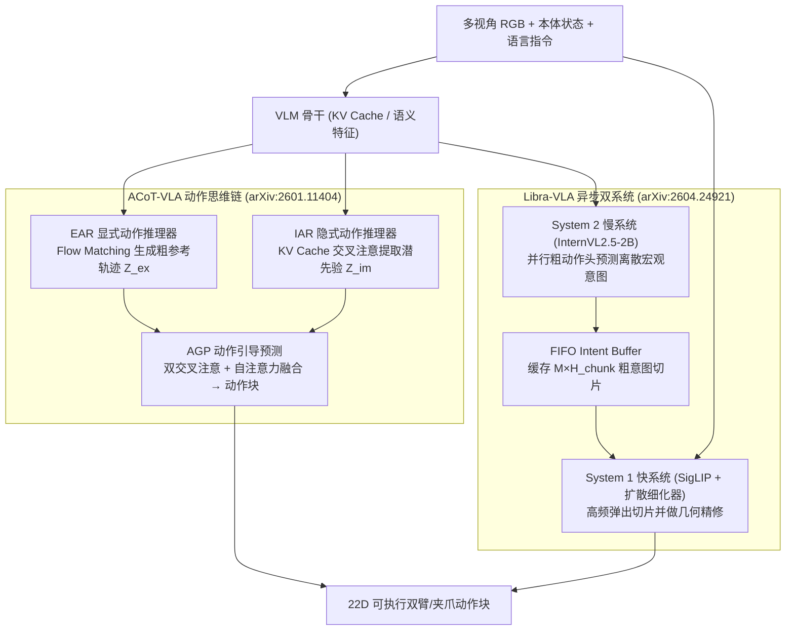
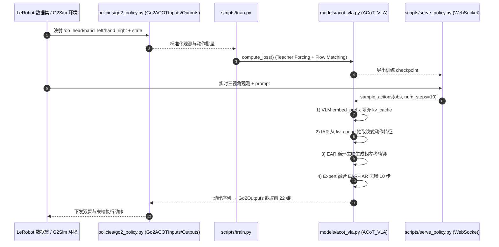

# GO-2（智元执行基座）

**GO-2（Genie Operator-2）** 是智元在 [2026-06 发布地图](../overview/agibot-june-2026-release-technology-map.md) 中的 **语义到动作执行基座**，学术技术支撑由两篇智元论文构成：**动作思维链**（**ACoT-VLA**，[arXiv:2601.11404](https://arxiv.org/abs/2601.11404)，[开源实现](https://github.com/AgibotTech/ACoT-VLA)）与 **异步粗到细双系统**（**Libra-VLA**，[arXiv:2604.24921](https://arxiv.org/abs/2604.24921)，项目页：<https://libra-vla.github.io/>）。核心定位是跨越 **语义–运动鸿沟**：理解指令后须把规划落实为可执行、可高频修正的底层动作。

## 一句话定义

**动作思维链 + 异步双系统 VLA**——把推理放进动作空间生成结构化序列，并由快慢系统分工完成规划与高频视觉对齐执行。

## 英文缩写速查

| 缩写 | 英文全称 | 简要说明 |
|------|----------|----------|
| VLA | Vision-Language-Action | 视觉-语言-动作多模态策略 |
| Sim2Real | Simulation to Real | 仿真策略迁移真机 |
| CoT | Chain of Thought | 思维链，逐步推理再作答 |

## 为什么重要

- **接口问题：** 真机失败常来自视觉偏差、轨迹漂移、接触不稳——GO-2 把 **可执行性** 写进模型设计。
- **动作思维链：** 在动作空间生成结构化动作序列，使规划更接近可执行形式。
- **异步双系统：** 低频慢系统产出高层动作意图；高频快系统据视觉观测持续对齐、修正与执行。
- **评测：** ACoT-VLA 报告 LIBERO **98.5%**、LIBERO-Plus SFT **88.0%**、AgiBot G1 真机 **66.7%**；Libra-VLA 报告 LIBERO **97.2%**；发布材料另称在 Genie Sim Sim2Real 评测中仅用仿真数据训练后真机平均成功率 **82.9%**（对照 $\pi_{0.5}$ **77.5%**，商业整机发布口径，以官方材料为准）。

## 核心原理

GO-2 的学术技术由「动作空间思维链（ACoT-VLA）」与「异步粗到细双系统（Libra-VLA）」两条互补设计组成：

- **ACoT-VLA（动作思维链）：** 通过 **EAR** 在动作空间自条件生成参考轨迹，结合 **IAR** 从 VLM 各层 KV Cache 下采样抽取潜先验，再经 **AGP** 融合引导连续动作块生成（训练期用参考轨迹 Teacher Forcing 稳定收敛）。
- **Libra-VLA（异步双系统）：** 把动作拆进混合空间（离散粗桶对齐 VLM 语义推理 + 连续扩散处理微调），由 **Intent Buffer** 缓冲 System 2 多步宏观意图，让 System 1 在无 VLM 阻塞下高频执行。

## 源码运行时序图

开源实现集中在 `AgibotTech/ACoT-VLA`（基于 OpenPI/JAX）；Libra-VLA 项目页仍标 `Code (coming soon)`。ACoT-VLA 训练入口 `bash scripts/train.sh <CONFIG> <EXP>`（`scripts/train.py`），推理服务入口 `bash scripts/server.sh <GPU> <PORT>`（`scripts/serve_policy.py --env G2SIM`）：

图依据：`AgibotTech/ACoT-VLA@cb9d195`，读过 `README.md`、`scripts/train.sh`、`scripts/train.py`、`scripts/server.sh`、`scripts/serve_policy.py`、`src/openpi/policies/go2_policy.py` 与 `src/openpi/models/acot_vla.py`；未运行 GPU 训练或真机服务。

## 工程实践

- **开源与许可边界：** `AgibotTech/ACoT-VLA` 已开源 EAR/IAR 训练、推理、LIBERO/LIBERO-Plus/VLABench 及 ICRA 2026 Challenge（`acot_icra_simulation_challenge_reasoning_to_action`）配置，但 `README.md` 仍将 **预训练模型权重（checkpoints）列为 TODO**；`Libra-VLA` 代码尚未开源。
- **环境与数据规范：** 使用 `uv` 管理依赖（`GIT_LFS_SKIP_SMUDGE=1 uv sync`）；训练数据需转为 **LeRobot 格式** 并先运行 `scripts/compute_norm_stats.py`；`Go2Inputs`/`Go2ACOTInputs` 固定读取 `top_head`、`hand_left`、`hand_right` 三路图像并由 `Go2Outputs` 截取前 **22 维** 动作。
- **异步与推理细节：** 推理服务通过 `WebSocketPolicyServer` 暴露（默认端口 8000，支持 `--env G2SIM`）；参考论文实验设置时注意 `Frozen`（冻结 LLM 骨干）与全参微调的数据量差异。

## 局限与风险

- **论文与商业整机口径分离：** 智元商业发布的 GO-2 模型全量预训练权重与商业部署栈未开源；公开 `ACoT-VLA` 仓库侧重学术基线与挑战赛复现，不能等同于开箱即用的商业全栈权重。
- **异步队列无动态重规划（Libra-VLA）：** Libra-VLA 论文指出其 Intent Buffer 顺序消费全部粗意图，缺乏实时置信度检测与重生成门控，异步倍率过高时成功率出现轻度衰减。
- **依赖缺失：** 截至 2026-11-21，`ACoT-VLA` 尚未发布预训练权重，直接复现需自备基座（OpenPI）与下游任务数据进行微调。

## 与 GO-1 / 其他 VLA

- 论文与生态中另有 **GO-1** 等前代/并行产品线（如 [GreenVLA](../../sources/papers/greenvla_arxiv_2602_00919.md) 对照表）；本页仅覆盖 **GO-2** 在 2026-06 发布语境下的定位。

## 关联页面

- [语义执行分类 hub](../overview/agibot-release-category-04-execution-vla.md)
- [VLA](../methods/vla.md)
- [Genie Sim 3.0](./genie-sim-3.md)
- [agibot-go-3-preview](agibot-go-3-preview.md) — AGIBOT GO-3 Preview（新闻稿：WRAM + Genie Evolver / Master；三榜第一的核对结果与开放状态）

- [AI 模型与智能体基准评测](../methods/ai-benchmark-evaluation.md)：对照评测任务、协议与指标。

## 参考来源

- [ACoT-VLA 论文与官方代码归档（arXiv:2601.11404）](../../sources/papers/acot_vla_arxiv_2601_11404.md)
- [Libra-VLA 论文与项目页归档（arXiv:2604.24921）](../../sources/papers/libra_vla_arxiv_2604_24921.md)
- [wechat_embodied_ai_lab_agibot_june_2026_release.md](../../sources/blogs/wechat_embodied_ai_lab_agibot_june_2026_release.md)

## 推荐继续阅读

- [ACoT-VLA 官方代码仓](https://github.com/AgibotTech/ACoT-VLA)
- [ACoT-VLA 论文（arXiv:2601.11404）](https://arxiv.org/abs/2601.11404)
- [Libra-VLA 论文（arXiv:2604.24921）](https://arxiv.org/abs/2604.24921)
- [LIBRA-VLA 项目页](https://libra-vla.github.io/)
