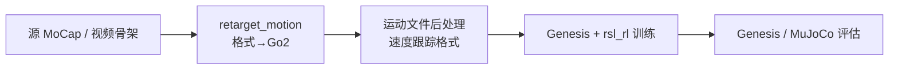
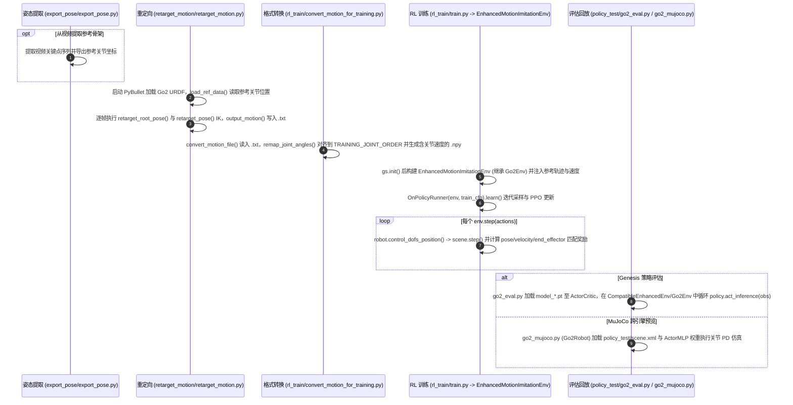

# Go2 Motion Imitation

**Go2 Motion Imitation**（<https://github.com/TSUITUENYUE/motion-imitation>）是针对 **Unitree Go2** 的 **运动模仿** 开源项目（个人/课程向维护，非 Unitree 官方仓）：在 **[Genesis](./genesis-world-10.md)** 仿真器中，把动物/论文 MoCap 经 **`retarget_motion`** 转为 Go2 格式，再以 **关节速度匹配** 奖励训练 RL 策略，支持周期性步态的高质量跟踪。

## 一句话定义

**Go2 Motion Imitation**（`TSUITUENYUE/motion-imitation`）是面向 Unitree Go2 四足机器人的开源模仿学习管线，打通了 MoCap 动作重定向到 Genesis 仿真器与基于关节速度匹配的强化学习策略训练。

## 英文缩写速查

| 缩写 | 英文全称 | 简要说明 |
|------|----------|----------|
| MoCap | Motion Capture | 源运动数据 |
| RL | Reinforcement Learning | rsl_rl PPO 训练 |
| PD | Proportional–Derivative | 底层关节控制 |
| Retargeting | Motion Retargeting | PyBullet/文本格式→Go2 状态 |

## 为什么重要

- **Go2 专用重定向脚本**：`retarget_motion/retarget_motion.py` 明确承担「源格式 → Go2 机器人状态」映射，是四足机型定制管线的可复现样本。
- **Genesis 生态补充**：与 Isaac Gym + legged_gym 主流不同，展示新仿真器上的模仿学习闭环。

## 流程总览（管线阶段）



重定向命令：

```bash
python retarget_motion/retarget_motion.py --input_file=source_motion.txt --output_file=retargeted_motion.txt
```

## 源码运行时序图



核心复现路径：先运行 `retarget_motion/retarget_motion.py` 与 `rl_train/convert_motion_for_training.py` 生成训练 `.npy`，再在 `rl_train/` 下运行 `python train.py --file data/canter.npy --envs 256 --iters 1000` 训练策略，最后通过 `policy_test/go2_eval.py`（Genesis）或 `policy_test/go2_mujoco.py`（MuJoCo）加载 checkpoint 回放。

核对源码（`TSUITUENYUE/motion-imitation` `master` 分支）：`README.md`、`export_pose/export_pose.py`、`retarget_motion/retarget_motion.py`、`rl_train/convert_motion_for_training.py`、`rl_train/train.py`、`rl_train/go2_env.py`、`policy_test/go2_eval.py`、`policy_test/go2_mujoco.py`。

## 工程实践

- **Genesis 并行仿真**：利用 Genesis GPU 并行环境加速四足步态模仿的 PPO 采样与策略收敛。
- **关节速度匹配**：在奖励函数中显式引入参考关节角速度追踪，提升动态步态的相位同步性。

## 局限

- **面向特定机型**：资产与重定向配置针对 Unitree Go2 定制，迁移到其他四足或人形平台需重新标定骨骼映射与物理参数。
- **Sim2Real 验证有限**：仓库聚焦仿真内模仿训练，真机部署需额外补充域随机化与状态估计器对齐。

## 关联页面

- [Imitation Learning (IL, 模仿学习)](../methods/imitation-learning.md) — MoCap 重定向与关节速度匹配构成示范到策略的管线，需同时检查相位和动态可执行性。

- [Motion Retargeting](../concepts/motion-retargeting.md)
- [legged_gym](./legged-gym.md)
- [Genesis World 1.0](./genesis-world-10.md)
- [Locomotion](../tasks/locomotion.md)

## 参考来源

- [Go2 Motion Imitation 仓库归档](../../sources/repos/go2_motion_imitation.md)

## 推荐继续阅读

- GitHub：<https://github.com/TSUITUENYUE/motion-imitation>
