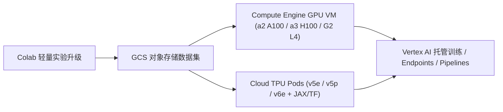

# Google Cloud GPU

**Google Cloud GPU** 涵盖 **Compute Engine GPU 虚拟机**与 **Vertex AI** 托管 ML 服务，是除 AWS 外最常用的 **超大规模云 GPU** 路径，并独家大规模出租 **Cloud TPU**。

## 一句话定义

数据在 **GCS**、团队用 **JAX/Vertex**，或需要 **TPU** 训 Transformer 时选 GCP；纯 PyTorch 单卡实验往往 [Colab](./google-colab.md) 或 neocloud 更省事。

## 英文缩写速查

| 缩写 | 英文全称 | 简要说明 |
|------|----------|----------|
| GCP | Google Cloud Platform | 谷歌云平台 |
| GPU | Graphics Processing Unit | a2/a3/G2 等 VM 加速器 |
| TPU | Tensor Processing Unit | Google 专用 AI 芯片 |
| Vertex AI | Google Vertex AI | 托管训练/推理/流水线 |
| GCS | Google Cloud Storage | 对象存储 |
| CUD | Committed Use Discount | 长期使用折扣 |

## 为什么重要

- **GPU + TPU 双轨**：大模型训练可在 TPU pod 与 NVIDIA GPU 间选型。
- **Vertex 推理价**：L4 等推理档在公开比价中常低于 AWS G5。
- **与 Colab 同生态**：从 notebook 实验升级到 VM/Vertex 路径清晰。

## 核心结构 / 机制

| 路径 | 说明 |
|------|------|
| **GPU VM** | a2（A100）、a3（H100）、G2（L4） |
| **TPU** | v5e/v5p/v6e pods |
| **Vertex AI** | Custom Training、Endpoints、Pipelines |
| **计费** | 按秒；Preemptible VM 大幅降价 |

## 机制与架构图

## 常见误区或局限

- **H100 按需价仍高**：8×H100 a3 公开报价比 AWS p5 更贵的情形存在（需实时比价）。
- **TPU ≠ 通用**：自定义 CUDA 内核多的机器人仿真栈仍偏 GPU。
- **运维复杂度**：裸 VM 与 Vertex 托管能力差距大。

## 与其他页面的关系

- [国外 GPU 云平台选型](../comparisons/international-gpu-cloud-platforms.md)
- [Google Colab](./google-colab.md) — 轻量入口
- [AWS EC2 GPU](./aws-ec2-gpu.md) — 超大规模云对照
- [AI Model Inference and Serving · AI 模型推理与服务部署](../methods/ai-model-serving-inference.md)：Vertex AI 与 L4/A100/H100 云端虚拟机常用于大模型及具身策略的托管训练与推理部署。
- [Reinforcement Learning (RL, 强化学习)](../methods/reinforcement-learning.md)：大规模并行强化学习与机器人控制策略训练常借助云端 GPU 与 TPU 算力加速。

## 推荐继续阅读

- [Cloud GPU 文档](https://cloud.google.com/compute/docs/gpus)
- [Vertex AI](https://cloud.google.com/vertex-ai)

## 参考来源

- [Google Cloud GPU 归档](../../sources/sites/google-cloud-gpu.md)
