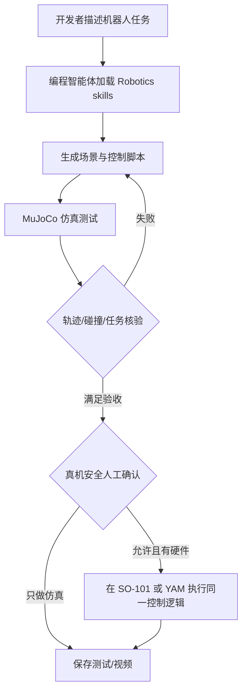
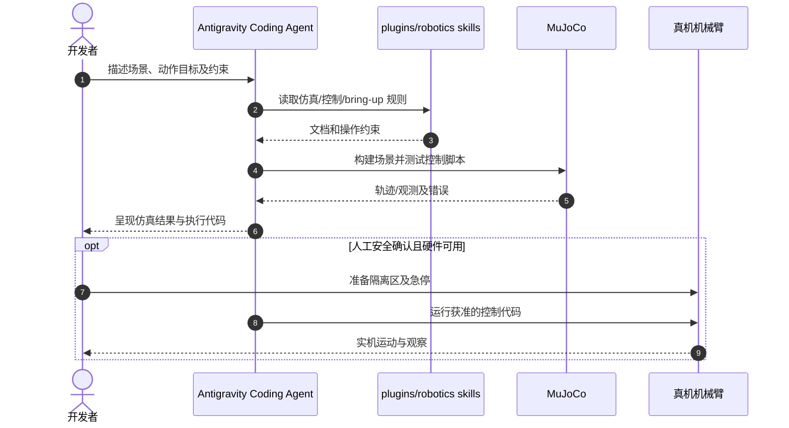

# Google DeepMind Robotics Antigravity 插件：仿真优先的智能体机器人开发工作流（robotics-antigravity-plugin）

## 一句话定义

为 Google Antigravity 等编程智能体提供机器人工作流技能：生成控制代码、在 MuJoCo 验证，随后经人工安全确认在真实机械臂上运行。

## 英文缩写速查

| 缩写 | 英文全称 | 简要说明 |
|---|---|---|
| LLM | Large Language Model | 代理的自然语言/代码生成模型 |
| API | Application Programming Interface | MuJoCo/机器人/感知调用接口 |
| MCP | Model Context Protocol | 与外部工具连接的协议（不是运行必需项） |

## 为什么重要

机器人代码生成的关键不是生成一段看起来合理的控制脚本，而是从场景与安全边界开始，先在可重复仿真中验证再做受控真机实验。

## 核心原理

插件是 `plugins/robotics/` 下的 skills/rules/sidecars 与说明材料，而不是机器人模型权重、独立仿真引擎或自动安全认证。官方 README 提供 SO-101/YAM 机械臂、传送带分拣及 MuJoCo 场景。技能可以只用于仿真，不需要硬件。

## 流程总览

## 源码运行时序图

以下为 README 已公开的**产品使用／工程运行路径**，不代表本次逐函数源码追踪或实际真机部署。

## 工程实践

`agy plugin install https://github.com/google-deepmind/robotics-antigravity-plugin`，或 `npx skills add google-deepmind/robotics-antigravity-plugin`。GitHub 安装方式与 marketplace 的 MuJoCo 7 项技能可能不同：按 README 补 `npx skills add google-deepmind/mujoco`。涉及 Gemini 感知服务的技能需自备 API key。

## 局限与风险

README 明确警示真机碰撞、人身伤害风险：确保操作员现场、环境清空、电源能即时切断。该 repo 的 Apache-2.0 不自动覆盖第三方机器人模型、控制代码或云服务条款。未声称自动生成的脚本已通过安全验证。

## 关联页面

- [lyapunov-vorynel](./lyapunov-vorynel.md)
- [robokit-openrobokit](./robokit-openrobokit.md)
- [paper-bicat](./paper-bicat.md)
- [manipulation](../tasks/manipulation.md)
- [model-predictive-control](../methods/model-predictive-control.md)
- [imitation-learning](../methods/imitation-learning.md)

## 参考来源

- [官方源码及运行流程归档](../../sources/repos/robotics-antigravity-plugin.md)

## 推荐继续阅读

- [官方网站](https://deepmind.google/models/gemini-robotics/)
- [GitHub 官方仓库](https://github.com/google-deepmind/robotics-antigravity-plugin)
