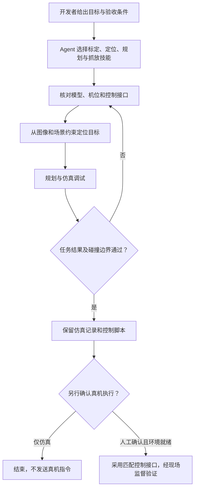
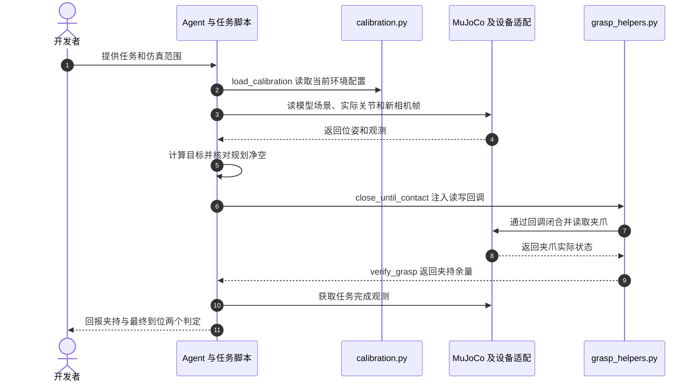

# Google DeepMind Robotics Antigravity 插件：仿真优先的智能体机器人开发工作流（Robotics Antigravity Plugin: Simulation-First Agentic Robotics Workflows）

## 一句话定义

为 Google Antigravity 等编程智能体提供机器人工作流技能：生成控制代码、在 MuJoCo 验证，随后经人工安全确认在真实机械臂上运行。

## 英文缩写速查

| 缩写 | 英文全称 | 简要说明 |
|---|---|---|
| LLM | Large Language Model | 代理的自然语言/代码生成模型 |
| API | Application Programming Interface | MuJoCo/机器人/感知调用接口 |
| FK | Forward Kinematics | 根据实测关节状态求末端或相机位姿 |
| IBVS | Image-Based Visual Servoing | 用图像误差闭环修正末端动作 |
| RGB-D | Red, Green, Blue and Depth | 彩色图像加深度，可用于几何校核 |

## 为什么重要

机器人代码生成的关键不是生成一段看起来合理的控制脚本，而是从场景与安全边界开始，先在可重复仿真中验证再做受控真机实验。

## 核心原理

| 项目 | 内容 |
| --- | --- |
| 机构 | 谷歌 DeepMind（Google DeepMind） |
| 核对版本 | 插件 0.1.13 |
| 交付边界 | 技能文档、规则、仿真查看侧车和可组合的 Python 辅助函数 |

入口由 `plugins.json` 发现，编码智能体针对任务读取技能并编写控制脚本。可先只做 MuJoCo 仿真：工位标定给出工作平面及相机参数，RGB 定位将图像观测变到机器人基座坐标，视觉伺服可在新帧上修正目标。0.1.13 用通用工位标定和抓放替代独立的 SO-101 标定技能；两条工作流的配置和执行接口仍需分别核对。

## 流程总览

## 源码运行时序图

图示为 0.1.13 已公开的仿真优先组合，驱动回调由任务脚本绑定，而非插件启用即自动触发控制。

夹持余量或力/卡滞阈值并不是物体最终到达目标区的证据，目标应另用新帧或可信场景状态验收。

## 工程实践

官方安装入口有 Antigravity 插件及单项 skills；Marketplace 版已捆绑七项 MuJoCo API 技能，GitHub 安装则按仓库说明从 [MuJoCo 官方技能目录](https://github.com/google-deepmind/mujoco/tree/main/doc/skills)补齐。读源码时先钉版本，再确认匹配的引擎、模型和设备适配；部分可选 Gemini 感知技能才需要自备 API 凭据。仿真可从模型读准确几何；不要跨仿真、实物直接复用 `.robot_calibration.json`。

## 局限与风险

官方将饼干分拣作为演示，而非跨机械臂的对照实验。边缘强度指纹受光照影响、可能漏掉小移动；平面单应只能在标定平面上解释几何，离面目标需要其他观测。插件级安全规则不能替代硬件急停、隔离、设备限位以及独立验收。在人员到场、工作区清空且能切断电源前，不应把生成脚本接入真机。本次仅读文档与相关源码。

## 与其他工作对比

| 项目 | 侧重 | 如何选 |
| --- | --- | --- |
| Robotics Antigravity Plugin | Agent 的技能协议及仿真、控制辅助代码 | 已在 Antigravity 编写任务脚本，想补齐可审阅的操作流程 |
| [Lyapunov](./lyapunov-vorynel.md) | 场景、Viewer、仿真、录制和配对评测的桌面宿主 | 希望在同一个工作台验证场景和方案；其 0.2.7 公开集成固定的是插件 0.1.11 |
| [RoboKit](./robokit-openrobokit.md) | ROS 2 原生硬件连接、策略服务与控制接口 | 已有 ROS 2 真机数据流，需要持续部署接口而非 IDE 技能 |

## 关联页面

- [lyapunov-vorynel](./lyapunov-vorynel.md)
- [robokit-openrobokit](./robokit-openrobokit.md)
- [paper-bicat](./paper-bicat.md)
- [manipulation](../tasks/manipulation.md)
- [model-predictive-control](../methods/model-predictive-control.md)
- [imitation-learning](../methods/imitation-learning.md)

## 参考来源

- [官方源码及运行流程归档](../../sources/repos/robotics-antigravity-plugin.md)

## 推荐继续阅读

- [官方网站](https://deepmind.google/models/gemini-robotics/)
- [GitHub 官方仓库](https://github.com/google-deepmind/robotics-antigravity-plugin)
