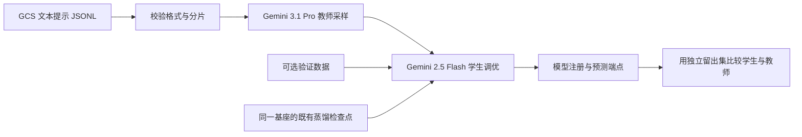
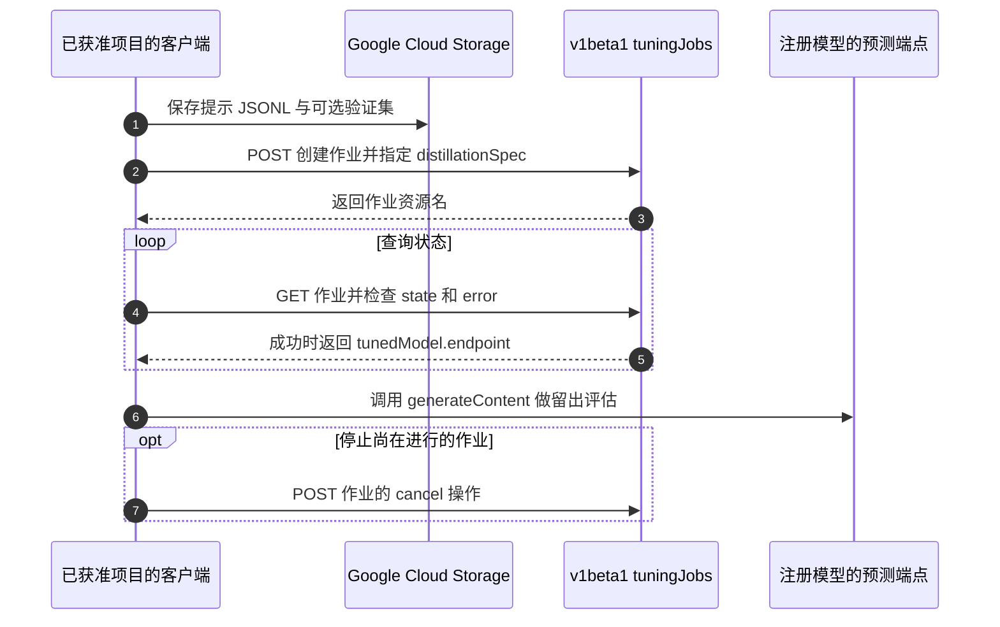

# Gemini 蒸馏服务｜Gemini Distillation Service on Google Cloud

## 一句话定义

Google Cloud 在 Gemini Enterprise Agent Platform 上提供的托管文本蒸馏服务：从提示数据集出发，由较强的 Gemini 教师在服务内产生监督信号，再调优较小的学生模型。官方将当前文档所述版本标为 **Early Access，仅供实验和开发，明确不得将该阶段蒸馏出的模型用于生产**。

## 英文缩写速查

| 缩写 | 英文全称 | 简要说明 |
|---|---|---|
| SFT | Supervised Fine-Tuning | 用带目标的样本进行监督调优 |
| GCS | Google Cloud Storage | 存放输入与可选验证数据 |
| JSONL | JSON Lines | 一行一个独立 JSON 样本 |
| IAM | Identity and Access Management | 控制项目和 API 的访问角色 |
| CMEK | Customer-Managed Encryption Keys | 客户自管加密密钥，第一方蒸馏作业不支持 |

## 为什么重要

有大量真实提示、没有合适标准答案时，可以让教师生成训练信号，评估小模型能否承担一部分文本推理负载。工程上先在相同留出集确认教师优于未调优学生，再看蒸馏后质量、延时与费用的取舍。不能把这个服务当作可直接读取教师内部推理的接口，也不能拿它做图像、函数调用或机器人动作策略蒸馏。

## 核心机制

1. 把文本提示以 JSONL 放在 GCS；可选系统指令和验证集。历史对话可包含 `model` 回复，但最后一轮必须为 `user`；不需要人工填入最终标准答案。文档提示多轮样本的质量验证有限。
2. 服务准备数据后，让教师对同一提示采样候选输出。Google 描述其监督包含教师回答和内部推理轨迹，**不是**承诺用户可导出这些内部轨迹、教师概率或权重，也未公开服务端训练损失细节。
3. 教师采样和学生调优在一次调用中串联。新作业从学生基座开始；持续调优只接收同一学生基座已蒸馏的检查点，普通 SFT 检查点不适用。指南说明后续调优不能直接复用先前的大批量教师采样。
4. 训练完成后，注册学生模型并给出预测端点。官方流程图还列出 10 个用于评估的中间检查点；不把这个图示写成适用于所有任务的服务保证。

## REST 调用时序

这是按官方客户端示例整理的公开接口时序，不是服务端源码图。未找到可独立运行的服务端源码；上线限制不因可以创建端点而解除。

## 工程实践

| 检查项 | 官方指南所述范围 |
|---|---|
| 获得访问 | 项目进入许可名单、启用 Agent Platform API、具备 `roles/aiplatform.admin`；仅 `us-central1`。首次访问期 30 天，新获准项目默认并发 4 |
| 模型 | 教师支持表写 Gemini 3.1 Pro，创建示例使用 `gemini-3.1-pro-preview`；学生为 `gemini-2.5-flash`。不要由通用 REST 枚举推断别的组合也获准 |
| JSONL | 建议至少 1,000 条，并覆盖不同长度和边缘情形；训练集至多 50,000 条、源文件至多 1 GB |
| 长度与模态 | 输入上限每条 8,000 token；超过该阈值的条目占比 **大于 10%** 时终止作业。教师输出上限 24,000 token，超出截断。仅文本，不含图像、视频和函数调用 |
| 教师采样 | `candidateCount` 1–5，默认 4。候选数是同一提示的采样数量，不是训练集的独立提示数 |
| 学生超参 | `epochCount` 1–100，默认 4；`learningRateMultiplier` 0.25–4.0，默认 1。REST JSON 中 `epochCount` 的类型为 int64 字符串 |
| 加密与监控 | Google 第一方蒸馏作业不支持 CMEK。早期控制台不显示教师采样的详细进度，中间检查点表的轮次可能误显示为 0；优先核对 API 状态和错误 |

**请求字段的文档差异。** 服务指南的创建示例写 `base_teacher_model`、`generation_config`；v1beta1 通用 JSON 参考用 `baseTeacherModel`，且其 `DistillationHyperParameters` 没列教师生成配置。同样，产品支持列表与示例给的教师标识不完全相同。提交前应以获准项目的产品说明确认实际字段与 ID；本页不提供未实测的混合请求，也不把通用 schema 缺项当作服务已移除教师采样设置。

## 实验与评测

- **基线：** 依 [AI 模型与智能体基准评测](../methods/ai-benchmark-evaluation.md) 固定提示、系统指令、生成预算、评分规则，比较原始 Flash、蒸馏 Flash 和教师。训练及调参过程中都不使用最终留出集。
- **分开测能力与效率：** 记录任务通过率、格式和幻觉错误，按提示长度、难度和业务切片分别统计；在同条件下再测延时分位与每个通过任务的成本。发布指南不提供该用户任务的实测提升。
- **本地核验：** 使用合成单轮与多轮文本检查 JSONL 组织和末轮角色，不登录云、不上传、不试跑云服务。

## 与相关方法对比

[监督式微调](../concepts/supervised-fine-tuning.md) 可使用人工审定的目标输出；这里由平台生成教师监督，覆盖上限受教师错误与数据分布影响。[Teacher–Student DAgger](../methods/teacher-student-dagger-training.md) 则关注学生执行时访问的状态和专家标注，不能把离线文本提示蒸馏当作闭环控制的替代。

## 局限与结论

服务适合在有许可的沙盒中验证文本推理的质量与延时权衡。教师错误可能被学生继承，超长或多轮样本需要抽查。没有公开的服务端源码、训练实现或该任务上的实测结果；不要把可建端点、通用 API 字段或公开文档等同于普遍可用、可上线或可自行部署。

## 关联页面

- [监督式微调](../concepts/supervised-fine-tuning.md)
- [AI 模型与智能体基准评测](../methods/ai-benchmark-evaluation.md)
- [Teacher–Student DAgger](../methods/teacher-student-dagger-training.md)

## 参考来源

- [Google Cloud 服务指南、发布记录与 REST 参考归档](../../sources/sites/google-gemini-distillation-service.md)

## 推荐继续阅读

- [tuningJobs v1beta1：DistillationSpec](https://docs.cloud.google.com/gemini-enterprise-agent-platform/reference/rest/v1beta1/projects.locations.tuningJobs#DistillationSpec)
