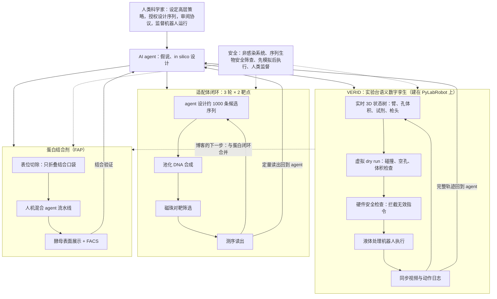

# Google Research：Grounding AI agents in biological reality（自主湿实验的构件）

## 一句话定义

**Google Research 的一篇综述性博客：把「物理接地的实验台孪生（VERID）」「适配体闭环沙盒」「表位切除的 de novo 蛋白结合剂设计」三项独立研究，讲成通向 AI agent 自主湿实验的三块构件，目标是人类指导下的闭环分子发现。**

## 英文缩写速查

| 缩写 | 英文全称 | 简要说明 |
|------|----------|----------|
| VERID | VERified Infrastructure for Discovery Laboratories | 实验台工作站的语义数字孪生，位于 agent 与液体处理机器人之间 |
| PLR | PyLabRobot | 开源、硬件无关的液体处理机器人 Python 控制框架，VERID 在其上构建 |
| G4 | G-quadruplex | 富 G 的核酸四链体结构，适配体设计中易成「粘性」混杂结合物 |
| FAP | Fibroblast Activation Protein alpha | 实体瘤中过表达的大型受体，表位切除案例的靶点 |
| FACS | Fluorescence-Activated Cell Sorting | 荧光激活细胞分选，配合酵母表面展示筛选蛋白结合剂 |
| HITL / HOOTL | Human-in-the-Loop / Human-out-of-the-Loop | 论文用语：人机混合 vs 全自主 agent（博客未用这两个缩写） |
| NGS | Next-Generation Sequencing | 适配体池筛选的定量读出手段 |

## 为什么重要

- 对机器人读者：这是「具身智能走进实验室」的一个具体样本。关键约束与机器人学相同：**模型写出的指令语法正确，不等于物理上可执行**；博客的解法是在派发前对一个有状态的数字孪生做门控（与库里的 [Physical Agentic AI](paper-physical-agentic-ai.md)「验证门控」是同一类思路）。
- 对 AI-for-science 读者：它把瓶颈从「假说生成」挪到「真实读出的速度与可信度」，并给出两个口径不同的闭环原型（廉价快速的适配体、昂贵慢速的蛋白）。
- 对库的结构：本页是博客总览节点，三篇论文各有独立节点；本页的价值在于**把博客的叙事和论文的原话对齐**，让读者知道哪些数字是博客自己的转述。

## 核心原理（博客的叙事结构）

博客的论证是三段式（以下均为作者表述）：

1. **接地**：前沿模型对三维几何与物理状态推理不可靠 → 用 VERID 把物理状态变成 agent 可查询、可模拟、可审计的对象。
2. **学会学习**：agent 需要真实读出才能修正假说 → 用 7–10 天一轮的适配体闭环验证「读出能否让 agent 变好」。
3. **放大到蛋白**：蛋白闭环更慢更贵 → 用表位切除压低计算成本，用酵母展示 + FACS 放大湿实验筛选。

**关于「构件」一词**：博客并没有列出正式的构件清单。结语把三条线（接地到实验台机器人、快速闭环适配体循环、个位数纳摩尔蛋白结合剂）合称为「人类指导自主发现的构件」。下面的「方法栈」按博客原意整理成可对照的表。

## 方法栈（博客描述的三块构件）

| 构件 | 博客给出的内容 | 博客给出的数字（作者表述） | 所在论文（独立节点另有全文核对） |
|------|----------------|---------------------------|----------------------------------|
| 实验台孪生 VERID | 实时 3D 状态跟踪、虚拟 dry run、硬件安全检查、同步视频与日志；建在 PyLabRobot 之上 | dry run「几秒」；闭环自博弈中重建盲配染料混合物，「准确度提升超过五倍」 | *Semantic Representation for Agentic Self-Play in Automated Laboratories*（PDF 文件头 2026-10-22） |
| 适配体闭环 | 设计 → 合成池 → 磁珠对靶筛选 → 测序，3 轮 × 2 靶点，7–10 天一轮 | myoglobin 33.5%、α-thrombin 42.1% 命中率；α-thrombin 特异性 98.5%；myoglobin 特异性 75.0% → 19.1% → 72.4%，命中率 10.2% → 3.7% → 33.5%（九倍） | *Aptamers as a sandbox for lab-in-the-loop agentic molecular discovery*（文件头 2026-10-12） |
| 表位切除 | 只折叠结合口袋，人机混合流水线，酵母展示 + FACS | 8.6x、「超过八倍」；in silico 命中率「近乎翻倍」；FAP 上「个位数纳摩尔」 | *Agent-guided epitope excision enables economical de novo binder design*（文件头 2026-10-23） |
| 安全层 | 非感染测试系统；每条设计序列过生物安全筛查；dry run 后才触机器人；人类授权与监督 | 无数字 | 三篇论文各有安全 / 局限讨论，本页未逐篇核对 |

## 流程总览

下图只画博客写到的东西。虚线表示博客自己说「下一步要合并」，目前不是一个运行中的整体。

## 源码运行时序图

**不适用。** 博客只是发布文，没有附带源码；三篇配套 PDF 的全文文本中也未见代码仓库或数据可得性声明（见下方开放核查）。唯一公开的组成部分是 PyLabRobot（MIT，`git ls-remote` 可达），但它是 VERID 的底座而非本项目发布物，其运行时序不属于本节点。VERID、适配体流水线、表位切除流水线均无从静态阅读真实入口，因此不画推测性时序图。

## 实验与评测（博客转述的数字，与论文对照）

数字来自博客正文与图注，括号内为我对论文摘要 / 结果段的针对性核对。博客自己不给表号；论文侧的表 / 图号请见各自独立节点。

| 主张 | 博客数字 | 论文侧核对 |
|------|----------|------------|
| 搜索空间 | 100 氨基酸蛋白至少 20^100 种序列 | VERID 引言同样写 20^100 |
| 适配体周期 | 7–10 天 | 适配体论文摘要「1–2 周验证周期」、图 1「约 10 天」，区间略异 |
| α-thrombin 命中率 | 0% → 26.0% → 42.1%，特异性 98.5% | 论文：0/167、54/208、131/311，特异性 0.0% → 76.7% → 98.5%，一致 |
| myoglobin 命中率 | 10.2% → 3.7% → 33.5%，特异性 75.0% → 19.1% → 72.4% | 论文摘要与结果段一致（9.1 倍） |
| 「48% 序列折叠被破坏」「63% 设计是 G4」 | 博客写 | 在论文可抽取文本中检索不到这两个数；论文写 G4 占第 1–2 轮 58.2%–60.7%。标作者表述、**未核到** |
| VERID 五倍 | 「准确度提升超过五倍」 | 论文度量为 millinats 平均损失，58 mnats 较 MC-2A「超五倍改进」，博客把「损失下降」说成「准确度提升」 |
| 表位切除加速 | 8.6x、「每个循环加速超过八倍」 | 论文：单次 AF3 折叠，令牌桶模型预期 59.3 s → 6.9 s（约 88% 降幅，仅为一个表位的预期）；不等同于整个设计循环 |
| 人机混合 | 命中率「近乎翻倍」 | 论文：5.06% → 9.33%（+84%），约 58% GPU 预算，23.2 vs 12.6 hits/GPU-h；博客省略了全自主 HOOTL 臂 |
| FAP 结合剂 | 「个位数纳摩尔」「仅几次实验运行」 | 论文：4 个富集克隆表观 KD = 3.0–9.1 nM（酵母展示克隆结合），三轮 FACS；可溶表达表征为未来工作 |

读法：博客的头条数字大多能在论文里找到对应，但**度量的含义被压缩了**：五倍是损失而非准确度，8.6 倍是单次折叠预期而非循环耗时，个位数纳摩尔是 4 个克隆的酵母展示表观值。博客省略的更重要的限定包括：VERID 案例全部用染料与去离子水（不是生物实验），适配体里纯 de novo 骨架亲和力只有微摩尔级（KD > 1 μM，初步）、达到 24.6–133 nM 的是文献来源 motif 经 agent 改造的候选。

## 工程实践

博客**不是操作手册**，没有给出复现步骤；能直接落地的只有这些：

1. **想复现底座**：PyLabRobot 有公开文档（<https://docs.pylabrobot.org/>，200）与 MIT 许可的 GitHub 仓库；VERID 在它之上做持久孪生，但 VERID 本身没有公开代码，复现要自行实现「状态树 + 派发前仿真门控 + 轨迹落盘」。
2. **想借鉴设计模式**：（a）每个指令块在物理派发前都过一次对孪生副本的模拟；（b）把视频、孪生状态快照、逐行执行日志放在同一时钟下，便于事后因果分析；（c）孪生状态跨指令块持久化，故障后能从断点续跑（博客称这让 agent 免于重新移液）。这些都是论文的做法；博客只概述。
3. **想做闭环实验**：适配体是低门槛的沙盒——序列即功能分子，直接合成成池再测序读出。先决条件是有池化寡核苷酸合成与 NGS 渠道；博客没给供应商或成本，论文摘要给出每候选 1–3 美元的量级（论文口径，未核成本构成）。
4. **想做蛋白侧**：表位切除可以用在算力受限的 binder 设计；论文自述裁剪太小会失败（部分靶点在约 85 残基以下失效）、无 MSA 折叠会让排序在个别靶点变差，详情见论文节点。
5. **开放核查（2026-11-07）**：博客无 GitHub / 数据链接；三篇 PDF 均 HTTP 200 可下载，VERID 版权行为 CC BY 4.0，另两篇为 © 2026 Google；代码与数据未见公开入口。引用时请把这三篇当作**预印本级技术报告**，而非已同行评审论文（推测：页面未提及期刊或会议）。

## 局限

**博客自述：**
- 蛋白闭环更复杂，计算与湿实验两侧都有瓶颈；下一步才是把 VERID 与蛋白闭环合并。
- 随着 agent 接管更多设计—测试循环，出现新的安全与可靠性问题：确保 agent 优化真结合而非实验捷径、验证多步湿实验协议、持续监测 agent 推理与执行轨迹。

**我的核对（含推测）：**
- **「栈」是路线图而非系统**：三项研究相互独立评估；博客结语自己说合并是「下一步」。没有任何一个实验同时跑了 VERID + 适配体 / 蛋白闭环。
- **VERID 的验证场景很窄**：只用染料与水、一台 Hamilton 工作站，案例是 3 个（论文），尚未涉及细胞、酶或真实生物试剂的流体差异。
- **数字被压缩**：见上节；尤其「五倍」「8.6x」「个位数纳摩尔」三处，务必回到论文度量。
- **未核到的博客数字**：48%、63%、「dry run 几秒」。
- **版本漂移**：博客 2026-10-16 发布，而 VERID 与表位切除 PDF 的文件头日期为 10-22 与 10-23，晚于博客，说明链接指向的是后续更新版；博客数字对应哪个版本未知（推测：与当前 PDF 口径大体一致，因抽查的数字均能在 PDF 找到）。
- **安全仅是做法声明**：博客没有披露生物安全筛查工具、阈值、红队方式；论文中 VERID 提到了基于功能的序列筛查方向（如 SecureDNA），属规划而非已部署说明（我读到的是该段的展望措辞，未逐字核对其时态）。
- 无独立复现、无外部评审、无代码，所有结果均为作者自报。

## 结论

**博客是一份可靠的路线图，不是一份可验证的系统发布：三块构件各自有论文支撑，但「自主湿实验栈」尚未被联合运行过。**

- 把它读成「三项独立研究 + 一个下一步计划」，不要读成「已有端到端自主湿实验室」。
- 最可迁移的工程思想是 VERID 式的**派发前孪生门控 + 状态持久化 + 同步轨迹**，与库里 [Physical Agentic AI](paper-physical-agentic-ai.md) 的验证门控结论互相印证。
- 适配体实验最有价值的发现不是命中率本身，而是 agent 能从反事实读出（脱靶 / 裸磁珠结合）中**识别并修正「刷指标」的捷径**（G4 粘性结合）。
- 引用数字务必回到论文度量；博客把损失说成准确度、单次折叠说成循环耗时。
- 复现价值目前限于底座 PyLabRobot 与公开 PDF，VERID 与两条生物流水线无公开代码或数据。

## 关联页面

- [沐曦 AI4S 科研实战营](metax-ai4s-science-camp.md) — 官方课程计划中的蛋白质模型编排与 GPU 性能实践，尚不构成已验证的湿实验闭环。

- [AISLE / AI Scientists' Last Exam（科学智能体实验反馈评测）](paper-ai-scientists-last-exam.md) — 对照可复现的实验任务与独立验证器

- [Physical Agentic AI（可验证的物理执行门控）](paper-physical-agentic-ai.md) — 同一类「LLM 提议、物理执行需门控」思路
- [Physical RSI](physical-rsi.md) — 用物理反馈改写 agent harness 的对照线
- [Physical RSI 研究地图](physical-rsi-research-map.md)
- [数据飞轮](../concepts/data-flywheel.md) — 闭环读出回到设计的通用框架
- [Sim2Real](../concepts/sim2real.md) — 仿真门控 / 数字孪生与真实偏差的对照语境
- [机器人安全状态机](../concepts/robot-safety-state-machine.md)、[安全滤波器](../concepts/safety-filter.md) — 执行前拦截不安全指令的机器人侧对应
- [paper-verid-semantic-representation-lab-self-play](./paper-verid-semantic-representation-lab-self-play.md) — VERID：自动化实验室的语义表示与智能体自博弈（Google）
- [paper-agentic-aptamer-sandbox](./paper-agentic-aptamer-sandbox.md) — 适配体作为 lab-in-the-loop 智能体分子发现的沙盒（Google）
- [paper-epitope-excision-binder-design](./paper-epitope-excision-binder-design.md) — 智能体引导的表位切除与经济的 de novo 结合剂设计（Google）
- [pylabrobot](./pylabrobot.md) — PyLabRobot：硬件无关的液体处理机器人开源接口

## 参考来源

- [Google Research 博客归档（核对范围、链接核查、口径对照）](../../sources/blogs/google_research_grounding_ai_agents_wet_labs_2026.md)
- 博客原文：<https://research.google/blog/grounding-ai-agents-in-biological-reality-building-blocks-for-autonomous-wet-labs/>

## 推荐继续阅读

- VERID 论文 PDF：<https://www.gstatic.com/science-ai/verid_semantic_lab.pdf>
- 适配体沙盒论文 PDF：<https://www.gstatic.com/science-ai/agentic_aptamer_sandbox.pdf>
- 表位切除论文 PDF：<https://www.gstatic.com/science-ai/epitope_excision.pdf>
- PyLabRobot 文档：<https://docs.pylabrobot.org/>
- Google DeepMind：Our approach to bioresilience：<https://deepmind.google/blog/our-approach-to-bioresilience/>
