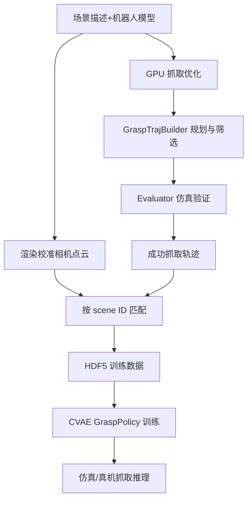
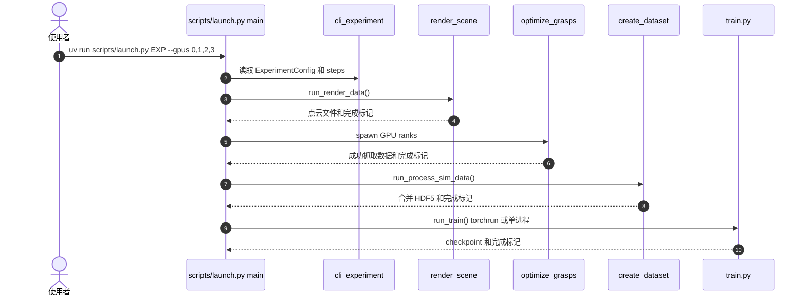

# GraspKit：从抓取合成到策略训练和部署

## 一句话定义

GraspKit 基于 RoboKit 的可微优化与仿真能力，把抓取生成、轨迹规划、仿真筛选、点云监督数据和抓取策略学习连接成端到端流水线。

## 英文缩写速查

| 缩写 | 英文全称 | 简要说明 |
|---|---|---|
| CVAE | Conditional Variational Autoencoder | 点云条件化抓取生成策略 |
| IK | Inverse Kinematics | 将漂浮手抓取转成固定机械臂可执行姿态 |
| GPU | Graphics Processing Unit | 并行抓取优化与模型训练设备 |
| HDF5 | Hierarchical Data Format version 5 | 处理中间点云和动作数据的存储格式 |

## 为什么重要

抓取学习不仅要生成关节姿态，还要筛选可到达、可碰撞检查、在仿真中成功的轨迹，并与观测点云严格配对。GraspKit 明确分离不同阶段，便于单独重跑优化或训练，复用场景资产和机器人配置。

## 核心原理

官方 `docs/guide/pipeline.md` 的默认 `steps` 为 `render_data`、`optimize_grasps`、`process_sim_data`、`train`。对同一场景分别渲染点云与优化抓取，经 scene ID 合并成 HDF5 数据；CVAE 策略预测 pre-grasp、grasp、post-grasp 关节配置，在轨迹构建和物理仿真校验后可部署。

### 流程总览

## 源码运行时序图

依据官方 `scripts/launch.py` 的具体调度入口：

源码存在 `restart-from` 与 `append` 机制，可从指定阶段继续；标记文件能让已有结果跳过重复计算。实际 CLI 实验名和显存依赖以仓库 `configs/experiment` 为准。

## 工程实践

- 官方示例：`uv run scripts/launch.py xhand_right_dex1b_v0_5_mini_tabletop --gpus 0,1,2,3`。
- 全流水线依赖 CUDA GPU、ManiSkill 与 spconv（官方注明部分功能限 Python 3.10–3.12）；避免把 `pip install graspkit` 理解为已具备所有训练可选依赖。
- 优先核对数据集中 scene ID 配对率、通过筛选的 grasp 数量、仿真评估结果、轨迹 IK 和真机相机标定。
- 真机输出须单独验证机器人驱动、限位、夹爪力与紧急停机；此页未进行实机复现。

## 局限与风险

官方提供仿真和真机部署文档及开源实现，但宣称的端到端能力不是所有机器人平台零配置兼容。不同相机、机械臂与灵巧手需单独标定和适配；论文性能指标也不能从演示视频推断。

## 关联页面

- [RoboKit 优化基础](./robokit-openrobokit.md)
- [RetargetingKit](./retargetingkit.md)
- [OpenRoboKit 总览](../overview/openrobokit-toolkit.md)

## 参考来源

- [GraspKit 源码归档](../../sources/repos/graspkit.md)
- [官方 Pipeline 文档](https://github.com/openrobokit/graspkit/blob/main/docs/guide/pipeline.md)

## 推荐继续阅读

- [官方 Quickstart](https://github.com/openrobokit/graspkit/blob/main/docs/guide/quickstart.md)
