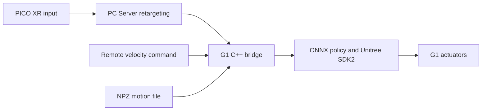

# GRIT Deploy Onboard G1

**一句话定义：** [GRIT_Deploy_Onboard_G1](https://github.com/KurokoWeidong/GRIT_Deploy_Onboard_G1) 是 Unitree G1 的机载 C++ 部署与多模式控制工程，把 locomotion、VR 全身跟踪和 NPZ 轨迹回放集成到一个运行时；它的重点是策略接入、通信和真机控制，不是训练新策略。

## 英文缩写速查

| 缩写 | 英文全称 | 简要说明 |
|------|----------|----------|
| GRIT | 项目名称 | 本仓库所依赖的全身遥操作策略 / 部署生态；此处不是训练框架 |
| AMP | Adversarial Motion Priors | 仓库引用的 locomotion 策略来源类别 |
| NPZ | NumPy compressed archive | 轨迹文件容器 |
| PICO | PICO VR headset | VR 遥操作输入设备 |
| WBC | Whole-Body Control | 全身跟踪控制策略与机器人控制接口 |
| XR | Extended Reality | PICO / XRoboToolkit 遥操作链路 |
| DDS | Data Distribution Service | Unitree SDK2 使用的机器人通信机制 |

## 系统职责

README 将运行栈拆为三端：

| 端 | 运行组件 | 职责 |
|----|----------|------|
| PICO | XRoboToolkit 客户端 | 采集 VR 控制器与身体姿态输入 |
| PC Server | XRoboToolkit PC Service、Python retargeting server | 将 VR 数据重定向为机器人参考并发送至局域网 |
| G1 onboard | C++ bridge、ONNX 推理、Unitree SDK2 低层控制 | 运行 locomotion / WBC 策略、播放 NPZ 并切换控制模式 |

仓库把三种能力组合到同一运行程序：Unitree remote 或 PICO 摇杆驱动 Loco 速度跟踪；PICO 驱动 VR whole-body tracking；NPZ 文件或目录支持预录轨迹播放。控制器支持在 Loco、VR Tracking、NPZ 之间切换，并以受控站立姿态完成 handoff。截图中的“一键切换”应理解为模式切换体验，不代表训练好的单一策略自动完成全部任务。

## 运行链路

VR 输入先经 PC Server 重定向后进入 G1；速度命令和 NPZ 轨迹则提供其他模式的输入。机载桥负责模式协调、策略推理和低层执行。仓库 README 报告 50 Hz C++ 推理 / 控制，并给出命令超时、VR 超时、重复桥进程保护和阻尼退出等机制。

## 工程实践

- **硬件与依赖：** 目标是 Unitree G1；机载 C++17/CMake 程序使用 Unitree SDK2 和 ARM64 ONNX Runtime。VR PC Server 需要 Ubuntu 22.04/24.04 x86_64、Python 3.10、`uv` 与 XRoboToolkit 服务。
- **模式切换：** remote 或 PICO 的按键循环切换 Loco → VR Tracking → NPZ → Loco；具体按键映射、端口和运行参数见仓库 README。
- **轨迹契约：** 示例 NPZ 以 50 Hz 播放，包含关节位置 / 速度与刚体位置、姿态、线速度、角速度数组。帧率、关节排序、机器人模型及策略观察量必须一致。
- **代码与模型：** 项目代码按 MIT 开源；README 指出 WBC ONNX 来自 GRIT_teleop_deploy，AMP locomotion ONNX 来自 wbc_fsm。README 声明已确认两个模型随项目分发的许可，但其许可与依赖版本仍应按上游逐项核对。训练实现或训练数据不应视为本仓库内容。

## 与相邻项目的区别

[Axellwppr/motion_tracking](./axellwppr-motion-tracking.md) 是本项目所参考的 sim2real 桥接 / VR 重定向代码来源之一；该知识库中的 HEFT 页面聚焦训练、评测和导出。GRIT_Deploy_Onboard_G1 则聚焦 G1 机载集成、模式切换和具体策略部署。两者有关联但不是同一仓库，也不可互相代替其训练或部署入口。

## 局限与安全边界

- 仓库提供机载执行与 VR 重定向集成，不构成跨硬件通用策略或训练复现方案。
- 策略文件、关节顺序、机器人固件 / 配置、网络接口必须一致；通信可达不等于控制稳定。
- 项目 README 要求新模型 / 配置 / 轨迹先在仿真中测试，并使用 gantry 或物理支撑做初次验证；建议周围保留至少 3 m 空间，并由受训操作者守在物理急停旁。Damping、语音、LED 与 SSH 均不能替代物理急停。

## 结论

这是一个有用的 G1 sim2real 工程案例，价值在于暴露策略运行时周边的系统工程，而非新的学习算法：

1. 把它作为机载部署样例阅读，避免将其误作 GRIT 的训练代码。
2. 将 Loco、VR Tracking、NPZ 看成不同输入 / 控制模式的集成，而不是一个端到端统一策略。
3. 按 README 分清 PICO、PC Server 与 G1 的进程和网络职责。
4. 复现前校验 ONNX 来源、关节与轨迹契约、时钟频率和 SDK 接口。
5. 先仿真，再支撑保护下测试；始终保留可触达的物理急停。

## 关联页面

- [HEFT / Axellwppr motion_tracking](./axellwppr-motion-tracking.md) — VR 重定向和 sim2real 参考实现
- [Locomotion](../tasks/locomotion.md) — 足式运动控制任务
- [Teleoperation](../tasks/teleoperation.md) — 人机遥操作与数据通路
- [Sim2Real](../concepts/sim2real.md) — 策略迁移与硬件部署

## 参考来源

- [GRIT Deploy Onboard G1 仓库归档](../../sources/repos/grit-deploy-onboard-g1.md)
- [项目 README](https://github.com/KurokoWeidong/GRIT_Deploy_Onboard_G1)
- [GRIT_teleop_deploy](https://github.com/mrzuang/GRIT_teleop_deploy)
- [wbc_fsm](https://github.com/ccrpRepo/wbc_fsm)

## 推荐继续阅读

- [GRIT Deploy Onboard G1 GitHub](https://github.com/KurokoWeidong/GRIT_Deploy_Onboard_G1)
- [Axellwppr/motion_tracking sim2real](https://github.com/Axellwppr/motion_tracking/tree/sim2real)
- [Unitree SDK2](https://github.com/unitreerobotics/unitree_sdk2)
