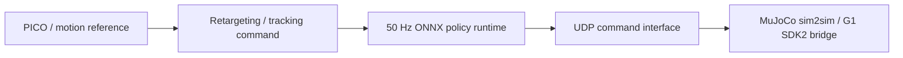
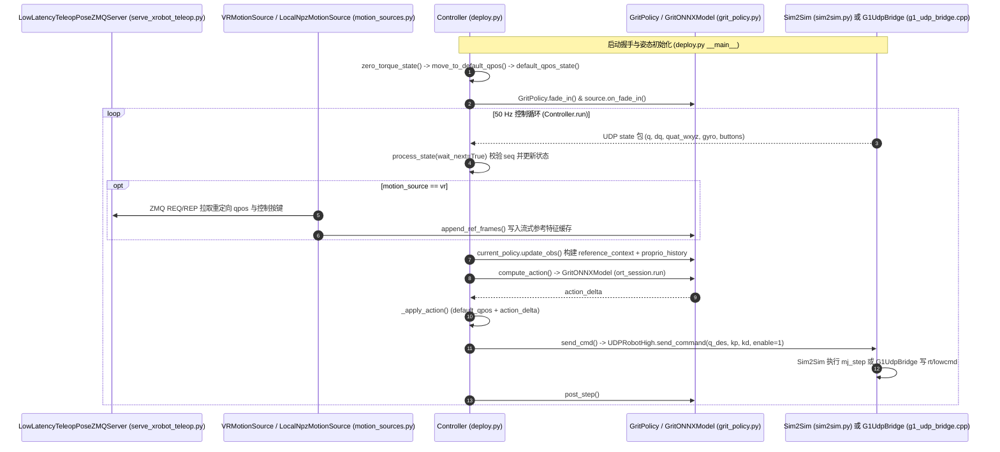

# GRIT v0.0.1

## 英文缩写速查

| 缩写 | 英文全称 | 简要说明 |
|---|---|---|
| ONNX | Open Neural Network Exchange | 发布策略模型格式 |
| UDP | User Datagram Protocol | 运行时统一通信接口 |
| SDK2 | Unitree SDK 2 | G1 真机通信接口 |
| PICO | PICO VR | 全身遥操作动作输入设备 |
| G1 | Unitree G1 | 部署目标人形机器人 |

[GRIT v0.0.1](https://github.com/mrzuang/GRIT_teleop_deploy) 是面向 Unitree G1 的全身动作跟踪策略发布及部署工程。仓库包含 ONNX policy 与部署 contract、50 Hz Python 推理/控制 runtime、MuJoCo sim2sim、PICO/XRoboToolkit 在线动作重定向，以及基于 Unitree SDK2 的真机 bridge，并设置 stale-command watchdog。

## 运行链路

README 将训练与数据生成明确列为仓库外部范围。硬件路径要求 G1 专用网络接口；PICO 路径需 XRoboToolkit、低延迟 Wi-Fi。上线前应先用 MuJoCo 验证 policy contract 和控制配置。它与本库中另一个 [GRIT Deploy Onboard G1](./grit-deploy-onboard-g1.md) 部署仓库分开记录，避免混淆代码来源。该策略出现在 [sim2real leaderboard](./egalahad-sim2real.md) 的 MotionDecode 评测中。

## 源码运行时序图

以下时序图基于 `mrzuang/GRIT_teleop_deploy`（`main` 分支）实际源码核对，展示 Python 高层推理控制器（`deploy.py`）通过统一 UDP 接口对接 MuJoCo 仿真（`sim2sim.py`）或 C++ 硬件桥（`g1_udp_bridge.cpp`），并结合 VR / NPZ 动作源运行 50 Hz 闭环的过程。

- **已核对源码路径：** `sim2real/src/deploy.py`、`sim2real/src/runtime/grit_policy.py`、`sim2real/src/runtime/policy.py`、`sim2real/src/runtime/motion_sources.py`、`sim2real/teleop/serve_xrobot_teleop.py`、`sim2real/src/sim2sim.py`、`g1_sim2real/src/g1_udp_bridge.cpp`。
- **关键契约：** `GritONNXModel`（`grit_policy.py`）显式校验 ONNX 计算图双输入 `("reference_context", "proprio_history")` 与输出 `("actions",)`；退出或捕获 `DampingRequested` 时，`deploy.py` 在 `finally` 块调用 `set_damping_cmd()` 与 `send_cmd()` 进入阻尼保护。

## 参考来源

- [GRIT v0.0.1 部署仓库归档](../../sources/repos/grit-v0-0-1-deployment.md)
- [官方 GRIT v0.0.1 仓库](https://github.com/mrzuang/GRIT_teleop_deploy)

## 关联页面

- [人形运动控制](../tasks/humanoid-locomotion.md) — 延伸阅读，理解人形全身运动任务。
- [遥操作](../tasks/teleoperation.md) — 延伸阅读，理解操作员与机器人之间的控制接口。
- [GRIT Deploy Onboard G1](./grit-deploy-onboard-g1.md) — 另一套部署实现，仓库来源不同。
- [EGalahad/sim2real leaderboard](./egalahad-sim2real.md) — 该策略的统一动作跟踪评测入口。
