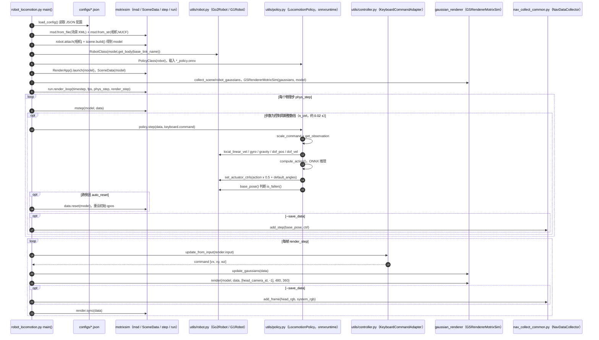

---

type: entity
tags: [repo, simulation, 3dgs, gaussian-splatting, photorealistic, visual-rl, sim2real, rss2026, nvidia]
status: complete
updated: 2026-10-22
related:
  - ./genesis-sim.md
  - ./isaac-gym-isaac-lab.md
  - ./mujoco.md
  - ../concepts/sim2real.md
  - ./world-labs.md
  - ./spark-3dgs-renderer.md
  - ./aholo-viewer.md
  - ./meshroom.md
  - ../methods/crisp-real2sim.md
  - ./flexion-niantic-nvidia-rgb-sim2real-pipeline.md
  - ./paper-panolog-ggps.md
sources:
  - ../../sources/repos/gs_playground.md
  - ../../sources/repos/gs_playground_gsplayground.md
  - ../../sources/papers/3d_gaussian_splatting_arxiv_2308_04079.md
summary: "GS-Playground 将并行物理仿真与批量 3D Gaussian Splatting 渲染耦合，以最高 10^4 FPS 提供光真实感视觉观测，用于视觉 RL 训练，RSS 2026 收录。"
---

# GS-Playground (3DGS 光真实感仿真)

**GS-Playground** 是由 discoverse-dev 开发的高吞吐视觉机器人学习仿真框架，核心创新是将 **并行物理仿真** 与 **批量 3D Gaussian Splatting (3DGS) 渲染** 耦合，在保持极高帧率的同时提供光真实感的视觉观测。已被 **RSS 2026** 收录。

## 英文缩写速查

| 缩写 | 英文全称 | 简要说明 |
|------|----------|----------|
| Sim2Real | Simulation to Real | 把仿真中学到的策略迁移落地真机的工程主线 |
| RL | Reinforcement Learning | 通过与环境交互最大化长期回报来学习策略的范式 |
| RGB | Red-Green-Blue | 彩色图像通道，常与深度 (RGB-D) 配合 |
| GPU | Graphics Processing Unit | 图形处理器，大规模并行仿真训练的算力基础 |
| G1 | Unitree G1 Humanoid | 宇树入门级教育科研人形平台 |
| Isaac Lab | NVIDIA Isaac Lab | 基于 Omniverse 的机器人学习训练框架 |
| MuJoCo | Multi-Joint dynamics with Contact | 接触丰富的刚体物理仿真引擎 |
| API | Application Programming Interface | 应用程序编程接口 |
| Isaac Gym | NVIDIA Isaac Gym | GPU 并行刚体仿真训练环境 |
| VLA | Vision-Language-Action | 视觉-语言-动作多模态基础策略方向 |

## 为什么重要？

视觉 RL 训练面临两个长期矛盾：

1. **吞吐量 vs 真实感**：传统渲染（OpenGL 光栅化）速度可接受，但外观失真严重；光线追踪真实感高但速度极慢。3DGS 渲染打破了这个 trade-off。
2. **Sim-to-Real 外观 gap**：用 3DGS 从真实场景重建的仿真环境，天然缩小 visual domain gap，减少 domain randomization 的负担。

## 核心技术

### 批量 3D Gaussian Splatting 渲染

| 指标 | 数值 |
|------|------|
| 渲染分辨率 | 640×480 |
| 峰值吞吐量 | **10,000 FPS** |
| 输出观测 | RGB + Depth |

**原理**：3DGS 将场景表示为数百万个各向异性高斯椭球，GPU 并行将其溅射（splat）到像素平面，速度远高于 NeRF 的 ray marching，质量远高于光栅化。

产业侧也有面向 **Web 大场景流式 3DGS** 的开源渲染栈（[Spark](./spark-3dgs-renderer.md)、[Aholo Viewer](./aholo-viewer.md)，见 [选型对比](../comparisons/spark-vs-aholo-web-3dgs-renderers.md)），与 GS-Playground 强调的 **物理仿真步进 + 批量光真实感观测** 关注点不同，但共享 splat 表征与工程化瓶颈词汇（排序、内存、LoD 等）。

### Rigid-Link Gaussian Kinematics

将高斯团簇绑定到物理刚体上：当物理引擎更新关节角度时，对应的高斯团簇跟随刚体变换，保证视觉与物理状态严格同步，不出现 "身体穿模" 等伪影。

### Real2Sim 工作流

```
真实场景采集（多视图照片 / 视频）
    ↓
摄影测量或 3DGS 重建（如 Meshroom + MrGSplat，或自研管线）
    ↓
导入 GS-Playground（物理 + 渲染耦合）
    ↓
视觉 RL 训练
```

外观直接来自真实世界，zero-shot 迁移时视觉分布对齐已内建。**上游几何与 splat 资产** 常用 [Meshroom](./meshroom.md)（AliceVision 摄影测量 + [MrGSplat](https://github.com/meshroomHub/mrGSplat) 插件）或同类工具产出，再导入本框架。

### 物理引擎

- **速度冲量求解器（Velocity-Impulse Solver）**：适合接触丰富任务（manipulator、locomotion）
- 支持四足（Go1、Go2）、人形（G1）、机械臂（Franka、Robotiq）

## 与其他仿真框架的对比

| 维度 | GS-Playground | Isaac Lab | Genesis | MuJoCo |
|------|--------------|-----------|---------|--------|
| 渲染方式 | 批量 3DGS | 光栅化 | 内置渲染器 | 无 / 基础 |
| 视觉真实感 | ★★★★★ | ★★★ | ★★★★ | ★ |
| 吞吐量 | 10^4 FPS | 高（GPU 并行） | 高 | 中 |
| Real2Sim | 原生支持 | 有限 | 有限 | 无 |
| 成熟度 | 早期预览 | 成熟 | 成熟 | 成熟 |

## 当前状态（早期预览）

已发布：
- 批量渲染 Benchmark notebook
- Franka / Robotiq replay demo
- Go1 / Go2 / G1 locomotion demo

规划中（未发布）：
- 核心 Simulator API
- Real2Sim 工具链
- 训练 pipeline
- 完整 benchmark 套件

## 源码运行时序图

入口：`uv run python demo/navigation/robot_locomotion.py --config configs/go2_scene1.json`（导航/运动控制演示；`replay.py` 批量 3DGS 回放另走 `demo/live_demo/replay.py`，未画入本图）



图依据：discoverse-dev/gs_playground@33127ca，实际读过 `demo/navigation/robot_locomotion.py`、`demo/navigation/nav_collect_common.py`、`demo/navigation/utils/{policy,robot,controller}.py`、`demo/live_demo/replay.py`、`README.md`、`pyproject.toml`；物理步进与渲染循环细节位于外部包 motrixsim / gaussian_renderer 中，未读其源码，未运行代码。

## 关联页面

- [Genesis 仿真器](./genesis-sim.md) — 同为新一代高吞吐仿真，侧重多物理场
- [Isaac Gym / Isaac Lab](./isaac-gym-isaac-lab.md) — 主流并行仿真平台，视觉质量较低
- [MuJoCo](./mujoco.md) — 物理内核参考，GS-Playground 使用自研求解器
- [Sim2Real](../concepts/sim2real.md) — Real2Sim 工作流直接服务 sim2real
- [Meshroom](./meshroom.md) — 多视图摄影测量与 MrGSplat 上游；产出 mesh / splat 再进仿真
- [Spark](./spark-3dgs-renderer.md) / [Aholo Viewer](./aholo-viewer.md) — Web 端大场景 3DGS 渲染（见 [对比](../comparisons/spark-vs-aholo-web-3dgs-renderers.md)）
- [HKTex](./paper-hktex-heat-kernel-textures.md) — 已知 mesh 上的无 UV 热核纹理（ECCV 2026 Best Paper）；补 sim 资产外观层，不是 splat 观测工厂
- [World Labs](./world-labs.md) — 空间世界生成与 Spark 产业侧上下文
- [Marble](./marble-world-model.md) — 创作者 SaaS 出 splat/collider；本页是批量训练渲染
- [CRISP](../methods/crisp-real2sim.md) — 另一条 Real2Sim 路线：单目视频 + 平面原语与接触物理（ICLR 2026），与 3DGS 外观路径互补对照（见 [选型对比](../comparisons/crisp-vs-gs-playground-real2sim.md)）
- [LEGS（论文实体）](./paper-legs-embodied-gaussian-splatting-vla.md) — 3DGS 背景 + mesh 前景为人形 VLA loco-manip 合成演示（arXiv:2606.01458）
- [PanoLOG / G²PS](./paper-panolog-ggps.md) — 户外全景大规模 3DGS 重建，可作仿真场景资产上游
- [NVIDIA Omniverse NuRec](./nvidia-nurec.md) — 官方神经体积 / USDZ，偏 Real2Sim 资产而非批量 RL 渲染
- [Instant NuRec](./paper-instant-nurec.md) — 驾驶日志前向 3DGS（秒级预览 + NuRec 初始化）

## 参考来源

- [gs_playground 源码归档](../../sources/repos/gs_playground_gsplayground.md)（<https://github.com/discoverse-dev/gs_playground>）

- [sources/repos/gs_playground.md](../../sources/repos/gs_playground.md)
- [discoverse-dev/gs_playground GitHub Repo](https://github.com/discoverse-dev/gs_playground)
- 源码核对（2026-11-02）：discoverse-dev/gs_playground@33127ca，读过 README.md、pyproject.toml、demo/navigation/robot_locomotion.py、demo/navigation/nav_collect_common.py、demo/navigation/utils/policy.py、demo/navigation/utils/robot.py、demo/navigation/utils/controller.py、demo/live_demo/replay.py；时序图依据以上文件，未运行代码。
