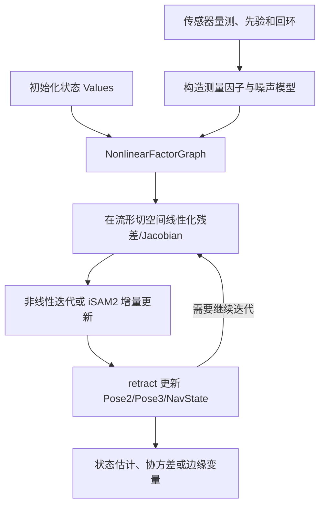
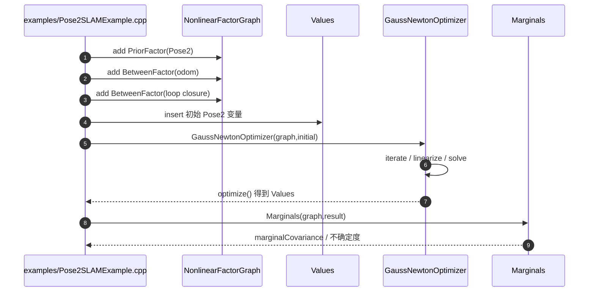

# GTSAM — 官方源码与原始技术文档深读

## 一句话定义

GTSAM 以非线性因子图、变量、流形局部线性化和 Gauss-Newton/Levenberg-Marquardt/iSAM2 等优化器实现机器人平滑与建图，支持 IMU 预积分因子。

## 英文缩写速查

| 缩写 | 英文全称 | 简要说明 |
|---|---|---|
| GTSAM | Georgia Tech Smoothing and Mapping | 机器人与视觉因子图优化库 |
| SAM | Smoothing and Mapping | 增量/批量平滑与建图 |
| IMU | Inertial Measurement Unit | 加速度计与陀螺仪 |
| MAP | Maximum a Posteriori | 后验最大化状态估计 |
| iSAM2 | incremental Smoothing and Mapping 2 | 增量式图优化 |
| GN | Gauss-Newton | 非线性残差局部迭代优化 |

## 为什么重要

传统 SLAM 常混合过程模型、观测残差、全局先验和非线性优化。GTSAM 提供明确的变量–因子接口，使 IMU 预积分、GPS、相机投影、相对位姿与回环可以在统一建模语言下组合，再根据实时性选批量优化或增量式更新。

## 核心原理与方法

1. **Values** 存储变量估计；**NonlinearFactorGraph** 保存 PriorFactor、BetweenFactor、投影与惯性因子，因子对应残差和噪声模型。
2. **流形状态**：SO(3)/SE(3) 的优化步骤先将非线性问题在线性切空间近似，再用 retract 更新到流形上，不能把旋转四元数当无约束欧氏向量相加。
3. **批量优化**：例如 `examples/Pose2SLAMExample.cpp` 构造 Pose2 的先验、相邻里程计和回环 BetweenFactor，通过 `GaussNewtonOptimizer` 求出轨迹并计算 `Marginals`。
4. **增量式优化**：iSAM2 面向图逐渐增长的在线估计；LIO-SAM 等系统可利用它更新关键帧、GPS 和回环约束。
5. **IMU**：README 明确给出 Forster 等的流形 IMU 预积分，以及当前 GTSAM 4 的 tangent-space NavState 实现；是否使用旧公式取决于 `GTSAM_TANGENT_PREINTEGRATION` 配置。

## 流程总览（作者技术文档/官方模块）

## 源码运行时序图

参照官方库 https://github.com/borglab/gtsam、README 与实际可执行模块（源码快照 `ba592c7`）。这是**关键调用路径**，并非已运行单步 profiler。

## 实验与评测

GTSAM 是**通用算法库，不存在一项统一的精度冠军值**。官方 README 提供快速编译和测试命令：`cmake -S . -B build`、`cmake --build build --target check`、`cmake --build build --target install`。优化精度、运行时间和可观性须由具体因子图、噪声、初值、线性求解器及回环数据决定，不能拿 LIO-SAM 的评测结果当 GTSAM 的独立 benchmark。

## 结论

GTSAM 最值得学习的是**从量测到因子、从因子到流形优化**的明确抽象；机器人项目应先验证因子与坐标约定，再选择 GN/LM/iSAM2，以避免把优化框架本身当成精度保证。

## 工程实践

通过 `find_package(GTSAM REQUIRED)` 与 `target_link_libraries(my_program PRIVATE gtsam)` 使用 C++ 库。建议先运行 `examples/Pose2SLAMExample.cpp`，再沿 `examples/CombinedImuFactorsExample.cpp` 学习 IMU 约束。开发分支 README 明确需要 C++17 且未来 API 可能变化，部署使用稳定 Release，CMake/TBB/Boost 可选配置需匹配工具链。

## 局限与风险

因子图求解器不会自动确定观测误差分布、异常值、量测的时间一致性或状态可观性；图结构与噪声选错，结果可能精确地优化了错误模型。`develop` 分支与 Release 的 C++/Python API 和数学设置可能不完全一致，复现实验必须记录源码版本；有 IMU 预积分的残差约定时尤其注意旋转和 bias 的定义。

## 关联页面

- [LIO-SAM](./lio-sam.md)
- [LVI-SAM](./paper-lvi-sam.md)

## 参考来源

- [GTSAM 官方技术资料归档](../../sources/repos/vision3d_gtsam_20261108.md)
- [GTSAM 原作者仓库及文档](https://github.com/borglab/gtsam)（ba592c7，主要执行入口及 README 对照）

## 推荐继续阅读

- [官方 README 与代码入口](https://github.com/borglab/gtsam)
