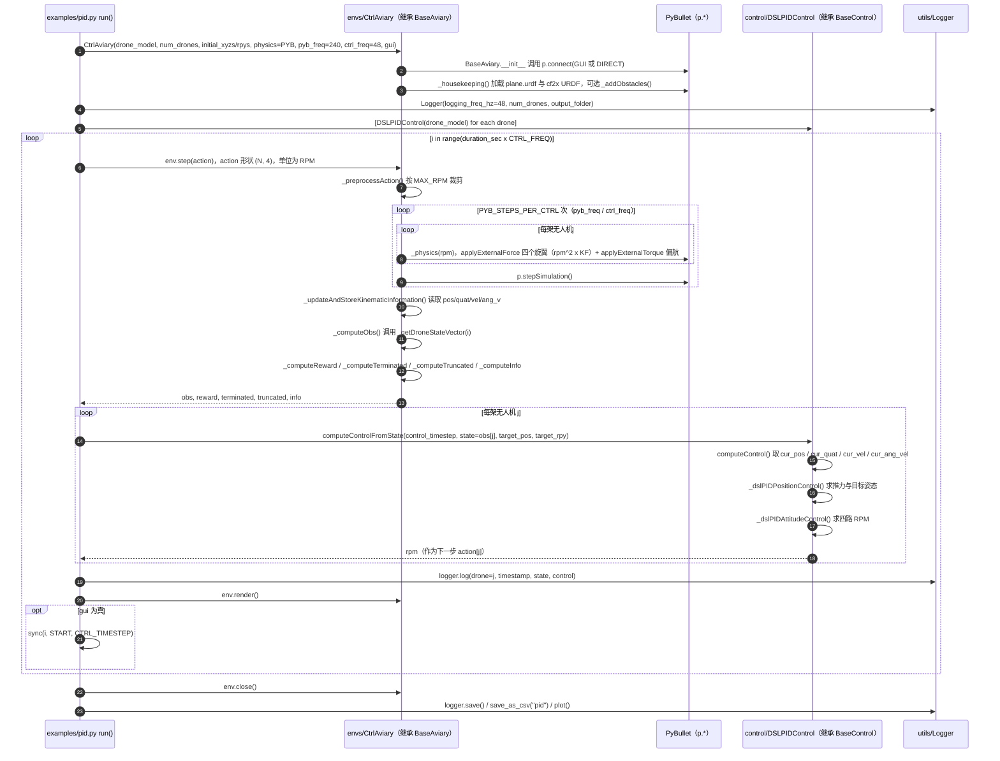

---

type: entity
tags: [repo, simulation, reinforcement-learning, pybullet, gymnasium, quadcopter, multi-agent, mit]
status: complete
updated: 2026-08-26
related:
  - ./pybullet.md
  - ../overview/multirotor-simulation-planning-control-stack.md
  - ./paper-rl-vs-gc.md
  - ../comparisons/rl-vs-geometric-control.md
  - ./betaflight.md
  - ./flightmare.md
  - ./quad-swarm-rl.md
  - ./px4-autopilot.md
  - ../concepts/sim2real.md
  - ./mujoco.md
  - ./gymnasium.md
sources:
  - ../../sources/repos/gym_pybullet_drones.md
  - ../../sources/papers/leveling_playing_field_rl_vs_gc_arxiv_2506_17832.md
summary: "gym-pybullet-drones 是 UTIAS DSL 的 PyBullet + Gymnasium 四旋翼 RL 环境：单/多机、多种控制接口，广泛用于四旋翼强化学习论文复现与教学。"
---

# gym-pybullet-drones

**gym-pybullet-drones**（[utiasDSL/gym-pybullet-drones](https://github.com/utiasDSL/gym-pybullet-drones)）将四旋翼动力学封装为 **Gymnasium 标准环境**，是 **空中 RL** 领域引用最广的开源基准之一。

## 英文缩写速查

| 缩写 | 英文全称 | 简要说明 |
|------|----------|----------|
| Sim2Real | Simulation to Real | 把仿真中学到的策略迁移落地真机的工程主线 |
| RL | Reinforcement Learning | 通过与环境交互最大化长期回报来学习策略的范式 |
| API | Application Programming Interface | 应用程序编程接口 |
| MuJoCo | Multi-Joint dynamics with Contact | 接触丰富的刚体物理仿真引擎 |

## 为什么重要

- **依赖轻、复现快**：PyBullet + Python，适合课程与算法 ablation。
- **API 清晰**：`CtrlAviary`、`VisionAviary` 等变体覆盖 **RPM / PID / 一步 RL 动作**。
- 与腿式 [MuJoCo](./mujoco.md) RL 栈互补：本仓专精 **多旋翼**，不混用地面机器人环境。

## 核心结构/机制

| 环境类型 | 特点 |
|----------|------|
| **CtrlAviary** | 动力学 + 低级控制接口 |
| **VisionAviary** | 叠加视觉观测 |
| **多机** | 多 quad 同场景交互 |

支持 **CF2X、HB** 等机型参数；可选 Crazyflie 尺度与 [Betaflight](./betaflight.md) 风格参数（见上游文档）。

**与 PX4 关系**：本环境 **不运行** [PX4](./px4-autopilot.md) SITL；策略上真机需 **接口转换 + Sim2Real**（见 [Sim2Real](../concepts/sim2real.md)）。

## 常见误区或局限

- **误区：仿真 reward 可直接部署** — 推力模型、延迟、传感器与真机差异大。
- **局限：视觉保真度** — 低于 [Flightmare](./flightmare.md) / [AirSim](./airsim.md)。
- **局限：桨叶/接触物理** — PyBullet 简化，不宜作唯一空气动力学真理源。

## 源码运行时序图

入口：`cd gym_pybullet_drones/examples && python3 pid.py`（README「Control examples」；`learn.py` / `play.py` 的 PPO 训练路径未画入本图）

图依据：utiasDSL/gym-pybullet-drones@bc5000c，实际读过 `gym_pybullet_drones/examples/pid.py`、`gym_pybullet_drones/envs/BaseAviary.py`、`gym_pybullet_drones/envs/CtrlAviary.py`、`gym_pybullet_drones/control/BaseControl.py`、`gym_pybullet_drones/control/DSLPIDControl.py`、`gym_pybullet_drones/utils/enums.py`、`README.md`；`Logger` 内部实现未读，未运行代码。

## 参考来源

- [sources/repos/gym_pybullet_drones.md](../../sources/repos/gym_pybullet_drones.md)
- [utiasDSL/gym-pybullet-drones](https://github.com/utiasDSL/gym-pybullet-drones)
- 源码核对（2026-11-02）：utiasDSL/gym-pybullet-drones@bc5000c，读过 README.md、gym_pybullet_drones/examples/pid.py、gym_pybullet_drones/envs/BaseAviary.py、gym_pybullet_drones/envs/CtrlAviary.py、gym_pybullet_drones/control/BaseControl.py、gym_pybullet_drones/control/DSLPIDControl.py、gym_pybullet_drones/utils/enums.py；时序图依据以上文件，未运行代码。

## 关联页面

- [多旋翼栈总览](../overview/multirotor-simulation-planning-control-stack.md)
- [RL vs GC](./paper-rl-vs-gc.md) — Isaac Lab 上带对称几何控制基线的跟踪试验台（更重、更贴近 RSS 协议）
- [Betaflight](./betaflight.md) — 真机 FPV 飞控与仿真参数对照
- [quad-swarm-rl](./quad-swarm-rl.md)
- [Sim2Real](../concepts/sim2real.md)
- [Gymnasium](./gymnasium.md) — 本环境所实现的 RL API 标准

## 推荐继续阅读

- [官方文档](https://utiasdsl.github.io/gym-pybullet-drones/)
