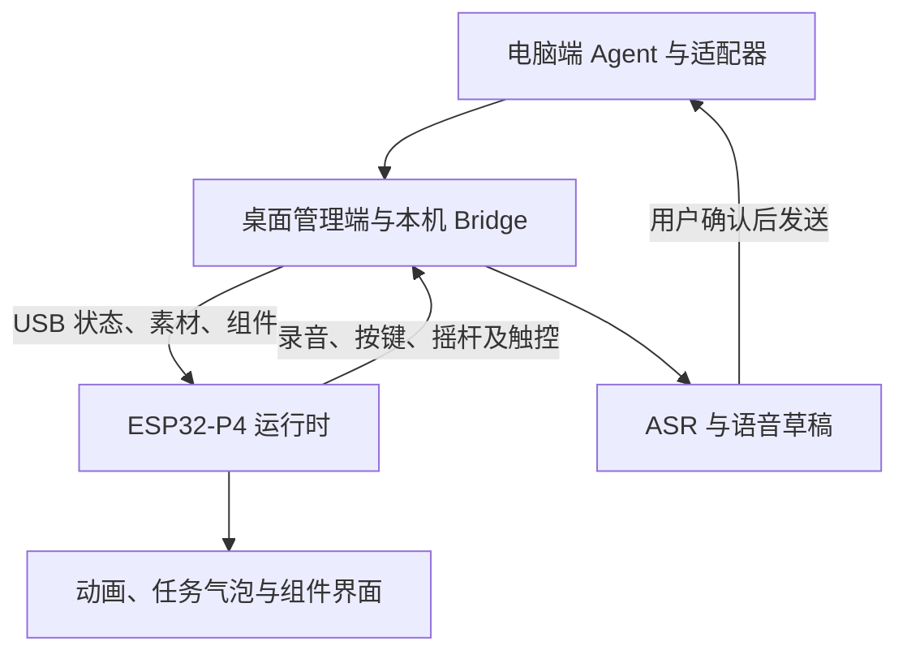
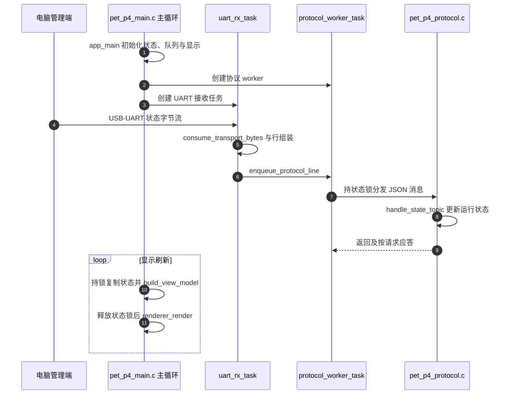

# HachimoDock / 哈基米机：AI Agent 桌面交互终端

## 一句话定义

HachimoDock 是由 Windows/macOS 管理端与 ESP32-P4 小屏组成的桌面交互终端，将电脑端 Agent 任务状态映射为桌宠动画、会话气泡与提醒，并提供按键和语音输入。

## 英文缩写速查

| 缩写 | 英文全称 | 简要说明 |
|---|---|---|
| BOM | Bill of Materials | 复刻所需物料清单 |
| UART | Universal Asynchronous Receiver-Transmitter | 当前 USB 转串口路径的设备通信 |
| DSI | Display Serial Interface | 2.8 英寸屏幕的显示接口 |
| ASR | Automatic Speech Recognition | 电脑端服务将录音转为语音草稿 |
| OTA | Over-the-Air | 项目文档沿用的应用分区升级称呼；日常升级由客户端完成 |

## 为什么重要

它展示了编码代理的任务反馈如何落到低成本实体界面：主机负责 Agent、服务与管理，微控制器负责可见反馈和输入。对机器人开发者的价值是人机交互与嵌入式任务状态界面参考，不能据此推断具有机器人闭环控制能力。

## 核心原理

Agent 适配器向电脑端提供状态，Tauri 2 + React 管理端和本机 Bridge 汇集会话信息，通过 USB 同步给 ESP32-P4。设备依据状态选择动画、字幕与组件；按键、摇杆、触控及麦克风输入回到管理端。语音先形成草稿，再由用户确认发送；这与批准 Agent 工具权限是不同动作。

| 模块 | 已核对的实现或资料 |
|---|---|
| 主控与存储 | ESP32-P4，32 MB Flash、32 MB PSRAM |
| 显示 | 2.8 英寸，物理 480×640；逻辑画布 640×480，由固件旋转 |
| 主机 | macOS Apple silicon / Windows x64；当前无 Linux 或 Intel Mac 预编译包 |
| 扩展 | PetUI 声明式有界组件，经电脑同步；不是任意脚本执行环境 |
| 模型服务 | 用户配置语音、对话、生成服务凭据；公开包不含服务 Key |

### 流程总览

## 源码运行时序图

以下聚焦已阅读源码的固件普通 UART 状态消息路径；没有把不同编译配置的诊断功能拼成默认能力。

实际入口是 `firmware/main/pet_p4_main.c::app_main`；worker 根据编译条件使用 `pet_p4_handle_line_with_reply` 或 `pet_p4_handle_line`。电脑入口 `pc/src-tauri/src/main.rs::main` 调用 `lib.rs::run`，初始化 USB manager、heartbeat 与状态 forwarder。源码核对固定于 `7fbe729`，完整路径见来源归档。

## 工程实践

1. 按嘉立创描述内的整机物料表核对模块，结构件区有两份 STEP，附件区有装配视频。平台独立 BOM 标签显示「暂无BOM」，应区分两种清单。
2. 确认芯片修订版，再选择 v1 / v3 完整烧录包，二者不可互刷；开发板名称的 M 表示焊接排针，不代表芯片修订。
3. 屏幕接 DSI；先确认连接和设备绑定，再测试状态跟随、气泡、录音草稿与确认发送。
4. 自行开发客户端需 Node.js 22+、Rust stable 和平台原生依赖；`npm run dev:web` 只验证网页 UI。固件构建使用 PlatformIO Core 6.1.19，按 `esp32_p4_evboard` / `esp32_p4_evboard_v3` 选择目标。
5. 参考成本约 150 元来自硬件页面的项目标价，实际费用按采购、PCB、打印、包装与运费核算。页面示例主板 81.15 元起、屏幕 65 元，不能把它们当作实时商品报价或保证总价。

## 局限与风险

- **许可有版本冲突**：当前 GitHub 为 HachimoDock Project License 1.0，允许范围内的个人非商业使用、修改及组件创作，商业用途与独立产品开发需书面授权；不是 GPL、AGPL 等标准开源许可。嘉立创页面仍写 GPL-3.0，硬件与素材须核对各自随附声明。历史已授予许可不被当前条款撤销，第三方许可继续独立适用。
- **来源分级**：“小米技术委创新产品团队孵化”可见媒体现场报道及团队引述；当前源码以 Yizheng Wang 名义声明版权，仓库位于个人账号。未取得小米官网原始发布，不能由机构背景推出小米组织仓库或全项目统一版权。
- **资料漂移**：根 README 为 0.1.201 / R181，子目录构建文档仍写较早版本；嘉立创仍留旧板卡与 MQTT 文案。复现应固定提交与发布包，不能混用。
- **验证范围**：已阅读主要软件文档、硬件网页和对应运行路径，未观看装配视频、检查 STEP 几何、构建固件或实机测试；没有测得延迟、语音效果或完整复刻成本。v3 显示修复等官方声明也不能替代全部外设验收。
- **系统依赖**：状态检测不等于能操作目标输入框；语音等能力可能需要联网及服务费用。普通状态同步走 USB，不能把它写成设备独立运行云端 Agent。

## 关联页面

- [AgentsDock](agentsdock.md)：同样改善 Agent 任务交互，但使用跨端软件工作区；HachimoDock 增加实体反馈终端。
- [UART 串口通信](../concepts/uart-serial-communication.md)：理解 USB-UART 字节流、消息组装及板端接收路径。

## 参考来源

- [官方源码与文档核对](../../sources/repos/hachimodock.md)
- [嘉立创硬件原始页面核对](../../sources/sites/hachimodock.md)
- [杭州网现场报道](https://ori.hangzhou.com.cn/ornews/content/2026-10/26/content_9354933.htm)：仅用于团队孵化背景，属于媒体来源。

## 推荐继续阅读

- [固定版本 README](https://github.com/YizhengWw/HachimoDock/blob/7fbe729aa52911da5fdd7e8c3c0578d4a4d8f60f/README.md)：架构、安装、平台与功能边界。
- [固定版本 LICENSE](https://github.com/YizhengWw/HachimoDock/blob/7fbe729aa52911da5fdd7e8c3c0578d4a4d8f60f/LICENSE)：使用、分发与额外授权范围。
