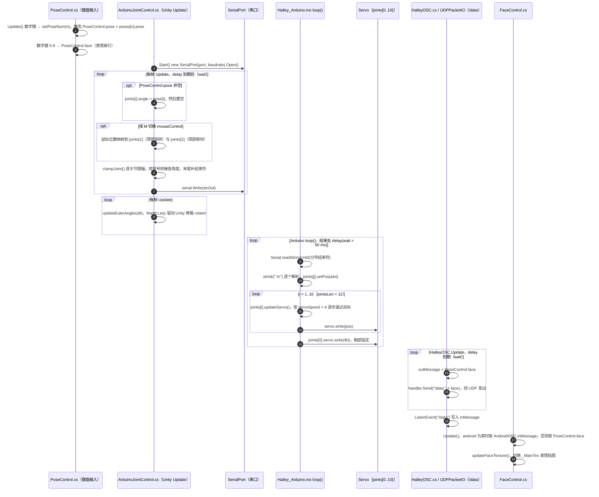

# Halley

**Halley**（[GitHub](https://github.com/johnchoi313/Halley-Ambassador-Robot-001)）是 [GitHubStore《19 款能自己造的开源人形机器人》](https://mp.weixin.qq.com/s/UUwUAcKdVrlo-N60Oar3Xg) 的第 15 项，文章标价 约 $500–800。

## 一句话定义

**Halley（Halley-Ambassador-Robot-001）是约 2.6 英尺高、用于动画研究的开源人形机器人，文章称可用手机作脸、用于人机交互与表情表达。**

## 英文缩写速查

| 缩写 | 英文全称 | 简要说明 |
|------|----------|----------|
| GPL | GNU General Public License | GNU 通用公共许可证 |

## 为什么重要

- 属于文章按成本从低到高排列的「能自己造」清单；横向对比见 [能自己造的开源人形机器人 19 款：按成本与形态排序的阅读坐标](../overview/open-source-buildable-humanoids-19-technology-map.md)。
- 价格为文章标价（约 $500–800），入库日未核实。

## 核心信息

| 项 | 内容 |
|----|------|
| **链接** | [GitHub](https://github.com/johnchoi313/Halley-Ambassador-Robot-001) |
| **许可（核查）** | GPL-2.0（LICENSE 文件） |
| **最近提交** | 2015-04-09 |

## 文章说法核对

- **文章：** 文章称提供完整 3D 设计、软件和详细构建教程（GPL），教程见 Instructables。
- **README / 核查：** README 仅一句「A 2.6-ft humanoid robot for use in animation research」；LICENSE 为 GNU GPL v2；最近提交 2015-04-09。
- **差异与保留：** 「手机作脸」「完整软件与教程」来自文章，README 未展开，未核实；仓库已多年无更新。

## 源码运行时序图

入口：Unity 编辑器打开 `Halley Robot/`，运行 `Assets/Halley_Robot.unity` 场景；Arduino 侧烧录 `Halley_Arduino/Halley_Arduino.ino`（串口 `port` / `baudrate` 在 Unity 组件上配置）。

图依据：johnchoi313/Halley-Ambassador-Robot-001@efdfead，实际读过 `Halley Robot/Assets/Scripts/ArduinoJointControl.cs`、`PoseControl.cs`、`HalleyOSC.cs`、`AndroidOSC.cs`、`FaceControl.cs`、`setFaceRotation.cs`、`Halley Robot/Assets/Standard Assets/{UDPPacketIO,Osc}.cs`（仅看接口）、`Halley_Arduino/Halley_Arduino.ino`、`README.md`；`.unity` 场景中的脚本挂载关系未逐一核对，Unity 运行与真机舵机未实际运行。

## 关联页面

- [humanoid-robot](../entities/humanoid-robot.md)
- [open-source-humanoid-hardware](../entities/open-source-humanoid-hardware.md)
- [open-source-buildable-humanoids-19-technology-map](../overview/open-source-buildable-humanoids-19-technology-map.md)

## 参考来源

- [halley_ambassador_robot.md](../../sources/repos/halley_ambassador_robot.md)
- [wechat_githubstore_19_buildable_open_source_humanoids_2026-11-02.md](../../sources/blogs/wechat_githubstore_19_buildable_open_source_humanoids_2026-11-02.md)
- [原文（微信公众号）](https://mp.weixin.qq.com/s/UUwUAcKdVrlo-N60Oar3Xg)
- 源码核对（2026-11-02）：johnchoi313/Halley-Ambassador-Robot-001@efdfead，读过 README.md、LICENSE、Halley Robot/Assets/Scripts/{ArduinoJointControl,PoseControl,HalleyOSC,AndroidOSC,FaceControl,setFaceRotation}.cs、Halley_Arduino/Halley_Arduino.ino；时序图依据以上文件，未运行代码。
