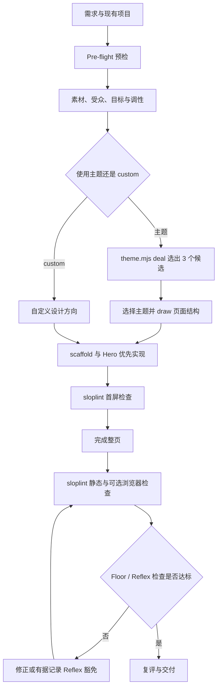
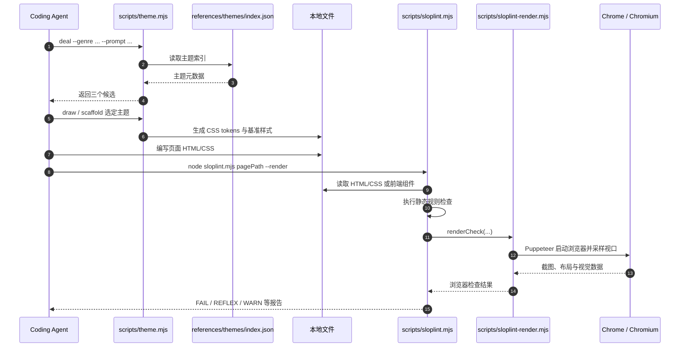

# Hallmark｜反 AI 模板化前端设计技能（Agent Skill）

## 一句话定义

**Hallmark** 是 Together AI 发布的开源前端设计 Agent Skill，为 Claude Code、Codex、Cursor、OpenCode 的网页生成、重设计和审查流程提供主题选择、设计约束与可运行检查；它不是 UI 生成模型或机器人控制算法。

## 英文缩写速查

| 缩写 | 英文全称 | 简要说明 |
|---|---|---|
| AI | Artificial Intelligence | 通过编程代理执行设计工作流 |
| UI | User Interface | 被生成、重设计、审查的网页界面 |
| CSS | Cascading Style Sheets | 主题 tokens、布局和动效限制的核心对象 |
| CLI | Command-Line Interface | `theme.mjs` 与 `sloplint.mjs` 命令入口 |
| UX | User Experience | 交互反馈、可访问性和真实任务完成路径 |

## 为什么重要

给编程代理一句「做得精致」常得到相似的紫蓝渐变、堆叠卡片和无效表单。Hallmark 把**不可妥协的质量底线**、**可变化的设计方向**与**静态 + 浏览器检查**分开，让不同页面不必套用同一模板。对 Robotics_Notebooks 的 `docs/` 展示层、机器人仿真可视化前端和项目介绍页面有参考价值；它不替代知识库 CI 或仿真/真机验证。

## 核心原理

| 层级 | 源码/文档中的职责 |
|---|---|
| Floor | 不能豁免的设计底线，如焦点可见、尊重 reduced motion、不编造数字和证言、避免明显模板式效果 |
| Reflex | 代理常见的审美惯性；有明确证据与理由时可以在 CSS stamp 中记录豁免 |
| Finish | 非阻塞的制作细节，经人工/子代理评审回答 |
| 主题 | v2 官方 README 列出 **50 种**；`theme.mjs deal` 给 3 个候选，`draw` 决定与任务相符的页面结构，`scaffold` 提供设计 token |
| 检查 | `sloplint.mjs` 静态扫描，`--render` 调 `sloplint-render.mjs` 完成真实浏览器检查与截图 |

**官方 v2 工作流：** 预读已有项目的字体、颜色和框架 → 一次性确认素材、受众、目标、调性 → 选择主题或定制 → 单独制作并检查首屏 → 完成其他区块 → 扫描与复评。指定 `redesign` / `audit` 才会处理已有页面，默认针对新页面。

## 流程总览



图依据官方 `README.md`、`SKILL.md` 的 Flow 和 `references/gates.md`；其中最终复评由 agent/评审执行，并非 `sloplint` 自动完成。

## 源码运行时序图

官方仓库提供可运行的 Node.js CLI，不是只有 Markdown 提示词。下图只展开已核对的**主题选择 → 页面构建 → 静态/浏览器检查**入口；agent 自己生成 HTML/CSS 是工具调用者动作，不代表仓库自带生成式模型。



源码依据：`scripts/theme.mjs`、`scripts/sloplint.mjs`、`scripts/sloplint-render.mjs`；浏览器检查视口来自 `sloplint-render.mjs`，需要事先安装浏览器与 `puppeteer-core`。本次**阅读源码，未实际运行**。

## 工程实践

**安装（官方）：**

```bash
# 全局安装（省略 -g 则安装到当前项目）
npx skills add nutlope/hallmark -g
# 仅安装 Codex，可使用：
npx skills add nutlope/hallmark -g --agent codex
```

Node.js 18+。Claude Code 使用 `/hallmark <prompt>`，Codex CLI 使用 `$hallmark <prompt>`。显式请求重设计：`/hallmark redesign ./src/app`；仅审查：`/hallmark audit ./index.html`。

**独立检查：**

```bash
npm i -g puppeteer-core
node skills/hallmark/scripts/sloplint.mjs ./index.html --render
```

上例第二条从 **Hallmark 仓库根目录** 执行；如通过 `skills` CLI 安装，需改成实际 skill 目录。检查有静态和浏览器层；缺失 Chrome/Chromium 时不能宣称 render 层完成。对 Robot/AI 项目，建议独立核实链接、表单、实际数据和小屏布局，不把项目官网示例视作真实部署评测。

## 局限与风险

- **领域边界：** 关注网页可用性和审美，不能保证机器人动力学仿真、关节/URDF 正确性、Sim2Real 或安全策略。
- **依赖：** `--render` 需要 Chrome/Chromium 与 `puppeteer-core`；静态检查并不等于实际浏览器验证。
- **流程边界：** 主题和 AI 评审并不能保证每次得到独特或优秀设计；官方示例与前后对比不是独立基准测试。
- **版本边界：** 50 个主题、脚本入口均来自 [2026-11-12 仓库快照](https://github.com/Nutlope/hallmark/tree/04977e15f3dfd6ee4b74c887dac3eb52665d6c92)，后续版本可能变化。

## 关联页面

- [frontend-design（Anthropic）](./anthropic-frontend-design-skill.md) — Agent 前端设计规约与反模板化原则。
- [Impeccable](./impeccable.md) — 更强调已有 UI 的诊断与视觉迭代的另一套 Skill。
- [Taste Skill](./taste-skill.md) — 通过设计偏好旋钮约束代理输出的对照。
- [MengTo/Skills](./mengto-skills.md) — 覆盖网页、3D 和质量验证的更广泛 Agent Skills 集合。

## 参考来源

- [Hallmark 官方 README、SKILL.md 与源码归档](../../sources/repos/nutlope-hallmark.md)
- [Hallmark 官方网站归档](../../sources/sites/hallmark.md)
- [项目官方仓库](https://github.com/Nutlope/hallmark)

## 推荐继续阅读

- [官方 SKILL.md](https://github.com/Nutlope/hallmark/blob/04977e15f3dfd6ee4b74c887dac3eb52665d6c92/skills/hallmark/SKILL.md)
- [设计门禁原文 gates.md](https://github.com/Nutlope/hallmark/blob/04977e15f3dfd6ee4b74c887dac3eb52665d6c92/skills/hallmark/references/gates.md)
- [官方主题展示](https://www.usehallmark.com/)
