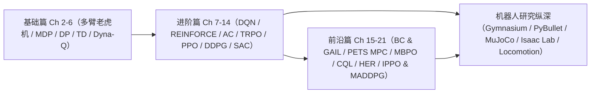
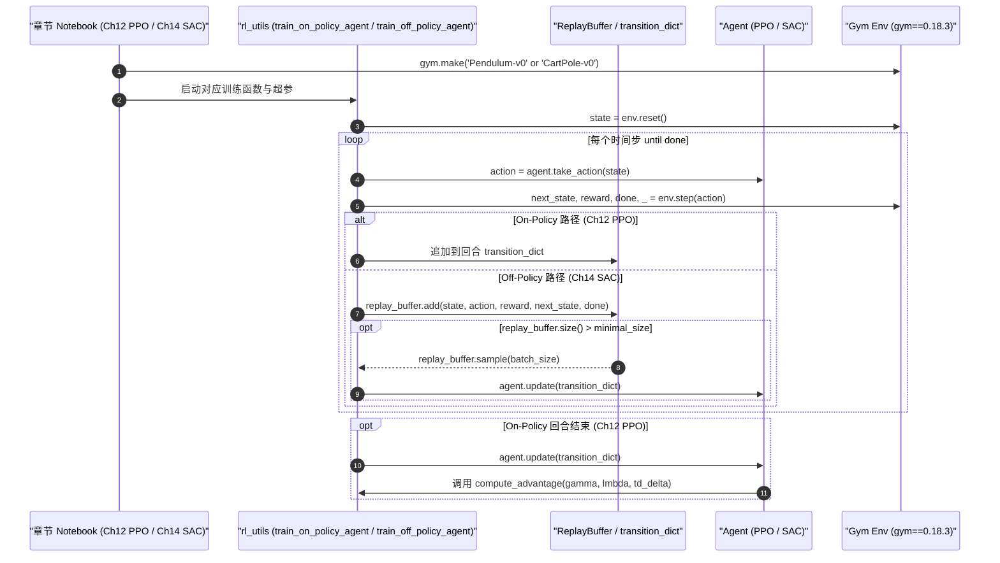

# 动手学强化学习（Hands-on RL / 蘑菇书）

**《动手学强化学习》**（社区常称**蘑菇书**）由上海交通大学 APEX 实验室团队编写，以中文图文讲解加分章可运行 Jupyter Notebook 的形式覆盖经典与深度强化学习核心主线。GitHub 仓库 [boyu-ai/Hands-on-RL](https://github.com/boyu-ai/Hands-on-RL) 提供第 2 章至第 21 章的全部代码 notebook 与共用工具模块 `rl_utils.py`，配合在线交互书站 [hrl.boyuai.com](https://hrl.boyuai.com/) 与伯禹学习平台免费视频课使用。

## 一句话定义

上海交大团队编写的开源中文 RL 教材与代码仓：每章一个独立 Notebook、共用 `rl_utils.py` 最小训练骨架，打通从多臂老虎机和表格型 MDP 到 PPO / SAC，以及 IL、MPC、MBPO、离线 CQL、HER 与多智能体 RL 的代码实现路径。

## 英文缩写速查

| 缩写 | 英文全称 | 简要说明 |
|------|----------|----------|
| RL | Reinforcement Learning | 通过与环境交互最大化累积折扣回报的序贯决策范式 |
| MDP | Markov Decision Process | 由状态、动作、转移与奖励构成的序贯决策数学框架 |
| PPO | Proximal Policy Optimization | 人形/足式运动控制最常用的 on-policy 截断代理目标策略优化算法 |
| SAC | Soft Actor-Critic | 连续控制主流 off-policy 最大熵 Actor-Critic 算法 |
| TRPO | Trust Region Policy Optimization | 带 KL 散度约束与共轭梯度近似的策略优化算法，PPO 的理论前身 |
| GAE | Generalized Advantage Estimation | 通过指数加权 TD 残差平衡偏差–方差的优势函数估计（`compute_advantage`） |
| MBPO | Model-Based Policy Optimization | 用学习到的环境动力学模型短时分支 rollout 辅助策略更新的算法 |
| MARL | Multi-Agent Reinforcement Learning | 多智能体协同或对抗强化学习（含 IPPO 与 MADDPG 实现） |

## 为什么重要

1. **中文教学链路完整、代码无黑盒封装：** 每章仅用少量 PyTorch 代码与统一的 `rl_utils.py` 从零实现核心更新公式，避免高阶 RL 库把 GAE、目标网络软更新、重参数化采样隐藏在配置里。
2. **算法栈紧贴机器人 RL 入门前置：** 进阶篇逐章推导并实现 REINFORCE、Actor-Critic、TRPO、**PPO**、DDPG 与 **SAC**，直接对接本知识库 [Reinforcement Learning](../methods/reinforcement-learning.md) 与 [人形 RL 运动控制路线](../../roadmap/depth-rl-locomotion.md) Stage 0 的算法要求。
3. **前沿篇横跨模型控制与安全/多体扩展：** 第 15–21 章专门覆盖模仿学习（Behavior Cloning / GAIL）、采样打靶型 MPC（CEM / PETS）、MBPO、离线保守 Q 学习（CQL）、目标条件事后回放（HER）以及多智能体算法（IPPO / MADDPG），便于在进入复杂仿真器前先建立跨方法对照。

## 核心原理

### 全书结构与学习路径

全书按「**基础篇（有限状态/动作表格法）→ 进阶篇（函数逼近与深度 RL）→ 前沿篇（数据效率、离线、多目标与多智能体扩展）**」三层递进；在仓库 `boyu-ai/Hands-on-RL` 中，Ch 2–Ch 21 的 20 个 `.ipynb` 文件共同依赖根目录 `rl_utils.py` 提供的回放池、训练环与 GAE 工具函数，再走向本库的机器人物理仿真与 Sim2Real 训练体系。

### 源码章节清单（第 2–21 章实核）与本库知识映射

> 注：仓库源码从第 2 章 notebook 开始（第 1 章导论仅见于在线书站正文，仓库无独立 `.ipynb`）。

| 篇目 | 章节与核心源码类 / 函数 | 演示环境 | 对应本库节点 |
|------|------------------------|---------|--------------|
| 基础篇 | Ch 2 多臂老虎机：`BernoulliBandit`、`EpsilonGreedy`、`DecayingEpsilonGreedy`、`UCB`、`ThompsonSampling` | 多臂老虎机基准 | [Reinforcement Learning](../methods/reinforcement-learning.md) |
| 基础篇 | Ch 3 马尔可夫决策过程：`sample`、`MC`、占用度量 `occupancy` | 小型马尔可夫链 / MDP | [MDP](../formalizations/mdp.md)、[Bellman 方程](../formalizations/bellman-equation.md) |
| 基础篇 | Ch 4 动态规划：`CliffWalkingEnv`、`PolicyIteration`、`ValueIteration` | 悬崖漫步、`FrozenLake-v0` | [Bellman 方程](../formalizations/bellman-equation.md) |
| 基础篇 | Ch 5 时序差分 & Ch 6 Dyna-Q：`Sarsa`、`nstep_Sarsa`、`QLearning`、`DynaQ` | `CliffWalking` 网格 | [Value-Based RL](../methods/value-based-reinforcement-learning.md)、[Model-Based RL](../methods/model-based-rl.md) |
| 进阶篇 | Ch 7–8 DQN 系列：`Qnet`、`DQN`、`ConvolutionalQnet`、`VAnet`（Vanilla / Double / Dueling） | `CartPole-v0`、`Pendulum-v0`（离散化） | [Value-Based RL](../methods/value-based-reinforcement-learning.md) |
| 进阶篇 | Ch 9–11 策略梯度至信任域：`REINFORCE`、`ActorCritic`、`TRPO`、`TRPOContinuous` | `CartPole-v0`、`Pendulum-v0` | [Policy Optimization](../methods/policy-optimization.md) |
| 进阶篇 | Ch 12 **PPO** & Ch 13 DDPG & Ch 14 **SAC**：`PPO`、`PPOContinuous`、`DDPG`、`SAC`、`SACContinuous` | `CartPole-v0`、`Pendulum-v0` | [PPO](../methods/ppo.md)、[SAC](../methods/sac.md)、[PPO vs SAC](../comparisons/ppo-vs-sac.md) |
| 前沿篇 | Ch 15 模仿学习：`BehaviorClone`、`GAIL` | `CartPole-v0` 专家轨迹 | [Imitation Learning](../methods/imitation-learning.md)、[RL vs IL](../comparisons/rl-vs-il.md) |
| 前沿篇 | Ch 16 MPC & Ch 17 MBPO：`CEM`、`PETS`、`MBPO` | `Pendulum-v0`（交叉熵打靶 + 动力学集成） | [Model Predictive Control](../methods/model-predictive-control.md)、[Model-Based RL](../methods/model-based-rl.md)、[MBPO](../methods/mbpo.md)、[MPC vs RL](../comparisons/mpc-vs-rl.md) |
| 前沿篇 | Ch 18 离线 RL：`CQL` | `Pendulum-v0` | [Online vs Offline RL](../comparisons/online-vs-offline-rl.md) |
| 前沿篇 | Ch 19 目标导向 RL：`DDPG` + `HER`、`WorldEnv` | 自建 2D 网格世界（`future` 重标注） | [HER](../methods/her.md) |
| 前沿篇 | Ch 20–21 多智能体 RL：`IPPO`、`MADDPG` | `ma-gym` `Combat`、`multiagent-particle-envs` `simple_adversary` | [MARL](../methods/marl.md) |

### 三种学习入口与接口约定

| 形态 | 入口 | 适用场景 |
|------|------|----------|
| 在线书 + 网页运行 | [hrl.boyuai.com](https://hrl.boyuai.com/) | 图文公式排版完整，可直接在浏览器阅读第 1–22 节 |
| GitHub Jupyter 仓库 | [boyu-ai/Hands-on-RL](https://github.com/boyu-ai/Hands-on-RL) | 本地修改代码、对比 `rl_utils.py` 实现与迁移实验 |
| 视频课程 | [伯禹平台课程](https://www.boyuai.com/elites/course/xVqhU42F5IDky94x) | 配合主讲节奏快速梳理公式推导 |

## 源码运行时序图

仓库所有深度强化学习与前沿算法章节均围绕 `rl_utils.py` 的两个统一训练函数运行：On-Policy 算法（如 Ch 12 `PPO` / `PPOContinuous`）按完整回合收集 `transition_dict` 并调用 `compute_advantage` 计算 GAE 优势后更新；Off-Policy 算法（如 Ch 14 `SAC` / `SACContinuous`）则在每步推进环境后写入 `ReplayBuffer`，达到 `minimal_size` 后每步随机采样更新。

关键复现路径集中在 [`rl_utils.py`](https://github.com/boyu-ai/Hands-on-RL/blob/main/rl_utils.py) 与各章 `Agent.update()`：所有 `env.step(action)` 均按照旧版 `gym==0.18.3` 的 4 元组返回值解包。

## 工程实践

1. **依赖版本钉死与接口迁移：** `README.md` 明确提示需使用 `gym==0.18.3`；若在现代 Python 环境下改用 [Gymnasium](./gymnasium.md)，需要把 `rl_utils.py` 中 `state = env.reset()` 改为 `state, _ = env.reset()`，把 `next_state, reward, done, _ = env.step(action)` 改为合并 `terminated or truncated`。
2. **建议学习顺序（面向机器人运动控制）：** 若目标为腿足 / 人形 RL，优先通读 Ch 3（MDP）、Ch 9–12（策略梯度 → TRPO → [PPO](../methods/ppo.md)）和 Ch 14（[SAC](../methods/sac.md)），再补充 Ch 15–17（[模仿学习](../methods/imitation-learning.md)、[MPC](../methods/model-predictive-control.md)、[MBPO](../methods/mbpo.md)）理解奖励、模仿与模型控制的分界，随后转入 [PyBullet](./pybullet.md)、[MuJoCo](./mujoco.md) 或 [Isaac Lab](./isaac-gym-isaac-lab.md) 学习 [Locomotion](../tasks/locomotion.md) 实战管线。
3. **教学代码向工程库过渡：** 本书单环境串行训练与单卡/CPU 演示适合算法原理与公式对齐；进入高维连续控制、域随机化与大规模并行仿真后，应迁移至 `rsl_rl`、`CleanRL` 或 `Stable-Baselines3` 等专用工程栈。

## 局限与风险

- **经典低维环境与旧版 Gym：** 全仓示例限于 `CartPole-v0`、`Pendulum-v0`、`FrozenLake-v0`、自建二维网格与小规模多智能体环境，不包含 URDF/MJCF 刚体机器人模型、接触动力学或并行 GPU 训练。
- **不涉及真机与运动控制工程基础设施：** 书中未覆盖全身控制（WBC）、状态估计、执行器动力学辨识、对抗运动先验（AMP）或 Sim2Real 迁移策略。
- **教学实验规模有限：** 多数章节为单随机种子运行可视化曲线（未给出多种子均值与方差区间），且第 16 章 PETS / 第 17 章 MBPO 等连续控制实验仅验证在 `Pendulum-v0` 上，超参数不可直接照搬到高自由度机器人任务。

## 与其他页面的关联

- [Reinforcement Learning](../methods/reinforcement-learning.md) — 本库强化学习方法体系总览
- [Policy Optimization](../methods/policy-optimization.md) · [PPO](../methods/ppo.md) · [SAC](../methods/sac.md) · [PPO vs SAC](../comparisons/ppo-vs-sac.md)
- [Model-Based RL](../methods/model-based-rl.md) · [MBPO](../methods/mbpo.md) · [HER](../methods/her.md) · [MARL](../methods/marl.md)
- [MDP](../formalizations/mdp.md) · [Bellman 方程](../formalizations/bellman-equation.md)
- [Gymnasium](./gymnasium.md) — 现代 Gym 标准 API（理解与书中 `gym==0.18.3` 差异）
- [Robot Learning Overview](../overview/robot-learning-overview.md) · [depth-rl-locomotion](../../roadmap/depth-rl-locomotion.md) · [Locomotion](../tasks/locomotion.md)
- [Modern Robotics Book](./modern-robotics-book.md) — 经典机器人运动学/动力学教材互补

## 参考来源

- [boyu-ai/Hands-on-RL（仓库与 Ch 2–21 代码全量核对）](../../sources/repos/boyu_ai_hands_on_rl.md)
- [hrl.boyuai.com（在线书站与目录归档）](../../sources/sites/hrl-boyuai-hands-on-rl.md)
- [伯禹平台《动手学强化学习》免费视频课归档](../../sources/courses/boyuai_hands_on_rl_elites_course.md)
- GitHub 官方仓库：<https://github.com/boyu-ai/Hands-on-RL>

## 推荐继续阅读

- Sutton & Barto, [*Reinforcement Learning: An Introduction*](http://incompleteideas.net/book/the-book-2nd.html) — RL 理论原典教材（本库实体页 [Sutton & Barto](./sutton-barto-rl-book.md)）
- [OpenAI Spinning Up in Deep RL](https://spinningup.openai.com/) — 英文经典策略梯度与连续控制实现对照
- [《动手学强化学习》在线书](https://hrl.boyuai.com/)
