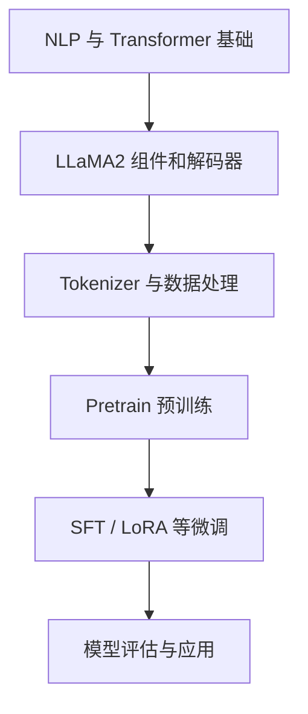

# Happy-LLM：从零开始构建大模型

## 一句话定义

Happy-LLM 是一套沿原理、手写模型、训练与应用组织的大模型学习课程；本页编译的是官方 README 的课程地图，而不是逐篇实验结果。

## 英文缩写速查

| 缩写 | 英文全称 | 简要说明 |
|---|---|---|
| LLM | Large Language Model | 大语言模型 |
| NLP | Natural Language Processing | 自然语言处理 |
| SFT | Supervised Fine-Tuning | 有监督微调 |
| PEFT | Parameter-Efficient Fine-Tuning | 参数高效微调 |

## 为什么重要

与只会调用现成 LLM 不同，课程让学习者理解 Decoder 的组成、Tokenizer 如何把文本变成 token，以及从预训练到 SFT 的可验证链条。它与机器人 VLA、语言条件策略中的 Transformer 基础相关，但不能直接替代机器人行为训练。

## 核心原理

官方第五章从 ModelConfig、RMSNorm、Attention/旋转位置编码、MLP、DecoderLayer 组装 LLaMA2；继续讨论 Tokenizer、预训练数据集与 SFT 处理。第六章使用 Transformers、DeepSpeed、PEFT 描述训练流程，依赖相应软硬件而非保证低成本本地复现。

### 课程结构与验证路径

## 源码运行时序图

**不适用（本知识页是课程概览而非单个可执行项目；官方 README 以逐章示例代码为主，未确认统一运行脚本）。** 子章节如需独立源码时序图，应先核查实际脚本与调用关系。

## 工程实践

按官方 README 顺序阅读第 2、5、6 章；先用课程中提供的代码片段理解 Attention 与数据右移，再在受控环境对照训练 loss 与样本输出。不同章节应使用各自依赖，避免混装。

## 局限与风险

课程是教学性实现，不能把 LLaMA2 示例的速度和质量直接外推到生产模型； README 并未给出全课程统一的一键训练脚本，源码运行时序图不适用（多个分章代码片段分别运行）。

**健康度口径：** `original` 对应的是已完整阅读的官方 README **入口原文**，所以本页作为“课程总览”可以独立完结；不代表所有子章节、实验及应用源码已逐篇通读或成功运行。

## 关联页面

- [agentic-rl-lab ](./agentic-rl-lab.md) — 同领域的基础、工程或应用对照。
- [easy-vibe ](./easy-vibe.md) — 同领域的基础、工程或应用对照。
- [pytorch ](../entities/pytorch.md) — 同领域的基础、工程或应用对照。

## 参考来源

- [2026-11-13 官方入口原文与核对范围](../../sources/repos/happy-llm-course-overview-read-20261113.md)
- [课程资料总归档](../../sources/repos/happy-llm.md)
- [官方 GitHub 仓库](https://github.com/datawhalechina/happy-llm)

## 推荐继续阅读

- [官方教程与项目入口](https://datawhalechina.github.io/happy-llm/)
