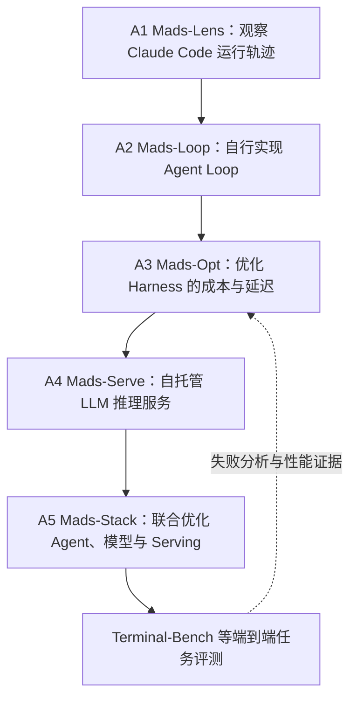

# 哈佛 CS2680：现代 AI 系统——智能体与系统优化 / Modern AI Systems: Agents and System Optimizations

## 一句话定义

**CS2680** 是哈佛大学 2026 年秋季的现代 AI 系统课程，围绕**同一个 Agent 系统**从使用现成 Coding Agent 逐步深入到自行设计 Agent Loop、改进 Harness，再到自托管大模型推理服务与全栈任务评测；授课教师为 **Juncheng Yang**。

## 英文缩写速查

| 缩写 | 英文全称 | 简要说明 |
|---|---|---|
| LLM | Large Language Model | 驱动 Agent 并由服务引擎推理的模型 |
| MADS | Modern Agent Design and Systems | 五次递进作业的统一命名主线 |
| API | Application Programming Interface | A2–A3 用于调用课程提供模型的接口 |
| KV | Key–Value | Attention 的 KV Cache；Serving 性能的重要部分 |
| GPU | Graphics Processing Unit | A4–A5 的自托管推理计算资源 |
| HPC | High-Performance Computing | 课程支持的 GPU 计算环境 |

## 为什么重要

很多 Agent 教学止于提示词、工具和多智能体，但落地的软件工程还必须回答：**Agent 为什么失败、每项任务到底花了多少 token / 时间、工具执行瓶颈在哪里、模型服务的吞吐改进能否真正缩短完整任务时间？**

本课程用一个逐步接管的系统做实验：前半段学习 Agent 的行为与可靠性；后半段让同一工作负载穿过 model serving、batching、KV-cache、routing、量化及 speculative decoding 的系统边界。相比只做模型 API 调用，它更适合训练端到端性能分析能力。

## 核心原理与课程流程总览

官网将课程分为 **Part I：LLMs 与 Agents**、**Part II：LLM 与 Agent Systems**；五项作业依次扩大学生能修改的系统范围：

> 图为**官方作业的教学递进及评测反馈**，不是某个已开源 Agent 的源码调用链；课程未给出一套统一可核对的最终成品实现。

| 作业 | 学习目标与边界 | 官方任务与核验材料 |
|---|---|---|
| [A1 · Mads-Lens](https://cs2680.seas.harvard.edu/assignments/assignment1) | 给 Claude Code 做实时观测 UI：tool call/result、子 Agent 树、继续会话、成本和失败状态 | headless `stream-json` 事件 + UI + writeup；本阶段**不**重新实现 Loop |
| [A2 · Mads-Loop](https://cs2680.seas.harvard.edu/assignments/assignment2) | 自行构建工具调用循环、上下文处理、异常恢复、日志与任务终止 | 课程模型 API + 任务容器 + SWE-bench Pro 相关测试；避免把 starter 提示当成标准架构 |
| [A3 · Mads-Opt](https://cs2680.seas.harvard.edu/assignments/assignment3) | 模型仍为 API 黑盒，改进 context、工具执行、agent 角色与资源开销 | Harness 竞赛：对比任务成功、完整任务成本与延迟 |
| [A4 · Mads-Serve](https://cs2680.seas.harvard.edu/assignments/assignment4) | 用自己的 Serving Engine 替代课程模型 API，对推理和 Agent 联合调优 | 单张 RTX PRO 4500 32 GB；SGLang 起步；端到端任务耗时 |
| [A5 · Mads-Stack](https://cs2680.seas.harvard.edu/assignments/assignment5) | 在 A4 的基础上允许优化 Agent、模型选择与服务引擎 | Terminal-Bench 2.0 与官方 leaderboard；全栈而非纯 tokens/s |

### 两层系统相互作用

- **Agent 层**：prompt/context、工具 schema、调用循环、子智能体、可靠性、评测、预算。
- **Serving 层**：GPU、batching/scheduling、KV-cache 和 prefix reuse、routing、quantization、speculative decoding。

实际调优应该先把每次任务的模型调用、工具开销、失败/重试、真实完成时间和任务判定记录下来，再判断该改 Agent Harness 还是模型推理系统。课程专题 [Cost-effective agents](https://cs2680.seas.harvard.edu/notes/cost-effective-agents) 明确把完整任务而不是单独 token 价格作为成本核算单位。

## 工程实践

| 可练习环节 | 可观测的验收指标 | 与机器人研发的迁移关系 |
|---|---|---|
| Agent 轨迹仪表盘（A1） | tool-call 输入与输出、异常、会话恢复、端到端成本 | 可以借鉴用于研发 Agent 的自动测试与 ROS 2 项目代码审查；**不是**机器人控制策略 |
| 设计 Harness（A2） | 任务成功率、日志完整性、非法工具响应处理与停止条件 | 可借鉴 Agent 管理仿真任务、收集测试结果的控制流 |
| 优化 Harness（A3） | 成功任务数、总 token / 费用、p50/p95 延迟 | 不把“少调用模型”误判为“任务完成更快” |
| 自托管模型（A4） | GPU 占用、服务吞吐、单步与全任务延迟 | 可迁移到机器人工程中的后台模型部署和资源预算 |
| 全栈对比（A5） | 固定任务/硬件条件下的准确性和成本延迟权衡 | 为机器人开发 Agent 构建回归测试与成本基线 |

**使用建议：** 若目标是机器人运控或 Sim2Real，先把课程方法用于**开发与评测自动化**（代码审阅、仿真脚本、回归测试），不要将课程的 Terminal-Bench 结果当成机器人操作成功率。

**源码运行时序图：不适用。** 课程官网公开的是教学任务、可下载的部分 starter 入口与阅读材料；本次未取得/审阅足以证明独立真实执行链的完整官方参考实现，不绘制虚构的源码运行时序图。

## 局限与风险

- **访问权限：** 官网、课程/作业要求公开；学校提供的 API key、GPU 计算资源、私有 GitHub 交付仓库与部分作业材料不能默认向公开读者开放。
- **课程范围：** 这是 Agent 与 LLM 推理系统课程，并非 RL、机器人运动控制或 VLA 机器人真机实验课。
- **评测边界：** A2/A3、A4、A5 使用的 benchmark、模型与硬件条件并不完全一致，不能跨阶段直接把排行榜数值解释成纯算法或模型效果改进。
- **核读边界：** 本次已读官网概述及官方作业说明；没有逐页读完全部授课 Slides、课程 reading list 中所有论文或未来预定讲次。详见原文归档。
- **安全与隐私：** 课程 A1 包含可执行系统命令的 Agent UI 示例；仅在测试目录/受控环境运行，避免泄漏凭据及会话轨迹。

## 关联页面

- [斯坦福 CS146S：现代软件开发者](cs146s-modern-software-developer.md) — 偏 AI-native 开发工作流；CS2680 更深入 Agent Harness 和 LLM Serving
- [Agentic Coding 时代的软件工程基础](../concepts/agentic-coding-software-fundamentals.md) — 测试、观测、安全和工程规范，为 A1–A3 提供软件工程上下文

- [智能体规划与反馈执行](../methods/agent-planning-feedback.md)：对照任务分解、行动与反馈。
- [AI 模型推理与服务部署](../methods/ai-model-serving-inference.md)：对照运行时接口、延迟与资源。

## 参考来源

- [哈佛 CS2680：2026 秋季官网和五次作业一手核读](../../sources/courses/harvard-cs2680-modern-ai-systems-2026.md)
- [Harvard CS2680 课程首页](https://cs2680.seas.harvard.edu/)
- [官方 Assignments 总览](https://cs2680.seas.harvard.edu/assignments/)

## 推荐继续阅读

- [官方课程阅读清单](https://cs2680.seas.harvard.edu/readings/)
- [Agent evaluation and benchmarks](https://cs2680.seas.harvard.edu/notes/agent-evaluation)
- [Cost-effective agents](https://cs2680.seas.harvard.edu/notes/cost-effective-agents)
