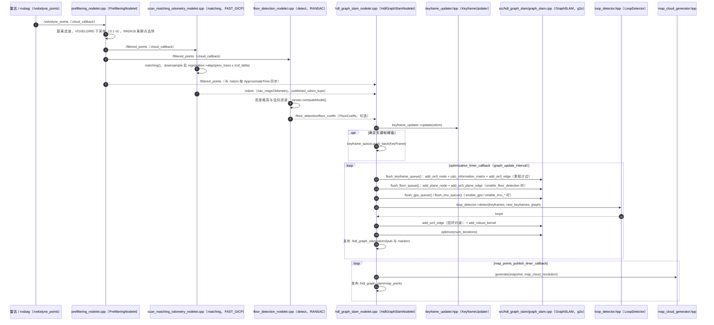

---

type: entity
tags: [repo, lidar, graph-slam, ndt, outdoor, hku]
status: complete
updated: 2026-05-27
related:
  - ../entities/fast-lio.md
  - ../comparisons/lidar-slam-lio-vio-selection.md
sources:
  - ../../sources/repos/hdl_graph_slam.md
summary: "hdl_graph_slam 是 3D 激光图 SLAM：NDT 扫描匹配 + g2o 位姿图，适合室外大场景与 koide3 点云工具链。"
---

# hdl_graph_slam

**hdl_graph_slam** 以 **NDT 配准 + 位姿图优化** 构建室外 3D 激光 SLAM。

## 英文缩写速查

| 缩写 | 英文全称 | 简要说明 |
|------|----------|----------|
| SLAM | Simultaneous Localization and Mapping | 同步定位与建图 |
| IMU | Inertial Measurement Unit | 惯性测量单元，提供加速度与角速度 |
| ROS 2 | Robot Operating System 2 | 机器人系统集成与通信的常用中间件 |
| LIO | LiDAR-Inertial Odometry | 激光-惯性里程计 |
| LiDAR | Light Detection and Ranging | 激光雷达，地形感知与建图主传感器 |
| VIO | Visual-Inertial Odometry | 视觉-惯性里程计，融合相机与 IMU 估计位姿 |

## 为什么重要

- **室外大场景**：与 hdl_localization 等配套使用广泛。
- **图优化透明**：g2o 约束便于二次开发。

## 核心结构/机制

| 模块 | 说明 |
|------|------|
| **Frontend** | NDT scan matching |
| **Backend** | g2o pose graph |
| **GPS/IMU** | 可选约束 |

## 常见误区或局限

- **ROS1 遗产**：ROS2 迁移需查社区 fork。
- **实时性**：大场景图优化可能成为瓶颈。

## 源码运行时序图

入口：`roslaunch hdl_graph_slam hdl_graph_slam_501.launch`（README「Example1 (Indoor)」，另需 `rosbag play --clock hdl_501_filtered.bag` 回放数据）

图依据：koide3/hdl_graph_slam@95b8dce，实际读过 `launch/hdl_graph_slam_501.launch`、`apps/prefiltering_nodelet.cpp`、`apps/scan_matching_odometry_nodelet.cpp`、`apps/floor_detection_nodelet.cpp`、`apps/hdl_graph_slam_nodelet.cpp`、`src/hdl_graph_slam/graph_slam.cpp`（仅看构造与求解器选择）、`README.md`；`keyframe_updater.hpp`、`loop_detector.hpp`、`map_cloud_generator.hpp` 仅依据调用点，未读其实现；未运行代码。

## 参考来源

- [sources/repos/hdl_graph_slam.md](../../sources/repos/hdl_graph_slam.md)
- [koide3/hdl_graph_slam](https://github.com/koide3/hdl_graph_slam)
- 源码核对（2026-11-02）：koide3/hdl_graph_slam@95b8dce，读过 README.md、launch/hdl_graph_slam_501.launch、apps/prefiltering_nodelet.cpp、apps/scan_matching_odometry_nodelet.cpp、apps/floor_detection_nodelet.cpp、apps/hdl_graph_slam_nodelet.cpp、src/hdl_graph_slam/graph_slam.cpp、include/hdl_graph_slam/keyframe_updater.hpp（仅看接口）；时序图依据以上文件，未运行代码。

## 关联页面

- [FAST-LIO](../entities/fast-lio.md)
- [LiDAR / LIO / VIO 选型](../comparisons/lidar-slam-lio-vio-selection.md)

## 推荐继续阅读

- https://github.com/koide3/hdl_graph_slam
