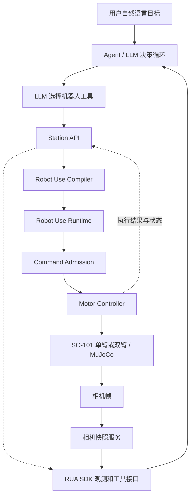
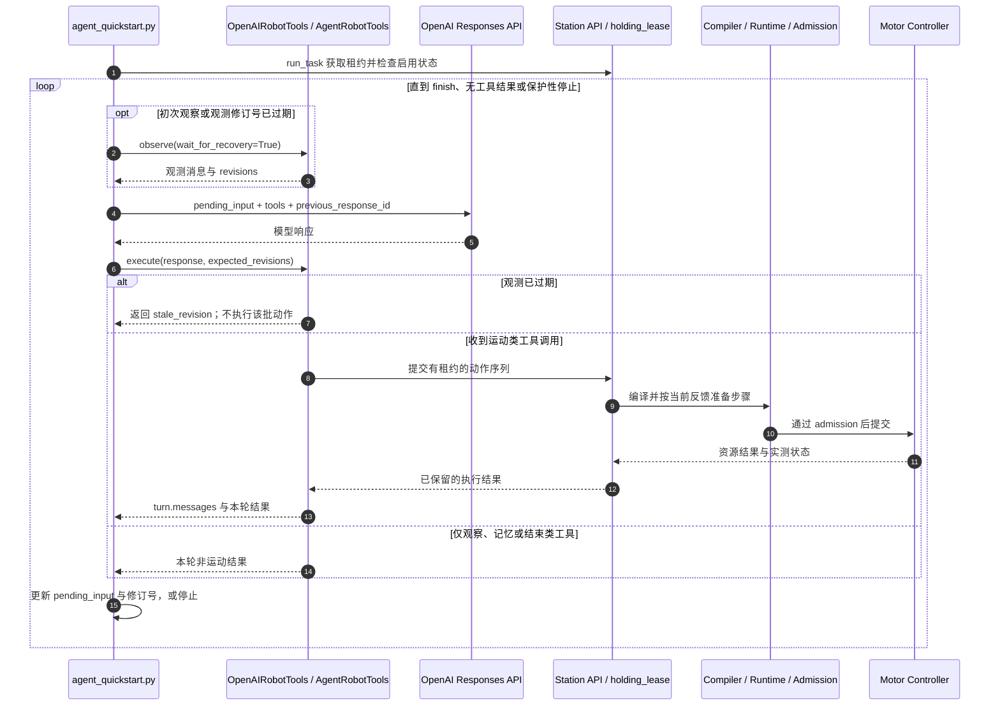

# Hebbian RUA：基于工具编排的机器人使用智能体 / Hebbian Robot-Use Agents

## 一句话定义

Hebbian Robot-Use Agents（RUA）提供可观测、可调用和可执行的机器人工具链：应用自己负责大模型决策循环，RUA 负责机器人状态、动作编译、运行时检查和电机指令交付。

## 英文缩写速查

| 缩写 | 英文全称 | 简要说明 |
|---|---|---|
| RUA | Robot-Use Agents | 机器人使用智能体框架 |
| LLM | Large Language Model | 通过工具调用规划下一步动作 |
| SDK | Software Development Kit | Python、TypeScript、Rust 的客户端接口 |
| API | Application Programming Interface | Station 提供机器人工具与命令访问 |

## 核心信息

| 项 | 资料 |
|---|---|
| 官方入口 | [项目或论文](https://hebbianrobotics.com/) |
| 官方源码 | [GitHub](https://github.com/Hebbian-Robotics/rua) |
| 开放程度 | 官方代码/资料可访问，详见归档与许可边界 |
| 本次检查 | 2026-11-28，[官方源码 `9516173`](https://github.com/Hebbian-Robotics/rua/tree/9516173300984a74ce903bd3e18fbf80536a6848)，静态核对，未调用模型或运行机器人 |

## 为什么重要

文本指令不能直接等同为安全的关节指令。将 LLM 的工具调用和实际机器人执行用编译、运行时重校验、权限/接管机制隔开，能提高可观察性和控制边界的清晰度。

## 核心机制

1. SDK 获取相机帧、关节状态和动作结果，组成下轮模型观测。
2. 应用将用户目标和可用机器人工具交给 LLM；模型返回工具调用而非直接接管驱动器。
3. Station 中 Robot Use Compiler 检查结构和配置能力，生成编译产物；Runtime 基于实测状态逐步准备动作，交由统一 admission 和 Motor Controller。编译成功不意味着各步骤都会被接纳。
4. 只有租约持有者可下发运动。控制器将结果和反馈交还 Station，SDK 将模型所需的观测与工具结果回传应用；相机快照由 media companion 提供。

## 流程总览

## 源码运行时序图

依据仓库 README、官方可运行入口及相应模块文件编写；仅核对静态源码，未声称已执行训练或真机运行。

## 项目资料与能力边界

| 维度 | 官方公开状态 |
|---|---|
| 受支持机器人 | 单臂和双臂 SO-101 |
| 仿真 | 提供 MuJoCo 测试路径 |
| 客户端 | Python / Rust / TypeScript SDK；模型由用户选择 |
| 授权 | MIT；第三方依赖另遵其各自许可 |

## 结论

**Hebbian Robot-Use Agents（RUA）提供可观测、可调用和可执行的机器人工具链：应用自己负责大模型决策循环，RUA 负责机器人状态、动作编译、运行时检查和电机指令交付；使用时必须区分作者报告和可独立复现的验证结果。**

1. LLM 不应直接发送电机原始指令，需经过运行时许可和安全检查。
2. 将模型推理循环与机器人 Station 的实时控制职责分离。
3. 先用 MuJoCo、再用受控网络与实体急停监督下的小幅真机动作验证。

## 工程实践

官方 `examples/python/agent_quickstart.py` 中 `OpenAIRobotTools.observe()`、`client.responses.create()`、`robot_tools.execute()` 构成可核对循环；`docs/architecture.md` 明确 Station API → Compiler → Runtime → command admission → motor controller。官方 CLI 有 `uv run rua serve --help`。建议先按 `docs/simulation.md` 在 MuJoCo 测试，再监督真机。

### 运行时诊断：拒绝、限位和未知结果不能混为一谈

- 先分清 `stale_revision`、`not_started`、`outcome_unknown` 和 `finished` 的语义：过期观测应重新观察，控制器断连后的未知执行结果应先查状态，不直接重发运动。即使 `completed`，若规划做了限位调整也可能到的是调后的目标。
- `at_seconds` 是**单臂规划动作**的最短请求时刻，不是实时到达保证；超时段平移后续到达时刻，最终动作仍须通过限位并等待位置稳定。双臂协调规则不同。
- 官方 MuJoCo 单臂示例先跑 Station 与模拟 plant，再跑 `hello_robot.py` 或模型循环；用户提供的单臂 ONNX 位姿策略另需兼容模型与 ONNX Runtime 动态库，不能理解成框架自带训练权重。模型依赖的摄像头数据与推理服务单独验收。

## 与其他工作对比

| 路线 | 输出 | 边界 |
|---|---|---|
| [VLA](../methods/vla.md) | 直接输出连续动作/动作块 | RUA 主要执行模型选择的预定义工具 |
| [JustRUA](./paper-justrua-robot-use-agents.md) | RoboDojo 仿真中的智能体接口与上下文消融 | 同用 RUA 术语，不是 Hebbian SDK，评测数字不可套用 |
| [PyRUA-Dex](./paper-pyrua-dex.md) | 开发期用编码智能体搜索与精炼，部署冻结程序 | Hebbian 示例保留在线模型决策，两者的部署成本不同 |
| [Mind2Act World](./paper-mind2act-world.md) | 对执行与再规划做任务评测 | RUA 提供工具化运行时而非通用 benchmark |

## 局限与风险

真实机械臂可被工具调用移动，必须使用受控网络、明确的租约和硬件断电手段；适配器输出不是形式化安全保证。当前文档明确支持 SO-101，不应推断对其他硬件自动兼容。

## 关联页面

- [相关知识与路线](../tasks/manipulation.md)
- [相关知识与路线](../tasks/teleoperation.md)
- [相关知识与路线](../methods/vla.md)
- [相关知识与路线](../concepts/llm-robotics-control-interfaces.md)
- [相关知识与路线](../../roadmap/depth-teleoperation.md)

## 参考来源

- [原始资料归档](../../sources/repos/hebbian-rua.md)
- [原始资料归档](../../sources/sites/hebbian-rua.md)

## 推荐继续阅读

- [RUA 官方代码](https://github.com/Hebbian-Robotics/rua)
- [运行架构](https://github.com/Hebbian-Robotics/rua/blob/9516173300984a74ce903bd3e18fbf80536a6848/docs/architecture.md)
