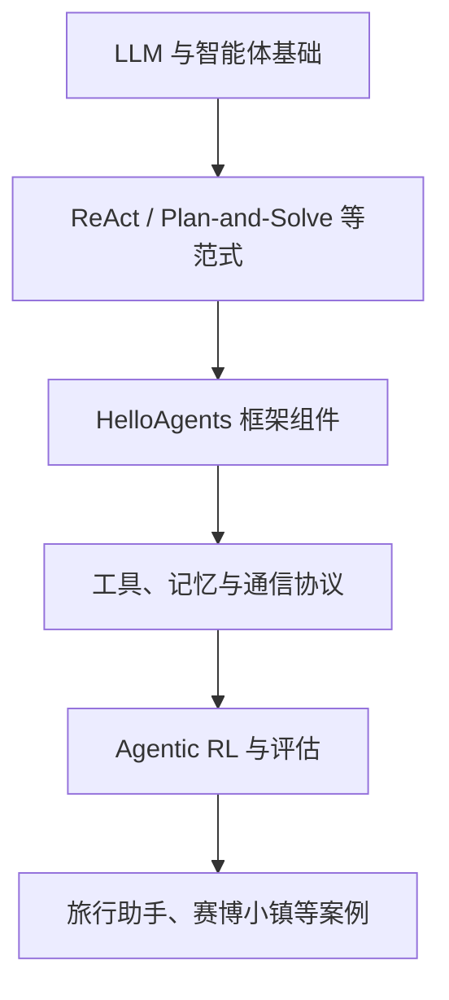
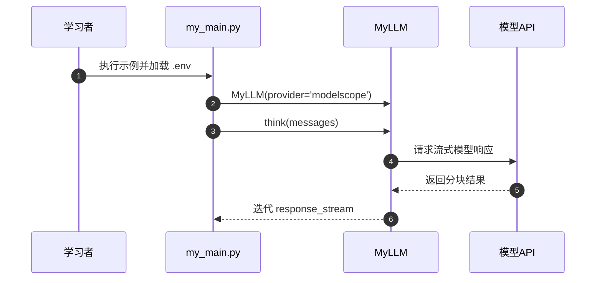

# Hello-Agents：从零开始构建智能体

## 一句话定义

Datawhale 的 Hello-Agents 课程把 ReAct 等经典范式、低代码平台、自研框架、记忆与协议，以及进阶训练与案例连接成一套学习路线；图片中两条课程记录不应建立两份重复实体。

## 英文缩写速查

| 缩写 | 英文全称 | 简要说明 |
|---|---|---|
| LLM | Large Language Model | 语言模型 |
| MCP | Model Context Protocol | 工具连接协议 |
| SFT | Supervised Fine-Tuning | 监督微调 |
| GRPO | Group Relative Policy Optimization | 组内相对策略优化 |

## 为什么重要

要区分 LLM 文本推理、Agent 决策和工具实际执行，需要看到消息历史、工具调用和状态更新如何在一个运行框架中流动。教程提供从概念到可运行代码的分层练习。

## 核心原理

第 4 章讲 ReAct、Plan-and-Solve、Reflection；第 7 章设计 HelloAgentsLLM 与 SimpleAgent 等组件；第 8–10 章讲记忆、上下文与通信协议；第 11 章引入 SFT、GRPO 等 Agentic RL；第 13–16 章为应用与毕业设计。自研 HelloAgents 框架有独立版本与示例入口，需核对依赖。

### 课程结构与验证路径

## 源码运行时序图

这里仅依据已核对的**实际入口**描述一条运行路径，不代表其他章节项目。

## 工程实践

入门可阅读第 4、7 章，并运行 code/chapter7/my_main.py；该入口加载环境变量，通过 MyLLM(provider='modelscope') 调用模型。进阶看第 11 章的 SFT/GRPO 训练管线，评测应记录数据和奖励口径。

## 局限与风险

MyLLM 示例依赖服务商 API 与本地凭据，不是无网络可复现；书内 Agentic RL 示例不能直接作为机器人真机控制策略。

**健康度口径：** `original` 对应的是已完整阅读的官方 README **入口原文**，所以本页作为“课程总览”可以独立完结；不代表所有子章节、实验及应用源码已逐篇通读或成功运行。

## 关联页面

- [agentic-rl-lab ](./agentic-rl-lab.md) — 同领域的基础、工程或应用对照。
- [deepagents-in-action ](./deepagents-in-action.md) — 同领域的基础、工程或应用对照。
- [easy-vibe ](./easy-vibe.md) — 同领域的基础、工程或应用对照。

## 参考来源

- [2026-11-13 官方入口原文与核对范围](../../sources/repos/hello-agents-course-overview-read-20261113.md)
- [课程资料总归档](../../sources/repos/hello-agents.md)
- [官方 GitHub 仓库](https://github.com/datawhalechina/hello-agents)

## 推荐继续阅读

- [官方教程与项目入口](https://hello-agents.datawhale.cc/)
