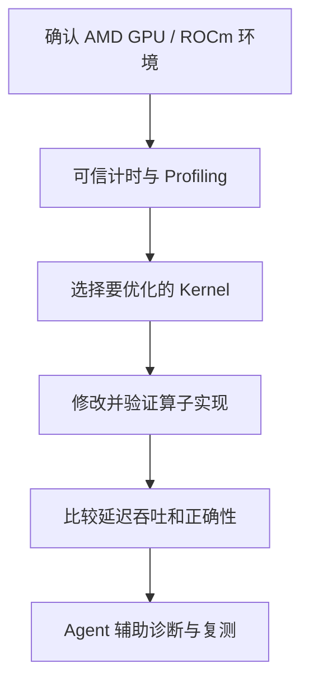
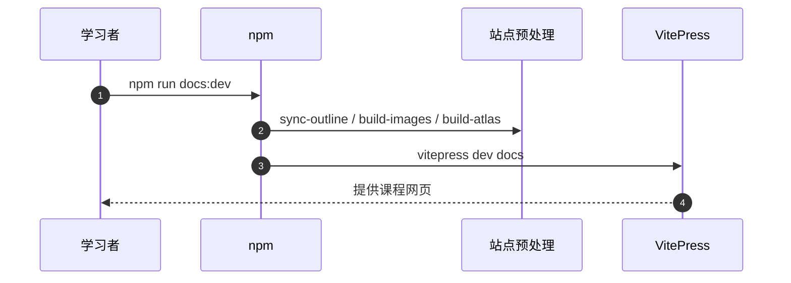

# hello-gpu：GPU Profiling 与算子优化教程

## 一句话定义

hello-gpu 是面向 GPU 性能分析和 kernel 实战的开源课程。课程把“先度量、再优化、最后验证”放在训练和模型部署性能学习前面。

## 英文缩写速查

| 缩写 | 英文全称 | 简要说明 |
|---|---|---|
| GPU | Graphics Processing Unit | 并行加速处理器 |
| HIP | Heterogeneous-compute Interface for Portability | AMD 可移植 GPU 编程接口 |
| ROCm | Radeon Open Compute | AMD 计算软件栈 |
| GEMM | General Matrix Multiplication | 矩阵乘法算子 |

## 为什么重要

单看 kernel 执行结果会忽略预热、异步计时、访存带宽和误差验证。课程先教 Profiling 和 benchmark，再进入 Reduction、Softmax、GEMM、Attention 等常见算子，最后探索 Agent 辅助优化。

## 核心原理

README 分 Part 0 环境与硬件、Part 1 Profiling、Part 2 Kernels、Part 3 Agent 优化、Part 4 Models + Agent。官方同时提醒 PyTorch ROCm 仍可使用 device='cuda' 接口名称，但该命名并不表示 AMD GPU 使用 NVIDIA CUDA 驱动。

### 官方课程结构/执行思路

## 源码运行时序图

下图仅依据已核对的**代表性入口**，不把未阅读的其他子项目一并视为已复现。

## 工程实践

可以先运行作者第 4 章第一个 GPU 程序与性能分析练习。官方站点构建入口 docs:dev 会依次调用 sync-outline、build-images、build-atlas，然后启动 VitePress；但站点运行不代表 HIP notebook 在当前机器已运行。

## 局限与风险

需要 AMD GPU、合适的 ROCm 环境或作者指定的云算力。切勿将不同 GPU 的 kernel 时间混为可比较数值；实验测量应单独跑。

**原文通读范围：** 本页是课程入口的概览节点；`original` 仅对应已完整核对的官方 README，其他课程单篇仍可能未逐篇核验。节点健康度 3/3 不等于全课程实操结业。

## 关联页面

- [hello-rocm](./hello-rocm.md) — 相关概念、工具或工程路线。
- [pytorch](./pytorch.md) — 相关概念、工具或工程路线。
- [nvidia-cuda](./nvidia-cuda.md) — 相关概念、工具或工程路线。

## 参考来源

- [官方 README 原文核对和范围](../../sources/repos/hello-gpu-course-overview-read-20261113.md)
- [上游资料索引](../../sources/repos/hello-gpu.md)
- [官方仓库](https://github.com/datawhalechina/hello-gpu)

## 推荐继续阅读

- [官方课程原始页面](https://github.com/datawhalechina/hello-gpu)
