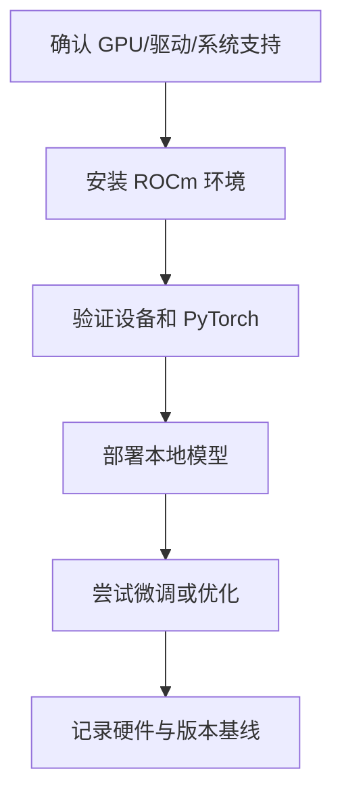
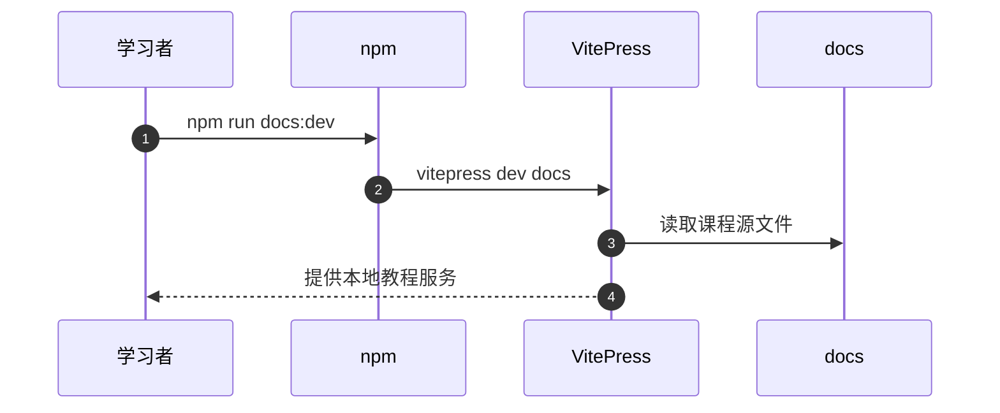

# hello-rocm：ROCm 环境、部署与微调教程

## 一句话定义

hello-rocm 是 AMD GPU/ROCm 开源学习课程，帮助学习者从驱动与软件栈环境进入模型部署、微调及算子编程。

## 英文缩写速查

| 缩写 | 英文全称 | 简要说明 |
|---|---|---|
| ROCm | Radeon Open Compute | AMD GPU 计算软件栈 |
| GPU | Graphics Processing Unit | 模型推理和训练加速硬件 |
| LLM | Large Language Model | 部署/微调的目标模型 |
| NPU | Neural Processing Unit | 部分 Ryzen AI 设备的另一类加速器 |

## 为什么重要

实际部署前需要确定 GPU 架构、操作系统、驱动与 ROCm 版本能否匹配。教程把这些兼容性和 smoke test 放在性能讨论之前，避免将软件栈错误误判为模型性能差。

## 核心原理

README 的 00 Environment → 01 Deploy → 02 Fine-tune → 03 Infra → 04 References → 05 AMD-YES 案例形成路径。环境页以 ROCm 10.0 / TheRock 的写法说明其版本背景，并强调对不同 GPU 架构、系统组合需查官方兼容表。

### 官方课程结构/执行思路

## 源码运行时序图

下图仅依据已核对的**代表性入口**，不把未阅读的其他子项目一并视为已复现。

## 工程实践

文档站的 package.json 给出 docs:dev = vitepress dev docs；教材另有模型与硬件的独立部署指南，实践前应先跑兼容性检查和最小模型推理。

## 局限与风险

该课程针对 AMD ROCm；不能不加辨别地搬到 NVIDIA CUDA 环境，NPU 快速入门与 GPU 开发也不是同一条依赖链。版本通知可能持续变化，需以 AMD 官方 release notes 复核。

**原文通读范围：** 本页是课程入口的概览节点；`original` 仅对应已完整核对的官方 README，其他课程单篇仍可能未逐篇核验。节点健康度 3/3 不等于全课程实操结业。

## 关联页面

- [hello-gpu](./hello-gpu.md) — 相关概念、工具或工程路线。
- [pytorch](./pytorch.md) — 相关概念、工具或工程路线。
- [nvidia-cuda](./nvidia-cuda.md) — 相关概念、工具或工程路线。

## 参考来源

- [官方 README 原文核对和范围](../../sources/repos/hello-rocm-course-overview-read-20261113.md)
- [上游资料索引](../../sources/repos/hello-rocm.md)
- [官方仓库](https://github.com/datawhalechina/hello-rocm)

## 推荐继续阅读

- [官方课程原始页面](https://github.com/datawhalechina/hello-rocm)
