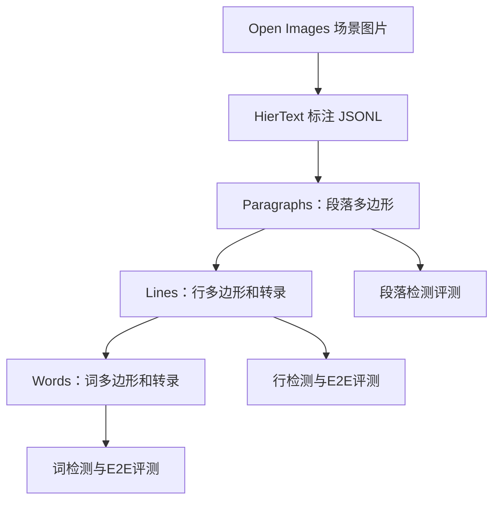

# HierText：分层文本检测与版面分析数据集

## 一句话定义

**HierText** 是面向场景文本检测和版面分析的开放数据集，覆盖自然场景与文档，提供**词、行、段落**三级几何与文本标注。

## 英文缩写速查

| 缩写 | 英文全称 | 简要说明 |
|------|----------|----------|
| OCR | Optical Character Recognition | 从图片读取文本的任务 |
| GT | Ground Truth | 词、行、段级标注真值 |
| E2E | End-to-End | 检测并识别文本的联合任务 |
| JSONL | JSON Lines | 官方分片标注的数据格式 |

## 为什么重要

相比只有单词矩形框的检测数据，HierText 能同时评估**文本是否找到、是否读对、行与段落是否正确组成**。它可作为 [YOLO26 OCR](../methods/yolo26-ocr-document-parsing.md) 等场景文本系统的测试数据来源，但官方论文与第三方博客的样本选择和指标不可直接互换。

## 数据集速查

| 项目 | 官方 README |
|------|-------------|
| 总图像 | 11,639 |
| 训练 / 验证 / 测试 | 8,281 / 1,724 / 1,634 |
| 词标注 | 约 120 万 |
| 标注层级 | paragraph → line → word；多边形、转录、可辨性等 |
| 任务 | 词检测与 E2E、行检测与 E2E、段落检测 |
| 图片来源 | Open Images，通过 CVDF 托管下载 |
| 许可 | CC BY-SA 4.0；仍须留意图片来源许可 |
| 模态 | 自然场景与文档 RGB 图片；词/行/段多边形、转录文本和可辨性属性 |
| 重定向就绪度 | **不适用**：无机器人关节、动作、人体轨迹等运动数据，不能直接做动作重定向；可作为视觉文字感知训练/评测数据 |

## 核心原理

官方词多边形可包含超过四个顶点以表示曲线文本；段落中的各行未必按阅读顺序存储，不能未经处理就把标注数组顺序当作自然阅读序。

## 工程实践

1. 从[官方仓库](https://github.com/google-research-datasets/hiertext)获取 `gt/*.jsonl.gz` 和 `eval.py`；图像按 README 从 Open Images 的 CVDF S3 位置下载。
2. 分别以训练集训练、验证集选模型、测试集报告结果。词级检测评估示例：`python3 eval.py --gt=gt/validation.jsonl --result=results.jsonl --output=/tmp/scores.txt --mask_stride=1`。
3. 论文结果建议保留 `--mask_stride=1` 并显式声明 detection 或 `--e2e`、是否启用 line/paragraph 评价。
4. **Ultralytics 自测只用了其中 80 张验证图片**，词级 F1 0.722 属于特定检测器 + 识别器 + 数据抽样条件，不等同官方完整数据集分数。

## 局限与风险

- 高密度场景文本数据不能代表全部财税表单、手写体、中文票据等目标域；迁移需专门测试。
- 仓库目前已归档只读；下载渠道、图片来源使用限制应在复现实验前重新确认。
- 词识别分数不能代替行/段落布局质量；也不能与 [TeleOCR](./paper-teleocr.md) 使用不同标注协议的基准成绩直接比较。

## 关联页面

- [YOLO26-Text + PP-OCRv6](../methods/yolo26-ocr-document-parsing.md)
- [Ultralytics](./ultralytics.md)
- [TeleOCR](./paper-teleocr.md)

## 参考来源

- [HierText 官方 README 归档](../../sources/datasets/hiertext.md)
- [HierText GitHub](https://github.com/google-research-datasets/hiertext)
- [CVPR 2022 论文](https://arxiv.org/abs/2203.15143)

## 推荐继续阅读

- [官方评估脚本与示例](https://github.com/google-research-datasets/hiertext/blob/main/eval.py)
- [Ultralytics OCR 使用指南](https://docs.ultralytics.com/guides/ocr)
