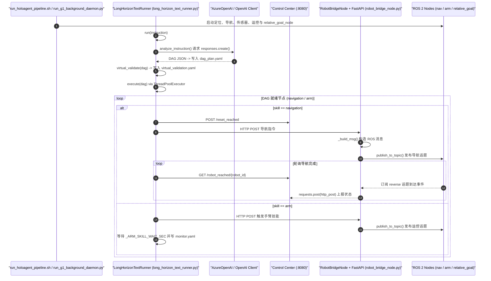

# HoloAgent

[HoloAgent](https://github.com/HorizonRobotics/HoloAgent) 收录于具身智能研究室 [开源项目主表](https://github.com/RealXiaoze/humanoid-motion-intelligence/blob/main/%E8%AE%BA%E6%96%87%E4%B8%8E%E9%A1%B9%E7%9B%AE/%E5%BC%80%E6%BA%90%E9%A1%B9%E7%9B%AE%E4%B8%BB%E8%A1%A8.md) 的「世界模型、VLA与Agent」分组，是本库为该入口建立的独立详情节点。

## 一句话定义

AgentOS把语言任务展开为受监控的技能图，三维空间记忆负责保存环境变化并在失败后触发重规划。当前开放的导航组件已经露出记忆更新、技能调用和异常恢复之间的接口，新能力仍有一部分停留在发布路线图。

## 英文缩写速查

| 缩写 | 英文全称 | 简要说明 |
|------|----------|----------|
| VLA | Vision-Language-Action | 视觉语言条件动作策略 |
| IL | Imitation Learning | 从示范学习控制 |
| WM | World Model | 预测未来观测/状态的模型 |
| BC | Behavior Cloning | 监督式模仿基线 |

## 为什么重要

- **主表工程定位清晰**：该条目被放在「世界模型、VLA与Agent」下，说明它服务的是这条人形运动智能问题链上的具体环节，而不是泛泛的链接收藏。
- **可对照开源边界**：主表已概括其可复现范围（训练/推理/部署或仅方法页）；选型时应先读本页「开源状态」，再回官方 README / 项目页核对许可证与平台支持。
- **便于知识库交叉引用**：独立节点让路线图、对比页与 ingest 日志可以稳定链接，避免只在策展列表里「点名」却无法下钻。

## 核心原理

### 在技术路线中的位置

| 字段 | 内容 |
|------|------|
| 主表分组 | 世界模型、VLA与Agent |
| 官方入口 | https://github.com/HorizonRobotics/HoloAgent |
| 开源状态（据主表） | 已开源（以官方仓库 README 为准） |

主表给出的技术定位可压缩为：

> AgentOS把语言任务展开为受监控的技能图，三维空间记忆负责保存环境变化并在失败后触发重规划。当前开放的导航组件已经露出记忆更新、技能调用和异常恢复之间的接口，新能力仍有一部分停留在发布路线图。

阅读时建议抓住三点：**(1) 输入是什么数据或观测；(2) 输出是参考轨迹、策略、数据还是中间件能力；(3) 公开材料能否支撑训练/部署复现。**

### 流程直觉（对照主表叙事）

具体模块边界以官方文档为准；本页不替代 README。

## 源码运行时序图

以下时序图基于官方仓库 `HorizonRobotics/HoloAgent`（`main` 分支）中已开放的 AgentOS 编排、后台守护与 HTTP↔ROS 2 桥接代码核读整理：
- 核对源码路径：`agentic_robot/agentOS/sandbox_test/long_horizon_text_runner.py`、`agentic_robot/services/src/robot_bridge/robot_bridge/robot_bridge_node.py`、`agentic_robot/agentOS/holoagent_skills/skills/sem-nav-skill/scripts/semantic_nav.py`、`agentic_robot/agentOS/run_dameon/run_g1_background_daemon.py`、`scripts/intergation/run_holoagent_pipeline.sh`

## 工程实践

1. **先核入口类型**：若是 GitHub/Gitee 仓库，从 README 的安装、训练与部署章节入手；若是项目页/论文，先确认是否已挂代码或权重。
2. **对齐本体与接口**：人形项目需核对关节顺序、控制频率、观测契约与仿真后端（Isaac / MuJoCo 等）是否与本机栈一致。
3. **按主表定位做消融**：主表强调的可分拆实验切口（例如只换重定向约束、只换部署层）应优先验证，避免一上来全链路重训。
4. **记录开源边界**：若仅有权重、Sim2Sim 或说明文档，不要假设训练管线可复现。

| 检查项 | 建议 |
|--------|------|
| 许可与星标时效 | 以官方仓库页面为准 |
| 支持机器人 / 仿真 | 读 assets 与 task 配置 |
| 真机入口 | 查找 SDK、ROS、ONNX/JIT 导出说明 |

## 局限与风险

- **主表是策展摘要**：细节、指标与许可以一手来源为准；本页只做知识库节点与导航。
- **开源状态可能变化**：标为待发布的项目后续可能放码；已开源仓库也可能拆分或迁移路径。
- **不要与同名论文页混淆**：若本库另有 `paper-*` 深读页，以论文页承载方法细节，本实体页侧重工程入口与选型。

## 关联页面

- [vla](../methods/vla.md)
- [imitation-learning](../methods/imitation-learning.md)
- [Humanoid Motion Intelligence](./humanoid-motion-intelligence.md)
- [开源主表覆盖索引](../queries/hmi-opensource-projects-coverage.md)

## 参考来源

- [HoloAgent 来源归档](../../sources/repos/holoagent.md)
- [Humanoid Motion Intelligence 仓库归档](../../sources/repos/humanoid-motion-intelligence.md)
- [开源项目主表（上游）](https://github.com/RealXiaoze/humanoid-motion-intelligence/blob/main/%E8%AE%BA%E6%96%87%E4%B8%8E%E9%A1%B9%E7%9B%AE/%E5%BC%80%E6%BA%90%E9%A1%B9%E7%9B%AE%E4%B8%BB%E8%A1%A8.md)

## 推荐继续阅读

- [官方入口](https://github.com/HorizonRobotics/HoloAgent)
- [Humanoid Motion Intelligence 知识库实体页](./humanoid-motion-intelligence.md)
