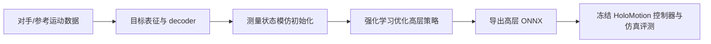
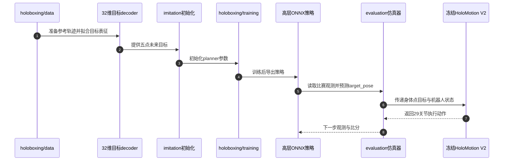

# HoloBoxing：复用全身跟踪器的人形拳击策略

**HoloBoxing** 是地平线面向 H-bot Track 2 的高层拳击策略方案：学习者负责比赛决策与未来身体目标，比赛提供的冻结 HoloMotion V2 控制器负责关节级跟踪执行。

## 英文缩写速查

| 缩写 | 英文全称 | 简要说明 |
|------|----------|----------|
| RL | Reinforcement Learning | 用仿真交互优化高层拳击决策 |
| SL | Supervised Learning | 通过演示轨迹初始化高层策略 |
| ONNX | Open Neural Network Exchange | 竞赛提交的高层策略模型格式 |
| G1 | Unitree G1 Humanoid | 教程和竞赛控制接口对应的人形机器人 |
| Hz | Hertz | 高层策略按 50 Hz 更新，仿真物理按 200 Hz 更新 |

## 为什么重要

- **训练边界清楚：** 将拳击战术和全身运动执行分开，复用已有跟踪能力，任务训练集中在一个紧凑的高层策略。
- **接口可复现：** 官方教程从数据准备、训练、导出 ONNX 到评估串起完整流程，并明确观察与输出张量形状和提交限制。
- **可迁移的分层思路：** 类似其他 planner–tracker 结构，但本工作针对规则明确的对抗拳击任务；参见 [HoloMotion](./holomotion.md) 与 [Whole-Body Tracking Pipeline](../concepts/whole-body-tracking-pipeline.md)。

## 核心机制

1. **策略输入：** 比赛观测包含自状态历史、对手位置、剩余时间和比分差。
2. **高层动作：** 高层网络输出 target_pose，形状 [1,225]，为骨盆、左右手腕、左右脚踝五个身体点在 20–100 ms 五个未来时刻的目标位姿；低层控制器读取这些目标和机器人状态。
3. **低维解码：** 论文摘要说明学习到的 decoder 把 32 维动作映射到结构化目标窗口，避免 planner 直接回归所有未来位姿。
4. **两阶段学习：** 先以测量状态模仿初始化 planner，再用强化学习改善交互行为；目标 decoder 与 HoloMotion 控制器冻结。
5. **控制频率：** 教程接口为高层 50 Hz、仿真物理 200 Hz；这两种更新频率不可混为一谈。

## 流程总览

## 工程实践

官方教程规定单个自包含 ONNX 文件小于 50,000,000 字节，输入 obs 为 float32 [1,1097]，输出 target_pose 为 float32 [1,225]。评估运行高层策略与冻结控制器的完整控制链；竞赛指定 RTX 5090 环境，端到端平均延迟要求不超过 10 ms（至少 100 FPS）。

“约 7 分钟”是论文报告的额外训练时间口径，含表征拟合与策略训练；该数字不含底层控制器和对手预训练、数据准备、评测及搜索。不要据此推断从原始数据到参赛模型的总成本只有 7 分钟。

## 评测与结果

论文摘要报告仿真拳击实验和组件对照，用于评估整体行为以及模仿初始化、目标表征的作用。官方教程另外定义竞赛链路性能指标和接口约束。现有摘要没有给出各胜率或消融的数值，因此这里不补写未经核对的指标。

## 与其他工作对比

| 路线 | 高层任务决策 | 低层动作执行 | 资料中的验证范围 |
|------|--------------|--------------|------------------|
| HoloBoxing | 对抗拳击策略，输出未来五点目标位姿 | 冻结 HoloMotion V2 | 仿真拳击实验与组件对照 |
| HoloMotion | 运动跟踪 / 稀疏指令条件化 | 自有全身策略 | 通用跟踪、仿真与部署工作流 |
| OMG | 多模态运动生成 | 复用 HoloMotion tracker | G1 多模态运动生成演示 |

HoloBoxing 与 HoloMotion 在论文和代码层面有关联，但研究职责不同：前者优化特定拳击任务的高层 planner，后者提供可复用的全身跟踪执行器。

## 源码运行时序图

该路径对应官方 holoboxing/README.md：策略训练与评估使用分层接口，竞赛评估时必须使用规定的冻结底层控制器。

## 局限与风险

- **证据范围：** arXiv 摘要和教程描述的是仿真拳击；不能将其写成已验证的实机拳击能力。
- **时间口径：** 7 分钟仅计附加训练部分，不是包含数据处理与所有预训练的端到端成本。
- **任务约束：** 高层输出的身体点目标依赖指定 tracker 和竞赛接口；不能直接替换成任意关节控制器。
- **开放状态：** 教程/实现已开源，但底层 controller、模型参数及评估资源按竞赛规定提供；提交者不得修改指定 controller。

## 结论

**HoloBoxing 的实用贡献是把拳击决策压缩成目标点规划并借助冻结 tracker 执行；7 分钟是额外训练口径，现有公开摘要的验证证据为仿真。**

1. **先区分策略层级：** 训练对象是高层 planner，关节动作由比赛指定的 tracker 生成。
2. **把指标对齐竞赛接口：** 输入输出张量、50 Hz 更新和完整链路延迟共同决定可提交性。
3. **合理解读训练时间：** 约 7 分钟不包括预训练、数据准备、评测和搜索。
4. **按仿真证据读结论：** 摘要提及组件对照但未给出具体数字，胜率结论需查阅论文正文与正式竞赛结果。

## 关联页面

- [HoloMotion（通用全身控制栈）](./holomotion.md)
- [强化学习](../methods/reinforcement-learning.md)
- [模仿学习](../methods/imitation-learning.md)
- [Whole-Body Tracking Pipeline](../concepts/whole-body-tracking-pipeline.md)
- [Unitree G1](./unitree-g1.md)
- [OMG（高层运动生成 + HoloMotion tracker）](./paper-omg-omni-modal-humanoid-control.md)

## 参考来源

- [HoloBoxing arXiv 论文摘录](../../sources/papers/holoboxing_arxiv_2610_32909.md)
- [H-bot 竞赛平台归档](../../sources/sites/hbot-competition.md)
- [HoloMotion 仓库归档](../../sources/repos/horizon_robotics_holomotion.md)

## 推荐继续阅读

- [HoloBoxing 论文](https://arxiv.org/abs/2610.32909)
- [H-bot 竞赛 Track 2 教程](https://github.com/HorizonRobotics/HoloMotion/tree/master/holoboxing)
- [HoloMotion](./holomotion.md) — 冻结的全身目标执行控制器
