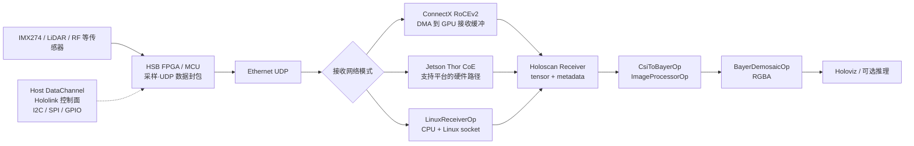
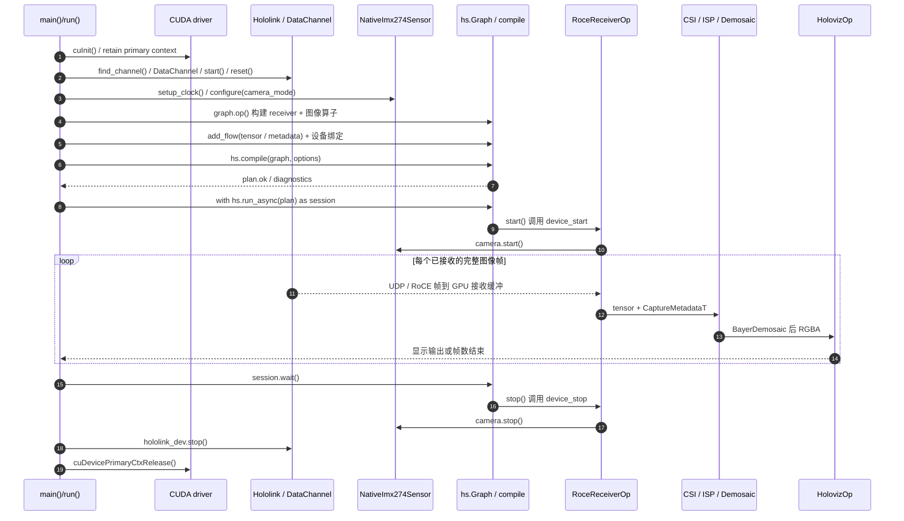

# Holoscan Sensor Bridge｜NVIDIA FPGA 传感器以太网桥接

**Holoscan Sensor Bridge（HSB）** 是 NVIDIA 的 Sensor-over-Ethernet 数据采集与控制平台：FPGA/MCU 桥接相机、雷达、LiDAR、RF 等高速传感器，使用 UDP over Ethernet 将数据送至主机，并由 Holoscan 算子完成处理。**截至 2026-11-12，官方文档为 HSB 3.0，明确使用 [Holoscan SDK 5.0](./nvidia-holoscan-sdk.md)**；下述运行接口和源码图针对 3.0，而非早期 2.x 的 GXF API。

## 一句话定义

**HSB 把传感器控制面（I2C/SPI/GPIO）与高速数据面（UDP/RoCE/CoE/socket）统一桥接进 GPU 处理图；它是硬件接入层，而不是 Holoscan SDK 本身。**

## 英文缩写速查

| 缩写 | 英文全称 | 简要说明 |
|---|---|---|
| HSB | Holoscan Sensor Bridge | FPGA/MCU + Ethernet 的传感器桥接系统 |
| BYOS | Bring Your Own Sensor | 基于通用控制 API 为新传感器实现 sensor object |
| RoCEv2 | RDMA over Converged Ethernet v2 | ConnectX 网卡的 UDP/RDMA 高速接收路径 |
| CoE | Camera-over-Ethernet | 在支持平台（如 Jetson Thor）可用的接收路径 |
| PTP | Precision Time Protocol | 跨传感器和主机对齐采集/接收时间戳 |
| CSI-2 | Camera Serial Interface 2 | 相机输入的数据编码与帧格式 |
| SDK | Software Development Kit | 3.0 配套的 Holoscan SDK 5.0 |
| ISP | Image Signal Processor | Bayer 图像的曝光/颜色处理链 |
| SIL | Safety Integrity Level | 产品页安全声明涉及的功能安全等级 |

## 为什么重要

- **多传感器统一接入：** 机器人通常同时处理高速相机、雷达、其他传感器；HSB 让传感器厂商通过通用接口实现网络与寄存器控制，减少每个设备重复维护专有主机驱动的工作。
- **网络路径可选：** 有 ConnectX 的主机可用 RoCEv2/GPUDirect，Jetson Thor 可选 CoE，其他主机可走 Linux socket；**可用不代表性能相同**。
- **明确时间戳与丢帧处理：** HSB 的 PTP 时间戳能用于测量感知延迟；SDK 5 的 Tensor/Metadata 配对与有界队列能明确界定丢帧与消费策略。
- **与 GPU 运行时互补：** [Holoscan SDK 5.0](./nvidia-holoscan-sdk.md) 负责类型化算子图、编译执行和运行时调度，HSB 负责 FPGA/以太网设备接入；二者的版本必须匹配。

## 核心原理

### FPGA 控制面与 GPU 数据面

**数据与控制分离：** `Enumerator.find_channel` 发现设备；`DataChannel` 和 `NativeImx274Sensor` 使用控制面配置传感器和 FPGA 数据端口，`RoceReceiverOp` / `LinuxReceiverOp` 等接收图像数据。实际网络分支按硬件选型，不代表三个接收器在单个 demo 中同时运行。

### SDK 5.0 原生软件接口（HSB 3.0）

| 层 | 对应源码 | 功能 |
|---|---|---|
| 传感器对象 | `NativeImx274Sensor` | `setup_clock()`、`configure()`、`start()`、`stop()`，对接 I2C 寄存器 |
| 网络与接收 | `DataChannel` + `RoceReceiverOp` / `LinuxReceiverOp` | 配置 FPGA 发送地址与 GPU/Host 接收缓冲区 |
| 数据/元数据 | `tensor`、`metadata`（`CaptureMetadataT`） | 分开的类型化端口；使用同一帧的 `capture_time` 对齐 |
| 图像处理 | `CsiToBayerOp`、`ImageProcessorOp`、`BayerDemosaicOp` | CSI-2 RAW10 → Bayer → ISP 风格处理 → RGBA |
| 显示与推理 | `HolovizOp`、可选 `InferenceOp` | 可视化或模型推理；并非强制自带机器人控制器 |
| 编译与运行 | `Graph` → `compile()` → `run_async()` | Holoscan SDK 5 图构建、校验与执行 |

**重要的拷贝边界：** 虽然 ConnectX 可将 UDP 数据直接写到 GPU **接收缓冲区**，官方 [MIGRATION.md](https://github.com/nvidia-holoscan/holoscan-sensor-bridge/blob/main/MIGRATION.md) 明确指出 SDK 5 的 receiver 再执行 **一次 `cudaMemcpyAsync`（GPU → GPU）** 到其 Tensor 池，不能称此参考流水线「严格端到端零拷贝」。

### 主机兼容性（HSB 3.0 / SDK 5.0）

| 主机 | 版本 | 官方列出的接收路径 |
|---|---|---|
| Jetson AGX Orin | JetPack 7.2.1 | 板载网络 Linux sockets |
| Jetson AGX Thor | JetPack 7.2.1 | Linux sockets / CoE |
| IGX Thor T7000（iGPU / RTX PRO 6000 dGPU） | IGX SW 2.0.1 | ConnectX-7 RoCE / Linux sockets |
| DGX Spark | DGX OS 7.6.0 | ConnectX-7 RoCE / Linux sockets |
| x86 Linux + NVIDIA dGPU | 满足 SDK 5 的 Linux/CUDA 条件 | ConnectX RoCE 或普通 Linux sockets |

**软件最低要求：** Ubuntu 24.04、CUDA 13、NVIDIA 驱动 R580+、Python 3.12+，容器外构建用 CMake 4.0+。**IGX Orin（IGX OS 1.x）和 JetPack 6 不支持 SDK 5.0 / HSB 3.0**，需使用 [HSB 2.7](https://github.com/nvidia-holoscan/holoscan-sensor-bridge/tree/2.7.0)。

## 源码运行时序图

下图按官方 [`examples/imx274_player.py`](https://github.com/nvidia-holoscan/holoscan-sensor-bridge/blob/main/examples/imx274_player.py) 的真实 Python **RoCE 参考入口**绘制；Linux 示例替换网络接收算子，其余图结构基本一致：

**注意：** 此图描述正常退出；该 Python player 对 `KeyboardInterrupt` 未包住清理代码，按 Ctrl+C 抛异常时可能跳过 `hololink_dev.stop()`。C++ `imx274_player.cpp` 通过 `player_support.hpp` 的信号机制提供协作式退出。

## 工程实践

| 环节 | 可执行动作 / 验证项 |
|---|---|
| 准备设备 | 确认 HSB FPGA 参考设计/评估板与 IMX274 传感器；主机和网卡符合 3.0 支持矩阵 |
| 构建 | 官方源码 `docker/build.sh` → `docker/demo.sh`；容器按主机自动识别类别，默认安装 SDK 5.0.0 |
| RoCE 演示 | 连接 ConnectX 后运行 `examples/imx274_player.py`；检查广播发现、GPU Context、`--hololink` 地址和 `--ibv-name` |
| socket 演示 | 无 ConnectX 时选择 `examples/linux_imx274_player.py`，检查 Linux 网卡与 HSB 的 UDP 连通性 |
| 多传感器 | 开启 PTP 对时并核对 `CaptureMetadataT` 的时间戳；多相机要避免重复初始化共享时钟 |
| 性能测量 | 官方 `roce_imx274_latency` / `linux_imx274_latency` 区分传感器采集、接收唤醒、GPU 处理、显示交接，不等同实际窗口呈现 |
| 可扩展性 | 新传感器先实现控制对象（I2C 寄存器、`configure/start/stop`），再根据原始数据格式接入转换 operator |

**开源状态（2026-11-12）：** 主机侧代码和示例以 Apache-2.0 开源；产品页也明确宣传 FPGA IP 开放并给出 [IP 下载入口](https://www.nvidia.com/en-us/technologies/holoscan-sensor-bridge/)，但仓库包含第三方许可说明，**须逐项确认** FPGA/板级固件及第三方 RTL 的实际授权。合作伙伴硬件与源码公开是不同维度。

## 官方性能指标（勿跨环境混用）

| 来源与场景 | 官方给出的指标 | 应如何读 |
|---|---|---|
| [产品页](https://www.nvidia.com/en-us/technologies/holoscan-sensor-bridge/) Lattice CertusPro-NX → IGX T7000 | 平均 **10 µs sensor-to-GPU**、**44 µs worst-case jitter** | 只对该配置和测量段成立 |
| 同页 IGX T5000 + FuSa Receiver | **CPU <1%** | 另一个配置，不能当作第一行的 CPU 指标 |
| [3.0 Latency 指南](https://docs.nvidia.com/holoscan/sensor-bridge/applications/latency) IMX274 RAW10 4K | FPGA 帧采集典型 **15.8 ms**、主机接收唤醒约 **120 µs**、下游 operator 唤醒约 **1 ms** | 测量阶段和平台各不相同；新 SDK 5 的完成时间**不含窗口渲染** |

## 局限与风险

- **硬件不可省：** 真正的 FPGA 采集及 RoCE 性能需 HSB 设备 + 正确主机/网卡；仅安装 SDK 不等于完成整条链路。
- **升级不兼容：** HSB 3.0 已支持 SDK 5；旧 HSB 2.7/SDK 4 的 `HoloscanApplication`/GXF/metadata dictionary 不能直接混用。
- **不等于强实时：** 产品页的 µs 数字仅为特定传输测量，不是机器人控制闭环的最坏时间；FPS、ISP、网络负载、内存拷贝、推理均需实测。
- **丢帧/数据一致性：** 官方应用对 display 使用 `DROP_OLDEST`，图像与元数据配对必须一致；3.0 部分 ECam0M30ToF 示例仍未适配 SDK 5。
- **安全级别：** SIL 2 是 NVIDIA 产品层面的表述，不能替代整机功能安全评估。
- **验证边界：** 已通读上文引用的主要原文与示例实现；本次未连接硬件或完成运行时实测。

## 关联页面

- [NVIDIA Holoscan SDK 5.0](./nvidia-holoscan-sdk.md) — 本页 3.0 所依赖的图编译与运行时框架
- [NVIDIA Jetson](./nvidia-jetson.md) — AGX Orin/Thor 机载主机和 JetPack
- [Jetson Orin NX](./jetson-orin-nx.md) — 其他边缘 GPU 选型（不等同官方 HSB 3.0 支持列表）
- [TensorRT](./tensorrt.md) — 可用于 Holoscan 推理链路
- [Isaac ROS Visual SLAM](./isaac-ros-visual-slam.md) — ROS 2 图像/SLAM 数据通路参考
- [Hardware-in-the-Loop](../concepts/hardware-in-the-loop.md)
- [边缘–云机器人](../concepts/edge-cloud-robotics.md)
- [ORT vs MNN vs TensorRT](../comparisons/onnxruntime-vs-mnn-vs-tensorrt.md)

## 参考来源

- [NVIDIA Holoscan Sensor Bridge 官方产品页（性能及开源信息）](../../sources/sites/nvidia-holoscan-sensor-bridge.md)
- [NVIDIA HSB 3.0 官方文档（架构、数据流、时延）](../../sources/sites/holoscan-sensor-bridge-docs-intro.md)
- [nvidia-holoscan/holoscan-sensor-bridge 官方 README、迁移指南及代码入口](../../sources/repos/nvidia_holoscan_sensor_bridge.md)

## 推荐继续阅读

- [Holoscan Sensor Bridge 3.0 Introduction](https://docs.nvidia.com/holoscan/sensor-bridge/getting-started/introduction)
- [Applications — IMX274 pipeline](https://docs.nvidia.com/holoscan/sensor-bridge/applications/applications)
- [Latency — 指标定义与测量方法](https://docs.nvidia.com/holoscan/sensor-bridge/applications/latency)
- [新传感器适配方法](https://docs.nvidia.com/holoscan/sensor-bridge/applications/new-sensors)
- [HSDK5 Migration](https://github.com/nvidia-holoscan/holoscan-sensor-bridge/blob/main/MIGRATION.md)
