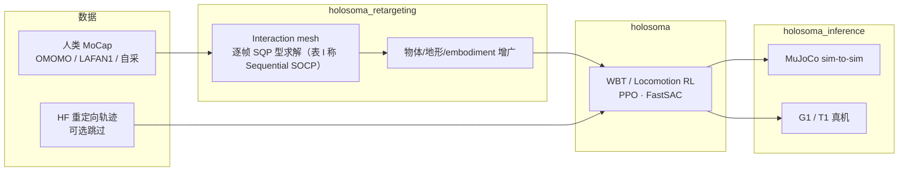
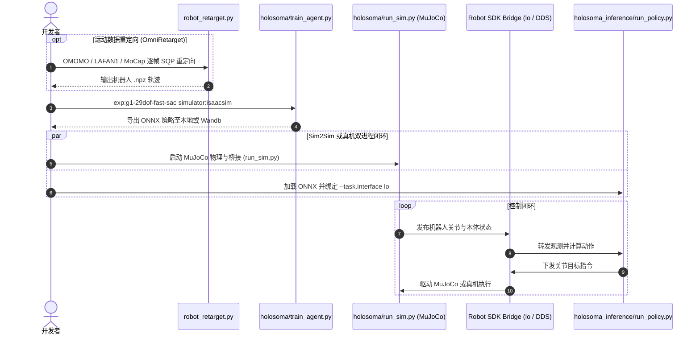

# holosoma（Amazon FAR 人形 RL + 重定向框架）

**holosoma**（<https://github.com/amazon-far/holosoma>，Apache-2.0）是 Amazon FAR 发布的 **人形机器人全身强化学习** 开源框架，名称取自希腊语「全身」。它将 **[OmniRetarget](./paper-hrl-stack-03-omniretarget.md)** 的 interaction-mesh 重定向与 **locomotion / whole-body tracking（WBT）** 训练、**sim-to-sim / sim-to-real** 推理统一在同一仓库，是论文承诺的 **代码与可复现管线入口**。

## 一句话定义

**把交互保留运动重定向（`holosoma_retargeting`）、多仿真器全身 RL 训练（`holosoma`）与跨 MuJoCo/真机的 C++ 底层推理引擎（`holosoma_inference`）集成在一个开源仓库的人形全栈基础框架。**

## 英文缩写速查

| 缩写 | 英文全称 | 简要说明 |
|------|----------|----------|
| WBT | Whole-Body Tracking | 全身关节/根轨迹跟踪类 RL 任务 |
| RL | Reinforcement Learning | 通过与环境交互最大化长期回报来学习策略的范式 |
| PPO | Proximal Policy Optimization | 常用 on-policy 策略梯度算法 |
| DR | Domain Randomization | 训练时随机化仿真参数以提升跨域鲁棒迁移 |
| ONNX | Open Neural Network Exchange | 跨框架神经网络模型交换格式 |
| G1 | Unitree G1 Humanoid | 宇树教育科研人形实验平台 |
| Sim2Real | Simulation to Real | 仿真训练策略迁移到真实硬件 |
| MoCap | Motion Capture | 动作捕捉，参考动作与演示数据的主要来源 |

## 为什么重要

- **论文落地入口：** OmniRetarget 的 `holosoma_retargeting` 子包实现交互保留重定向；下游 **5 reward + 4 DR** 的 WBT 训练与真机部署脚本同仓发布。
- **多仿真器覆盖：** 训练侧支持 **IsaacGym、IsaacSim、MJWarp**；推理侧支持 **MuJoCo** 与真机，降低「只训不配」的摩擦。
- **端到端 Demo：** 官方 `demo_omomo_wb_tracking.sh` / `demo_lafan_wb_tracking.sh` 串联 **数据下载 → 重定向 → 转换 → WBT 训练**，适合作为人形模仿学习工程样板。
- **与公开数据配套：** HuggingFace **[OmniRetarget 数据集](./omniretarget-dataset.md)** 提供 `.npz` 轨迹；LAFAN1 因许可需用本仓库自行重定向。

## 仓库结构

| 包 | 职责 |
|----|------|
| `src/holosoma/` | locomotion / WBT **训练**（PPO、FastSAC） |
| `src/holosoma_inference/` | **仿真与真机推理**、ONNX 部署工作流 |
| `src/holosoma_retargeting/` | **OmniRetarget** 人形 MoCap → 机器人轨迹 |

## 流程总览

## 源码运行时序图

图依据：基于 `amazon-far/holosoma@3b2c6fe` 的 `README.md`、`src/holosoma/holosoma/train_agent.py`、`src/holosoma/holosoma/run_sim.py` 与 `src/holosoma_inference/docs/workflows/sim-to-sim-locomotion.md` 核实。

## 工程实践

| 项 | 说明 |
|----|------|
| **环境脚本分离** | `setup_isaacsim.sh`（Ubuntu 22.04+）、`setup_mujoco.sh` / `setup_mujoco_via_uv.sh`、`setup_inference.sh`、`setup_retargeting.sh` 按子任务隔离依赖 |
| **仿真器版本边界** | `main` 分支已正式移除 IsaacGym 支持（仅保留在历史标签 `holosoma-v0.0.3` / `holosoma 0.0.3`）；当前主线支持 **IsaacSim、MJWarp** 训练与 **MuJoCo** 仅推理 |
| **Wandb 集成** | 内置视频日志、ONNX 自动上传与直接从 Wandb 拉取 checkpoint |
| **平台支持矩阵** | Unitree G1 支持 Locomotion 与 WBT（IsaacSim & MuJoCo）；Booster T1 当前支持 Locomotion，WBT 标为未支持 |
| **下游衍生仓注意** | [RPL](./paper-rpl-robust-humanoid-perceptive-locomotion.md) 与 [PHP](./paper-hrl-stack-22-perceptive-humanoid-parkour.md) 锁定各自 `thirdparty/holosoma/` gitlink（RPL 仍依赖 IsaacGym 力扰动 API），不可直接用最新 `holosoma` main 替换 |

## 局限与风险

- **IsaacGym 与主线分叉：** 早期基于 IsaacGym 的衍生项目（如 RPL）无法直接升级到 `holosoma` `main`，必须单独维护 `holosoma-v0.0.3` 环境。
- **平台与任务覆盖不对称：** `holosoma_inference` README 明确 Booster T1 尚不支持 WBT；真机部署目前主要针对 G1/T1 的 SDK 桥接。
- **桥接传输开销：** 在 `run_sim.py` 中开启 SDK bridge 会给每个物理仿真步带来额外传输开销，需按 `bridge/README.md` 调优步频与通信参数。

## 关联页面

- [PPO（Proximal Policy Optimization）](../methods/ppo.md) — 全身 RL 栈中的 PPO 路线需对齐仿真后端、参考动作与采样配置。
- [SAC（Soft Actor-Critic）](../methods/sac.md) — 理解框架所列 FastSAC 的离策略、回放与熵正则背景，具体实现差异以框架版本为准。

- **方法来源：** [OmniRetarget（arXiv:2509.26633）](./paper-hrl-stack-03-omniretarget.md)
- **公开轨迹：** [OmniRetarget 数据集](./omniretarget-dataset.md)
- **下游跑酷：** [PHP（感知跑酷）](./paper-hrl-stack-22-perceptive-humanoid-parkour.md) 使用 OmniRetarget 构建技能库
- **非官方下游：** [Hybrid-Motion-Imitation](https://github.com/jiashunwang/Hybrid-Motion-Imitation) 把 HIL / GfR 的 hybrid track+gen 接到 G1 箱攀/搬箱，见 [HIL 论文实体](./paper-hil-hybrid-imitation-learning.md)
- **问题域：** [Motion Retargeting](../concepts/motion-retargeting.md)

## 参考来源

- [holosoma 仓库归档](../../sources/repos/holosoma.md)
- [fastsac-humanoid 项目页](../../sources/sites/fastsac-humanoid-amazon-far.md) — 15 min locomotion 论文/视频入口
- [OmniRetarget 论文归档](../../sources/papers/omniretarget_arxiv_2509_26633.md)

## 推荐继续阅读

- [机器人论文阅读笔记：OmniRetarget](https://imchong.github.io/Robot_Learning_Paper_Notebooks/papers/02_Motion_Retargeting/OmniRetarget__Interaction-Preserving_Data_Generation_for_Humanoid_Whole-Body_Loc/OmniRetarget__Interaction-Preserving_Data_Generation_for_Humanoid_Whole-Body_Loc.html)
- [机器人论文阅读笔记：Perceptive Humanoid Parkour](https://imchong.github.io/Robot_Learning_Paper_Notebooks/papers/04_Loco-Manipulation_and_WBC/Perceptive_Humanoid_Parkour__Chaining_Dynamic_Human_Skills_via_Motion_Matching/Perceptive_Humanoid_Parkour__Chaining_Dynamic_Human_Skills_via_Motion_Matching.html)
- GitHub：<https://github.com/amazon-far/holosoma>
- OmniRetarget 项目页：<https://omniretarget.github.io/>
- 数据集：<https://huggingface.co/datasets/omniretarget/OmniRetarget_Dataset>
