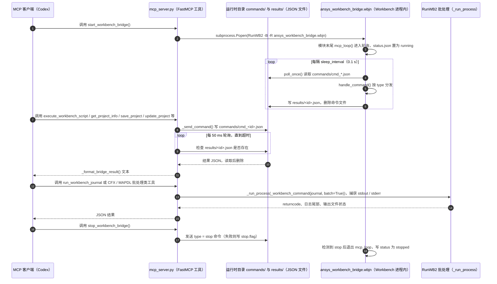

# ANSYS Workbench MCP（hongwenwang36-eng/ANSYS-Workbench-mcp）

## 一句话定义

ANSYS Workbench MCP（hongwenwang36-eng/ANSYS-Workbench-mcp）是中文 Workbench 本地桥接项目：以 Workbench journal 和文件队列作为进程间通信，MAPDL 采用批处理方式，适合需要可重放本地流程的场景。

## 英文缩写速查

| 缩写 | 英文全称 | 简要说明 |
|------|----------|----------|
| MCP | Model Context Protocol | 代理与工程软件工具的交互协议 |
| CAE | Computer-Aided Engineering | 计算机辅助工程软件与分析 |
| API | Application Programming Interface | 软件可供自动化调用的接口 |

## 为什么重要

对 CAE 自动化而言，代理能否稳定完成任务，取决于工程步骤是否清楚、工具边界是否明确、结果是否保留可审查证据。中文 Workbench 本地桥接项目：以 Workbench journal 和文件队列作为进程间通信，MAPDL 采用批处理方式，适合需要可重放本地流程的场景。

## 核心原理

**项目自身范围：** Local bridge for automating ANSYS Workbench through journals and file queues.

**工作流：** MCP 请求写入队列，由 Workbench journal 读取并操作工程；MAPDL 通过批处理执行，再回传状态与结果。

## 工程实践

1. 从目标问题识别所需的 Skill、MCP、CLI 或软件接口，不把指导文件当成求解器。
2. 依照仓库 README 检查安装前提、软件/许可证、输入文件和输出证据。
3. 小规模运行并逐项核对几何、网格、边界、求解状态和物理量，再决定是否扩大任务。

文章所述的项目特征：中文 Workbench 本地桥接项目：以 Workbench journal 和文件队列作为进程间通信，MAPDL 采用批处理方式，适合需要可重放本地流程的场景。

## 局限与风险

依赖 Windows/Workbench 与授权环境；文件队列和批处理要处理超时、并发、残留任务及输入可信边界。

源码状态核验：该 GitHub 仓库于 2026-10-07 可公开访问。仓库 API 报告许可证为 MIT。 涉及商业软件时，安装包和有效许可证需由使用者自行提供。

## 源码运行时序图

入口：MCP 客户端按配置启动 `python mcp_server.py`（stdio，见 README「配置 Codex」）；Workbench 内加载 `ansys_workbench_bridge.wbjn` 或由 `start_workbench_bridge()` 以 `RunWB2 -B -R` 拉起。

图依据：hongwenwang36-eng/ANSYS-Workbench-mcp@2950add，实际读过 `mcp_server.py`（工具注册、`_send_command`、`_run_process`、`start_workbench_bridge`、`stop_workbench_bridge`、`run_workbench_journal` 等调用点）、`ansys_workbench_bridge.wbjn`（`poll_once`、`handle_command`、`mcp_loop`）、`README.md`、`LICENSE`；未在 Windows / Ansys 环境实际运行，未读 ICEM / Fluent / CFX 桥接的完整分支。

## 关联页面

- [CAE / CFD 代理工具项目总览](../overview/cae-cfd-agent-skills-landscape.md)
- [Ansys MCP Server（PyAnsys）](./vorobjewsen30-max-ansys-mcp-server.md)

## 参考来源

- [公众号文章原始资料归档](../../sources/blogs/wechat_cae_cfd_agent_skills_2026-10-07.md)
- [GitHub 仓库资料归档](../../sources/repos/hongwenwang36-eng-ansys-workbench-mcp.md)
- [hongwenwang36-eng/ANSYS-Workbench-mcp 官方仓库](<https://github.com/hongwenwang36-eng/ANSYS-Workbench-mcp>)
- 源码核对（2026-11-02）：hongwenwang36-eng/ANSYS-Workbench-mcp@2950add，读过 README.md、LICENSE、mcp_server.py、ansys_workbench_bridge.wbjn；时序图依据以上文件，未运行代码。

## 推荐继续阅读

- [项目 README](<https://github.com/hongwenwang36-eng/ANSYS-Workbench-mcp/blob/main/README.md>)