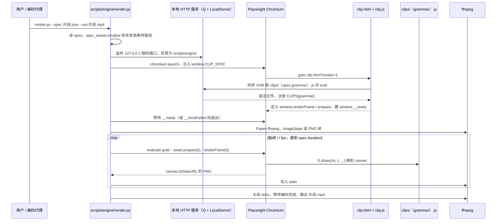

# huashu-art-motion（编码代理艺术动画）

**huashu-art-motion** 将面向编码代理的制作说明、艺术场景代码、解说动画语法和视频验收脚本组合成一个可安装 Skill。它主要服务于**动画制作与技术解释**，可用于机器人算法讲解、项目演示和教学视频；其输出不能作为机器人动力学或控制效果的验证证据。

## 英文缩写速查

| 缩写 | 英文全称 | 简要说明 |
|------|----------|----------|
| AI | Artificial Intelligence | 生成式工具可参与素材制作，是否使用由具体工作流决定 |
| CLI | Command-Line Interface | 通过命令行运行渲染、检查与交付脚本 |
| SVG | Scalable Vector Graphics | 部分平面卡通风格示例采用的矢量图形格式 |
| QA | Quality Assurance | 项目提供脚本检查动画片段与成片的可读性和运动表现 |
| FFmpeg | Fast Forward MPEG | 视频编码与片段拼接常用工具 |

## 为什么对机器人研究与工程有用

机器人研究常要解释控制状态、动作过程、系统架构或实验发现。这个项目把动画风格配方、场景代码和视频制作流程放在一起，可将抽象概念改写成可观看的技术演示，也能将既有仿真录像与代码绘制的标注或图示组合起来。它补充的是研究成果的**解释与传播层**，不进入机器人训练、仿真或控制闭环。

选择工具时，可将它与 [Manim](./manim.md) 和 [Math To Manim](./math-to-manim.md) 对照：huashu-art-motion 提供多种艺术场景和解说视频制作方式；Manim 更适合用 Python 编排数学对象与精确时间线；Math To Manim 则把自然语言主题编排成数学讲解和 Manim 场景。三者的输出都需要核对技术内容，动画本身不构成正确性证明。

## 工作结构

| 阶段 | 项目提供的内容 |
|------|---------------|
| 任务拆解 | SKILL.md 按动画复刻、艺术风格制作、口播动画等任务引导到对应方法文档 |
| 场景与语法 | references/ 提供风格配方、镜头语言和解说动画语法；scripts/engine/ 包含场景代码、渲染器、示例与参数化片段 |
| 参考分析 | scripts/analyze/breakdown.py 将参考视频整理为切点、节奏与运动分析线索 |
| 渲染检查 | scripts/qa.py 与 scripts/film_gate.py 检查项目设定的画面和运动问题 |
| 交付 | scripts/deliver.py 在门禁检查后复制成片并生成交付说明 |

项目强调以镜头表规划内容、逐镜渲染和抽帧检查。可视化证据应优先使用真实截图、照片或仿真录像；代码场景适合补充解释缺失的部分。具体命令和检查门槛随仓库版本及所选工作流而变，应按上游 SKILL.md 和对应 reference 执行。

## 工程实践

- **安装：** npx skills add alchaincyf/huashu-art-motion。
- **依赖：** 上游 README 列出 uv、FFmpeg 与 Playwright Chromium；不同脚本的依赖不完全相同。
- **运行：** 复制或使用上游提供的动画工程，按项目方法文档选用场景渲染或 JSON 参数化片段，再执行 QA 与交付脚本。
- **开源状态：** 仓库公开，代码和文档声明为 MIT；仓库明确列出受单独许可或使用限制的部分素材。

## 局限与风险

- **不是仿真或控制验证工具：** 代码绘制的轨迹和动作只表达画面，不意味着满足动力学、接触或硬件约束。若展示真实实验，应保留原始仿真或实机录像，并核对时间、坐标系和数据来源。
- **生成内容需复核：** Skill 的制作指引和 QA 脚本帮助组织制作，但不证明动画中的公式、单位、算法步骤或机器人表现正确。
- **许可按素材区分：** MIT 声明存在例外；作者角色形象、帧素材、字体和 Clawd 示例不能仅凭仓库根目录许可推断为 MIT 可再利用。
- **依赖与工作流成本：** 视频渲染需要配置外部工具。仅需交互式机器人仿真或三维数字资产时，应选对应的仿真或 DCC 工具。

## 源码运行时序图

入口：`uv run --with playwright python scripts/engine/render.py --spec 片段.json --out 片段.mp4`（参数化片段；整片模式为不带 `--spec` 的 `render.py --out 成片.mp4`，改走 `index.html` + `eras.js` 段落表；出片后按 SKILL.md 另跑 `scripts/qa.py`、`scripts/deliver.py`）

图依据：alchaincyf/huashu-art-motion@8a0d7d7，读过 README.md、SKILL.md、scripts/engine/render.py、scripts/engine/clip.html、scripts/engine/clip.js（头部与出口段）、scripts/engine/index.html、scripts/engine/engine.js（grep 部分）、scripts/deliver.py（头部）。

## 关联页面

- [Manim（程序化数学动画引擎）](./manim.md) — 用代码编排数学与技术讲解动画
- [Math To Manim](./math-to-manim.md) — 将自然语言数学主题编排为 Manim 视频的制作管线
- [Answer with HTML](./answer-me-with-html.md) — 将技术答案排版为可离线阅读的单页 HTML

## 参考来源

- [项目仓库归档](../../sources/repos/alchaincyf-huashu-art-motion.md)
- [上游 README](https://github.com/alchaincyf/huashu-art-motion#readme)
- [上游 SKILL.md](https://github.com/alchaincyf/huashu-art-motion/blob/main/SKILL.md)
- [上游许可证](https://github.com/alchaincyf/huashu-art-motion/blob/main/LICENSE)
- 源码核对（2026-11-02）：alchaincyf/huashu-art-motion@8a0d7d7，读过 README.md、SKILL.md、scripts/engine/render.py、clip.html、clip.js（部分）、index.html、engine.js（部分）、scripts/deliver.py（头部）；时序图依据以上文件，未运行代码。

## 推荐继续阅读

- [huashu-art-motion 上游仓库](https://github.com/alchaincyf/huashu-art-motion) — 安装、工作流、示例和许可证说明
- [Manim（程序化数学动画引擎）](./manim.md) — 对照数学动画引擎的编排方式与适用边界
